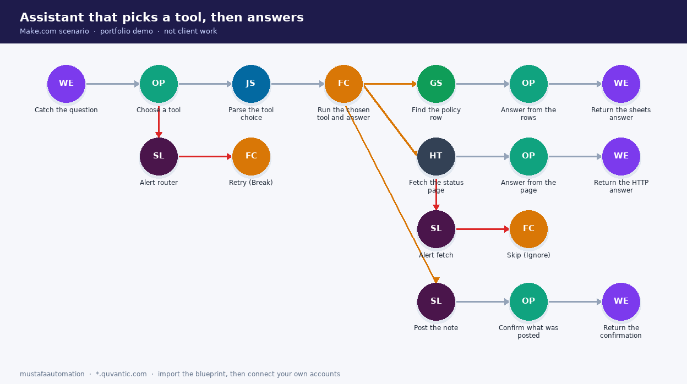
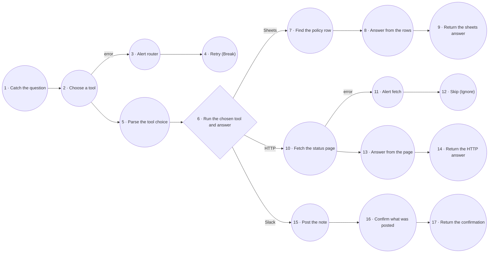

# Assistant that picks a tool, then answers

Portfolio demo by Mustafa ([mustafaautomation](https://github.com/mustafaautomation)). Not client work. Connect your own accounts after import. Live walkthroughs, when published, sit on a subdomain of quvantic.com.

**Category:** AI agents  
**Difficulty:** advanced  
**Apps:** Webhooks, OpenAI, Google Sheets, Slack  
**Test status:** documented blueprint, structurally validated

## Problem

A chat box that only talks to the model invents prices and policies. This demo forces a tool choice first. The model returns JSON naming sheets, http, or slack. A router runs that tool, and a second model call writes the answer from the tool output. The webhook response is what the caller receives.

## Who it's for

Teams who want a Make-native tool router they can read, without depending on an agent configuration that does not export cleanly.

## Module-by-module walkthrough

Ids match the blueprint. A router runs every route whose filter passes. An error handler runs only when that module throws.

### 1. Catch the question

`gateway:CustomWebHook` · Custom webhook · Webhooks

The caller posts message. tool_hint may be empty.

No mapped fields. Configure the module after import, or it only passes the bundle through.

### 2. Choose a tool

`openai-gpt-3:CreateCompletion` · Create a completion · OpenAI

Returns JSON only. The model does not answer the user in this step.

- `select`: `"chat"`
- `model`: `"gpt-4o-mini"`
- `max_tokens`: `"150"`
- `temperature`: `"0.2"`
- `messages`: `[{"role": "system", "content": "You choose one tool. Return JSON only: tool (sheets, http, or slack) and query (a short string). sheets is for policy and pricing. http is for status pages. slack is for 'tell the team'...`

### 3. Alert router — error handler

`slack:CreateMessage` · Send a message · Slack

Tool choice failed.

- `channelWType`: `"list"`
- `channelType`: `"public"`
- `channel`: `""`
- `text`: `"Tool choice failed."`
- `mrkdwn`: `true`
- `parse`: `false`

### 4. Retry (Break) — error handler

`builtin:Break` · Retry (Break) · Flow control

Tool choice failed. Retry before calling a tool.

- `retry`: `true`
- `count`: `3`
- `interval`: `15`

### 5. Parse the tool choice

`json:ParseJSON` · Parse JSON · JSON

Exposes tool and query.

- `json`: `"{{2.result}}"`

### 6. Run the chosen tool and answer

`builtin:BasicRouter` · Router · Flow control

Each route calls one tool, asks the model to answer from that result, and responds to the webhook.

### 7. Find the policy row — route **Sheets**

`google-sheets:filterRows` · Search rows · Google Sheets

Matches column A to the query. Limit 3.

Filter **Sheets tool**: `[[{"a": "{{5.tool}}", "o": "text:equal", "b": "sheets"}]]`

- `from`: `"drive"`
- `spreadsheetId`: `""`
- `sheetId`: `""`
- `includesHeaders`: `true`
- `tableFirstRow`: `"A1:Z1"`
- `valueRenderOption`: `"FORMATTED_VALUE"`
- `dateTimeRenderOption`: `"FORMATTED_STRING"`
- `limit`: `3`
- `filter`: `[[{"a": "A", "o": "text:contain", "b": "{{5.query}}"}]]`

### 8. Answer from the rows — route **Sheets**

`openai-gpt-3:CreateCompletion` · Create a completion · OpenAI

If the search returned nothing useful, say you do not know.

- `select`: `"chat"`
- `model`: `"gpt-4o-mini"`
- `max_tokens`: `"300"`
- `temperature`: `"0.2"`
- `messages`: `[{"role": "system", "content": "Answer using only the sheet rows. If they do not contain the answer, say you do not know. Two sentences."}, {"role": "user", "content": "Question: {{1.message}}\nRows: {{7.`0`}} {{7.`1`...`

### 9. Return the sheets answer — route **Sheets**

`gateway:WebhookRespond` · Webhook response · Webhooks

Status 200 and the answer text.

- `status`: `200`
- `body`: `"{{8.result}}"`

### 10. Fetch the status page — route **HTTP**

`http:ActionSendData` · Make a request · HTTP

GET example.com. parseResponse is on, but this page is HTML, so the next prompt treats it as text.

Filter **HTTP tool**: `[[{"a": "{{5.tool}}", "o": "text:equal", "b": "http"}]]`

- `url`: `"https://example.com"`
- `serializeUrl`: `false`
- `method`: `"get"`
- `headers`: `[{"name": "Accept", "value": "application/json"}, {"name": "Content-Type", "value": "application/json"}]`
- `qs`: `[]`
- `bodyType`: `"raw"`
- `parseResponse`: `true`
- `contentType`: `"application/json"`
- `data`: `""`
- `timeout`: `""`
- `shareCookies`: `false`
- `ca`: `""`
- `rejectUnauthorized`: `true`
- `followRedirect`: `true`
- `useQuerystring`: `false`
- `gzip`: `true`
- `useMtls`: `false`
- `followAllRedirects`: `false`

### 11. Alert fetch — error handler

`slack:CreateMessage` · Send a message · Slack

Status fetch failed.

- `channelWType`: `"list"`
- `channelType`: `"public"`
- `channel`: `""`
- `text`: `"Status fetch failed."`
- `mrkdwn`: `true`
- `parse`: `false`

### 12. Skip (Ignore) — error handler

`builtin:Ignore` · Skip (Ignore) · Flow control

The fetch failed. The answer module will not run on this route.

No mapped fields. Configure the module after import, or it only passes the bundle through.

### 13. Answer from the page — route **HTTP**

`openai-gpt-3:CreateCompletion` · Create a completion · OpenAI

Two sentences, no invented uptime numbers.

- `select`: `"chat"`
- `model`: `"gpt-4o-mini"`
- `max_tokens`: `"300"`
- `temperature`: `"0.2"`
- `messages`: `[{"role": "system", "content": "Answer from the fetched page only. If it is not relevant, say so."}, {"role": "user", "content": "Question: {{1.message}}\nPage: {{10.data}}"}]`

### 14. Return the HTTP answer — route **HTTP**

`gateway:WebhookRespond` · Webhook response · Webhooks

Sends the second model's text.

- `status`: `200`
- `body`: `"{{13.result}}"`

### 15. Post the note — route **Slack**

`slack:CreateMessage` · Send a message · Slack

The query is the message body, prefixed so the channel knows it came from the assistant.

Filter **Slack tool**: `[[{"a": "{{5.tool}}", "o": "text:equal", "b": "slack"}]]`

- `channelWType`: `"list"`
- `channelType`: `"public"`
- `channel`: `""`
- `text`: `"*Assistant note:* {{5.query}}"`
- `mrkdwn`: `true`
- `parse`: `false`

### 16. Confirm what was posted — route **Slack**

`openai-gpt-3:CreateCompletion` · Create a completion · OpenAI

A one-sentence confirmation. It does not add new facts.

- `select`: `"chat"`
- `model`: `"gpt-4o-mini"`
- `max_tokens`: `"80"`
- `temperature`: `"0.2"`
- `messages`: `[{"role": "system", "content": "Reply in one sentence confirming the note was posted. Do not add facts."}, {"role": "user", "content": "Note: {{5.query}}"}]`

### 17. Return the confirmation — route **Slack**

`gateway:WebhookRespond` · Webhook response · Webhooks

The caller sees the confirmation, not the Slack API payload.

- `status`: `200`
- `body`: `"{{16.result}}"`

## Diagram

## Setup

1. In Make, create a scenario, open the three-dot menu at the bottom of the editor, and choose **Import Blueprint**. Select `blueprint.json`.
2. Open every red module and pick or create the connection. Red means the account is not selected yet.
3. Schedule: Immediately. The caller waits on the webhook response, so keep the model calls small.
4. Create the spreadsheet tab this scenario expects, with a header row in row 1:
   - A topic
   - B answer — the knowledge rows the sheets tool searches
5. Select that spreadsheet and sheet on every Google Sheets module. The ids are blank in the file.
6. Run once with the bundled `sample-input.json`. Fictional payload. Paste it into the first module when you run the scenario once.
7. Check the output bundle of each module before you turn the schedule on.

## Connections

- **OpenAI** — create a connection and select it on every OpenAI module. The blueprint leaves `__IMTCONN__` unset on purpose.
- **Slack** — create a connection and select it on every Slack module. The blueprint leaves `__IMTCONN__` unset on purpose.
- **Google Sheets** — create a connection and select it on every Google Sheets module. The blueprint leaves `__IMTCONN__` unset on purpose.

Nothing in the file is a live connection id, webhook URL, or API key. Make rejects another team's connection id at import, so the slots are empty on purpose.

## Data mapping

References use the module id: `{{1.subject}}` is the `subject` field of module 1. Sheets columns are zero-based and backticked (`{{1.`0`}}` is column A) so a renamed header does not break the map.

- Tool name must be sheets, http, or slack. Each route is text:equal on that name, so only one tool runs.
- The sheets tool searches column A. Put short topic keys in column A and the approved answer in column B.
- The HTTP tool calls a public example host. Point it at your own status URL.
- Make's AI Agent module (`ai-local-agent:RunLocalAIAgent`) is a different shape: tools hang off the agent in the designer and do not travel as ordinary routes. This blueprint keeps the tools visible in the file.

## Error handling

Scenario settings: `maxErrors` 3, `dlq` true, `sequential` false, `autoCommit` true. After this many consecutive failed runs Make deactivates a scheduled scenario.

- Module 2 (Choose a tool) handles errors with `builtin:Break`. Tool choice failed. Retry before calling a tool.
- Router 6 (Run the chosen tool and answer) Each route calls one tool, asks the model to answer from that result, and responds to the webhook.
  - **Sheets.** Look up a row, then answer. Filter: **Sheets tool**.
  - **HTTP.** Fetch a page, then answer. Filter: **HTTP tool**.
  - **Slack.** Post to the channel, then confirm. Filter: **Slack tool**.
- Module 7 runs only when filter **Sheets tool** passes. A blocked bundle stops on that path. It is not an error.
- Module 10 (Fetch the status page) handles errors with `builtin:Ignore`. The fetch failed. The answer module will not run on this route.
- Module 10 runs only when filter **HTTP tool** passes. A blocked bundle stops on that path. It is not an error.
- Module 15 runs only when filter **Slack tool** passes. A blocked bundle stops on that path. It is not an error.

## Customization

- Change the system prompt's tool list before you add a fourth route.
- The HTTP URL is https://example.com. Replace it with an endpoint you control.
- If you would rather use the native agent, import this once to see the tool contract, then rebuild those three calls as agent tools in the UI.
- Duplicate the scenario before you change the prompt, so you can diff against this demo later.

## Time saved

Replaces a person pasting the same FAQ, status, or 'tell the channel' request. Call it 3 minutes a question.

## Files

| File | What it is |
| --- | --- |
| `blueprint.json` | Import this into Make. |
| `sample-input.json` | Fictional bundle for the first run. |
| `diagram.png` | Flow diagram. |
| `diagram.mmd` | Mermaid source for the same flow. |
