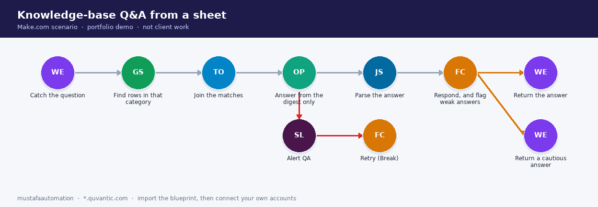
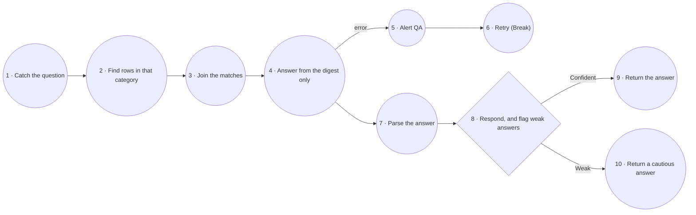

# Knowledge-base Q&A from a sheet

Portfolio demo by Mustafa ([mustafaautomation](https://github.com/mustafaautomation)). Not client work. Connect your own accounts after import. Live walkthroughs, when published, sit on a subdomain of quvantic.com.

**Category:** AI agents  
**Difficulty:** intermediate  
**Apps:** Webhooks, Google Sheets, OpenAI  
**Test status:** documented blueprint, structurally validated

## Problem

People paste the same policy questions into chat. The approved answers already live in a sheet. This demo searches that sheet, joins the matches into one block, and tells the model it may not leave that block.

## Who it's for

Ops and support teams who keep a FAQ sheet and want a webhook any form or bot can call.

## Module-by-module walkthrough

Ids match the blueprint. A router runs every route whose filter passes. An error handler runs only when that module throws.

### 1. Catch the question

`gateway:CustomWebHook` · Custom webhook · Webhooks

Sends category and question.

No mapped fields. Configure the module after import, or it only passes the bundle through.

### 2. Find rows in that category

`google-sheets:filterRows` · Search rows · Google Sheets

Column A equals the category. Limit 8 so the prompt stays small.

- `from`: `"drive"`
- `spreadsheetId`: `""`
- `sheetId`: `""`
- `includesHeaders`: `true`
- `tableFirstRow`: `"A1:Z1"`
- `valueRenderOption`: `"FORMATTED_VALUE"`
- `dateTimeRenderOption`: `"FORMATTED_STRING"`
- `limit`: `8`
- `filter`: `[[{"a": "A", "o": "text:equal", "b": "{{1.category}}"}]]`

### 3. Join the matches

`util:TextAggregator` · Text aggregator · Tools

One text bundle for the model. The feeder is the search module.

- `value`: `"{{2.`1`}}: {{2.`2`}}"`

### 4. Answer from the digest only

`openai-gpt-3:CreateCompletion` · Create a completion · OpenAI

JSON with answer and confidence. The instruction forbids outside knowledge.

- `select`: `"chat"`
- `model`: `"gpt-4o-mini"`
- `max_tokens`: `"400"`
- `temperature`: `"0.2"`
- `messages`: `[{"role": "system", "content": "Answer only from the notes. Return JSON: answer (string), confidence (0 to 1). If the notes do not say, confidence under 0.4 and answer that you do not know."}, {"role": "user", "conten...`

### 5. Alert QA — error handler

`slack:CreateMessage` · Send a message · Slack

Knowledge-base answer failed.

- `channelWType`: `"list"`
- `channelType`: `"public"`
- `channel`: `""`
- `text`: `"Knowledge-base answer failed."`
- `mrkdwn`: `true`
- `parse`: `false`

### 6. Retry (Break) — error handler

`builtin:Break` · Retry (Break) · Flow control

The answer call failed.

- `retry`: `true`
- `count`: `3`
- `interval`: `15`

### 7. Parse the answer

`json:ParseJSON` · Parse JSON · JSON

Exposes answer and confidence.

- `json`: `"{{4.result}}"`

### 8. Respond, and flag weak answers

`builtin:BasicRouter` · Router · Flow control

Both routes respond to the webhook. The weak route adds a sentence.

### 9. Return the answer — route **Confident**

`gateway:WebhookRespond` · Webhook response · Webhooks

Plain text body.

Filter **At least 0.6**: `[[{"a": "{{7.confidence}}", "o": "number:greaterorequal", "b": "0.6"}]]`

- `status`: `200`
- `body`: `"{{7.answer}}"`

### 10. Return a cautious answer — route **Weak**

`gateway:WebhookRespond` · Webhook response · Webhooks

The caller still gets a body, plus an explicit check-with-a-human line.

Filter **Below 0.6**: `[[{"a": "{{7.confidence}}", "o": "number:less", "b": "0.6"}]]`

- `status`: `200`
- `body`: `"{{7.answer}}\n\nA person should confirm this."`

## Diagram

## Setup

1. In Make, create a scenario, open the three-dot menu at the bottom of the editor, and choose **Import Blueprint**. Select `blueprint.json`.
2. Open every red module and pick or create the connection. Red means the account is not selected yet.
3. Schedule: Immediately.
4. Create the spreadsheet tab this scenario expects, with a header row in row 1:
   - A category
   - B question
   - C answer
5. Select that spreadsheet and sheet on every Google Sheets module. The ids are blank in the file.
6. Run once with the bundled `sample-input.json`. Fictional payload. Paste it into the first module when you run the scenario once.
7. Check the output bundle of each module before you turn the schedule on.

## Connections

- **Google Sheets** — create a connection and select it on every Google Sheets module. The blueprint leaves `__IMTCONN__` unset on purpose.
- **OpenAI** — create a connection and select it on every OpenAI module. The blueprint leaves `__IMTCONN__` unset on purpose.
- **Slack** — create a connection and select it on every Slack module. The blueprint leaves `__IMTCONN__` unset on purpose.

Nothing in the file is a live connection id, webhook URL, or API key. Make rejects another team's connection id at import, so the slots are empty on purpose.

## Data mapping

References use the module id: `{{1.subject}}` is the `subject` field of module 1. Sheets columns are zero-based and backticked (`{{1.`0`}}` is column A) so a renamed header does not break the map.

- Search matches column A to the category on the webhook, then the text aggregator joins column B and C.
- Aggregator output is `{{digest.text}}`. The model sees that string, not the raw rows.
- confidence below 0.6 still responds, but the body says a person should check it.

## Error handling

Scenario settings: `maxErrors` 3, `dlq` true, `sequential` false, `autoCommit` true. After this many consecutive failed runs Make deactivates a scheduled scenario.

- Module 4 (Answer from the digest only) handles errors with `builtin:Break`. The answer call failed.
- Router 8 (Respond, and flag weak answers) Both routes respond to the webhook. The weak route adds a sentence.
  - **Confident.** Return the answer. Filter: **At least 0.6**.
  - **Weak.** Return the answer with a warning. Filter: **Below 0.6**.
- Module 9 runs only when filter **At least 0.6** passes. A blocked bundle stops on that path. It is not an error.
- Module 10 runs only when filter **Below 0.6** passes. A blocked bundle stops on that path. It is not an error.

## Customization

- Add rows before you demo it. An empty sheet makes an empty digest and a low-confidence answer.
- Swap the category filter for a keyword filter on column B if you do not have categories.
- Point a site form at the webhook. The response body is plain text.
- Duplicate the scenario before you change the prompt, so you can diff against this demo later.

## Time saved

About 4 minutes a question when the answer is a hunt through a sheet.

## Files

| File | What it is |
| --- | --- |
| `blueprint.json` | Import this into Make. |
| `sample-input.json` | Fictional bundle for the first run. |
| `diagram.png` | Flow diagram. |
| `diagram.mmd` | Mermaid source for the same flow. |
