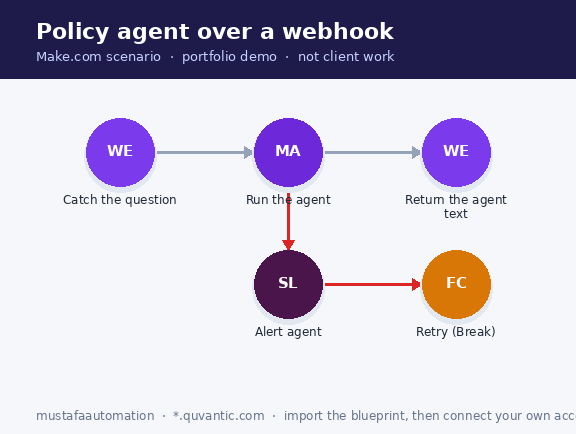
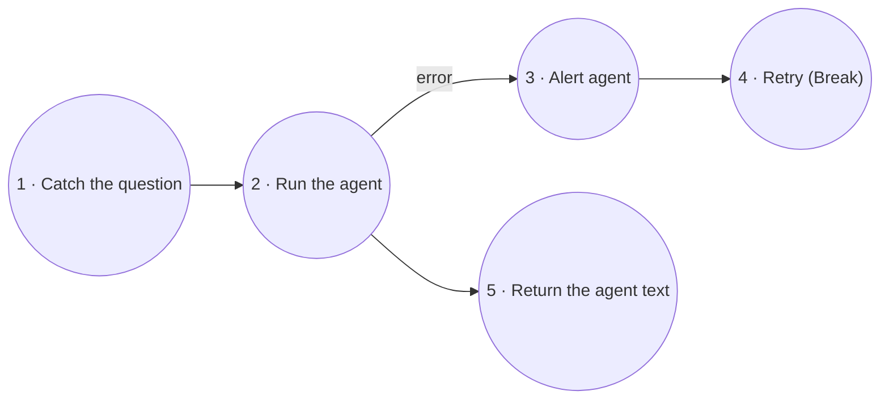

# Policy agent over a webhook

Portfolio demo by Mustafa ([mustafaautomation](https://github.com/mustafaautomation)). Not client work. Connect your own accounts after import. Live walkthroughs, when published, sit on a subdomain of quvantic.com.

**Category:** AI agents  
**Difficulty:** advanced  
**Apps:** Webhooks, Make AI Agent  
**Test status:** documented blueprint, structurally validated

## Problem

A chat endpoint that is not given a policy will invent one. This demo runs Make's AI agent with a system prompt that names the only topics it may answer: refunds within 14 days, and shipping to the address on the order. Anything else, it says it does not know. Tools are attached after import.

## Who it's for

Teams evaluating Make's agent module who want a prompt they can read in the blueprint.

## Module-by-module walkthrough

Ids match the blueprint. A router runs every route whose filter passes. An error handler runs only when that module throws.

### 1. Catch the question

`gateway:CustomWebHook` · Custom webhook · Webhooks

The caller posts message and an optional thread id.

No mapped fields. Configure the module after import, or it only passes the bundle through.

### 2. Run the agent

`ai-local-agent:RunLocalAIAgent` · Run an AI agent · Make AI Agent

The system prompt is the job. The message is the webhook field message.

- `systemPrompt`: `"You answer only two topics: refunds are allowed within 14 days of delivery, and shipping goes to the address on the order. If the question is anything else, say you do not know and that a person should answer. Do not...`
- `message`: `"{{1.message}}"`
- `threadId`: `"{{1.thread}}"`

### 3. Alert agent — error handler

`slack:CreateMessage` · Send a message · Slack

Agent failed.

- `channelWType`: `"list"`
- `channelType`: `"public"`
- `channel`: `""`
- `text`: `"Agent failed."`
- `mrkdwn`: `true`
- `parse`: `false`

### 4. Retry (Break) — error handler

`builtin:Break` · Retry (Break) · Flow control

The agent failed. Retry once before telling the caller it is down.

- `retry`: `true`
- `count`: `3`
- `interval`: `15`

### 5. Return the agent text

`gateway:WebhookRespond` · Webhook response · Webhooks

Make's example maps the agent output as response. If your first run names the field differently, change this body.

- `status`: `200`
- `body`: `"{{2.response}}"`

## Diagram

## Setup

1. In Make, create a scenario, open the three-dot menu at the bottom of the editor, and choose **Import Blueprint**. Select `blueprint.json`.
2. Open every red module and pick or create the connection. Red means the account is not selected yet.
3. Schedule: Immediately.
4. Fill every blank selector (spreadsheet, channel, base, calendar) from your own account.
6. Run once with the bundled `sample-input.json`. Fictional payload. Paste it into the first module when you run the scenario once.
7. Check the output bundle of each module before you turn the schedule on.

## Connections

- **Make AI Agent** — create a connection and select it on every Make AI Agent module. The blueprint leaves `makeConnectionId` unset on purpose.
- **Slack** — create a connection and select it on every Slack module. The blueprint leaves `__IMTCONN__` unset on purpose.

Nothing in the file is a live connection id, webhook URL, or API key. Make rejects another team's connection id at import, so the slots are empty on purpose.

## Data mapping

References use the module id: `{{1.subject}}` is the `subject` field of module 1. Sheets columns are zero-based and backticked (`{{1.`0`}}` is column A) so a renamed header does not break the map.

- The agent module's connection parameter is makeConnectionId and is left unset.
- Tools are attached in the Make agent panel after import. They are not in this file, because tool arms are designer state rather than ordinary routes. The assistant-agent-with-tools scenario is the one that shows tools as routes.

## Error handling

Scenario settings: `maxErrors` 3, `dlq` true, `sequential` false, `autoCommit` true. After this many consecutive failed runs Make deactivates a scheduled scenario.

- Module 2 (Run the agent) handles errors with `builtin:Break`. The agent failed. Retry once before telling the caller it is down.

## Customization

- Pass a stable thread id if you want the agent to remember the caller. Leave it blank for a stateless call.
- Duplicate the scenario before you change the prompt, so you can diff against this demo later.

## Time saved

The repeated policy question, about 3 minutes each, once the agent is connected.

## Files

| File | What it is |
| --- | --- |
| `blueprint.json` | Import this into Make. |
| `sample-input.json` | Fictional bundle for the first run. |
| `diagram.png` | Flow diagram. |
| `diagram.mmd` | Mermaid source for the same flow. |
