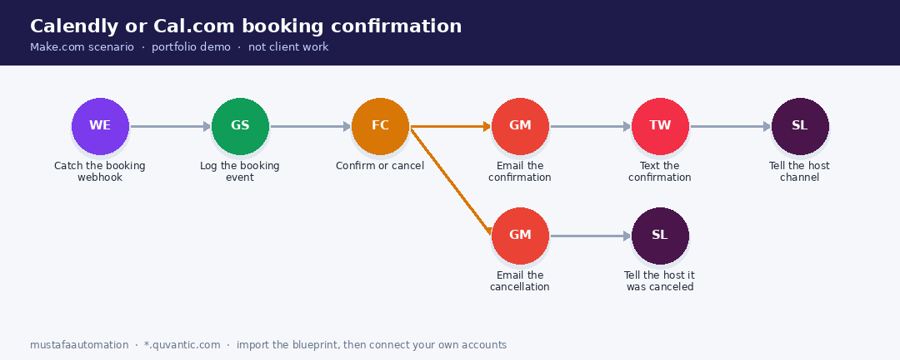
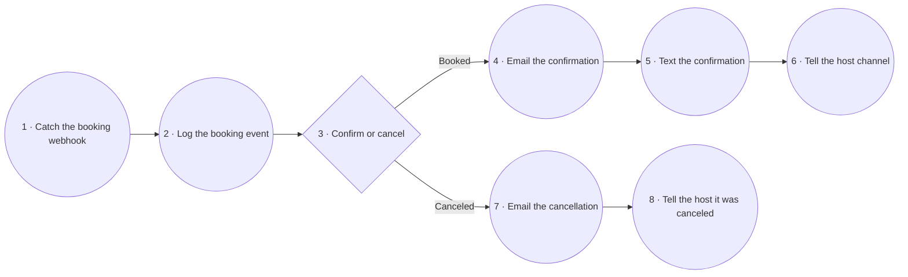

# Calendly or Cal.com booking confirmation

Portfolio demo by Mustafa ([mustafaautomation](https://github.com/mustafaautomation)). Not client work. Connect your own accounts after import. Live walkthroughs, when published, sit on a subdomain of quvantic.com.

**Category:** Booking  
**Difficulty:** beginner  
**Apps:** Webhooks, Google Sheets, Gmail, Twilio, Slack  
**Test status:** documented blueprint, structurally validated

## Problem

Calendly and Cal.com already email the invitee, and teams still retype the booking into a sheet and Slack. Cancellations are worse: the sheet stays stale. This demo branches on the event name, logs both, and sends your own confirmation or cancellation note.

## Who it's for

Consultants and agencies who book on Calendly or Cal.com and run the rest of the follow-up from a sheet.

## Module-by-module walkthrough

Ids match the blueprint. A router runs every route whose filter passes. An error handler runs only when that module throws.

### 1. Catch the booking webhook

`gateway:CustomWebHook` · Custom webhook · Webhooks

Subscribe this hook to invitee.created and invitee.canceled.

No mapped fields. Configure the module after import, or it only passes the bundle through.

### 2. Log the booking event

`google-sheets:addRow` · Add a row · Google Sheets

Both created and canceled land here, distinguished by the event column.

- `from`: `"drive"`
- `mode`: `"select"`
- `spreadsheetId`: `""`
- `sheetId`: `""`
- `includesHeaders`: `true`
- `insertDataOption`: `"INSERT_ROWS"`
- `valueInputOption`: `"USER_ENTERED"`
- `values`: `{"0": "{{now}}", "1": "{{1.event}}", "2": "{{1.name}}", "3": "{{1.email}}", "4": "{{1.start}}", "5": "{{1.event_type}}"}`

### 3. Confirm or cancel

`builtin:BasicRouter` · Router · Flow control

The two event names are mutually exclusive.

### 4. Email the confirmation — route **Booked**

`google-email:ActionSendEmail` · Send an email · Gmail

Your words, not the scheduler's default template.

Filter **Created**: `[[{"a": "{{1.event}}", "o": "text:equal", "b": "invitee.created"}]]`

- `from`: `""`
- `to`: `["{{1.email}}"]`
- `cc`: `[]`
- `bcc`: `[]`
- `replyTo`: `""`
- `subject`: `"Confirmed: {{1.event_type}}"`
- `html`: `"
Hi {{1.name}},

You are booked for {{1.event_type}} at {{1.start}}.
"`
- `attachments`: `[]`

### 5. Text the confirmation — route **Booked**

`twilio:SendSMS` · Send an SMS · Twilio

One line with the time.

- `to`: `"{{1.phone}}"`
- `from`: `"YOUR_TWILIO_NUMBER"`
- `message`: `"Confirmed: {{1.event_type}} at {{1.start}}."`

### 6. Tell the host channel — route **Booked**

`slack:CreateMessage` · Send a message · Slack

So the host is not surprised by their own calendar.

- `channelWType`: `"list"`
- `channelType`: `"public"`
- `channel`: `""`
- `text`: `"*Booked* {{1.name}} — {{1.event_type}} at {{1.start}}. Host {{1.host}}."`
- `mrkdwn`: `true`
- `parse`: `false`

### 7. Email the cancellation — route **Canceled**

`google-email:ActionSendEmail` · Send an email · Gmail

Does not try to rebook inside the scenario.

Filter **Canceled**: `[[{"a": "{{1.event}}", "o": "text:equal", "b": "invitee.canceled"}]]`

- `from`: `""`
- `to`: `["{{1.email}}"]`
- `cc`: `[]`
- `bcc`: `[]`
- `replyTo`: `""`
- `subject`: `"Canceled: {{1.event_type}}"`
- `html`: `"
Hi {{1.name}},

Your {{1.event_type}} at {{1.start}} is canceled.
"`
- `attachments`: `[]`

### 8. Tell the host it was canceled — route **Canceled**

`slack:CreateMessage` · Send a message · Slack

The sheet row from the first module is the record.

- `channelWType`: `"list"`
- `channelType`: `"public"`
- `channel`: `""`
- `text`: `"*Canceled* {{1.name}} — {{1.event_type}} at {{1.start}}."`
- `mrkdwn`: `true`
- `parse`: `false`

## Diagram

## Setup

1. In Make, create a scenario, open the three-dot menu at the bottom of the editor, and choose **Import Blueprint**. Select `blueprint.json`.
2. Open every red module and pick or create the connection. Red means the account is not selected yet.
3. Schedule: Immediately. Point the Calendly or Cal.com webhook at the Make hook.
4. Create the spreadsheet tab this scenario expects, with a header row in row 1:
   - A received_at
   - B event
   - C name
   - D email
   - E start
   - F event type
5. Select that spreadsheet and sheet on every Google Sheets module. The ids are blank in the file.
6. Run once with the bundled `sample-input.json`. For a cancellation, change event to invitee.canceled and run once more.
7. Check the output bundle of each module before you turn the schedule on.

## Connections

- **Google Sheets** — create a connection and select it on every Google Sheets module. The blueprint leaves `__IMTCONN__` unset on purpose.
- **Gmail** — create a connection and select it on every Gmail module. The blueprint leaves `account` unset on purpose.
- **Twilio** — create a connection and select it on every Twilio module. The blueprint leaves `__IMTCONN__` unset on purpose.
- **Slack** — create a connection and select it on every Slack module. The blueprint leaves `__IMTCONN__` unset on purpose.

Replace these placeholders in the HTTP modules before the first live run:
- `YOUR_TWILIO_NUMBER`

Nothing in the file is a live connection id, webhook URL, or API key. Make rejects another team's connection id at import, so the slots are empty on purpose.

## Data mapping

References use the module id: `{{1.subject}}` is the `subject` field of module 1. Sheets columns are zero-based and backticked (`{{1.`0`}}` is column A) so a renamed header does not break the map.

- Calendly's invitee.created payload is nested. Flatten it in Calendly's webhook relay, or map `payload.invitee.email` once you have inspected a real bundle. The sample is already flat.
- The day-before reminder is a separate scenario, `appointment-day-before-reminder`, which reads this same sheet. One blueprint cannot both listen to a webhook and wake up tomorrow morning.

## Error handling

Scenario settings: `maxErrors` 3, `dlq` false, `sequential` false, `autoCommit` true. After this many consecutive failed runs Make deactivates a scheduled scenario.

- Router 3 (Confirm or cancel) The two event names are mutually exclusive.
  - **Booked.** Email, text, and tell the host. Filter: **Created**.
  - **Canceled.** Email the cancellation and tell the host. Filter: **Canceled**.
- Module 4 runs only when filter **Created** passes. A blocked bundle stops on that path. It is not an error.
- Module 7 runs only when filter **Canceled** passes. A blocked bundle stops on that path. It is not an error.

## Customization

- Add the questions on your event type as extra sheet columns.
- Remove Twilio if you do not have mobile numbers on the booking form.
- Host Slack pings use the host email only as text. They do not look up a Slack user.
- Swap any `YOUR_*` value for the id from your own account. Do not commit the filled-in file.
- Duplicate the scenario before you change the prompt, so you can diff against this demo later.

## Time saved

About 3 minutes per booking of copying the time into a sheet, Slack, and a personal text.

## Files

| File | What it is |
| --- | --- |
| `blueprint.json` | Import this into Make. |
| `sample-input.json` | Fictional bundle for the first run. |
| `diagram.png` | Flow diagram. |
| `diagram.mmd` | Mermaid source for the same flow. |
