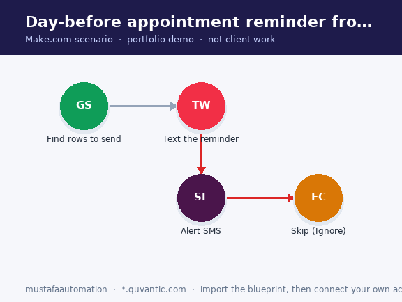
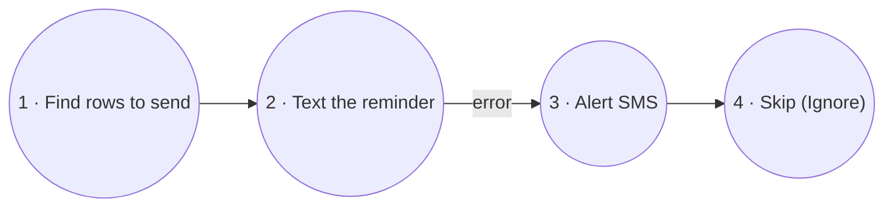

# Day-before appointment reminder from the sheet

Portfolio demo by Mustafa ([mustafaautomation](https://github.com/mustafaautomation)). Not client work. Connect your own accounts after import. Live walkthroughs, when published, sit on a subdomain of quvantic.com.

**Category:** Booking  
**Difficulty:** beginner  
**Apps:** Google Sheets, Twilio  
**Test status:** documented blueprint, structurally validated

## Problem

The booking scenario logs the appointment. It cannot wake up the morning before. This one can, because it is a scheduled search. Text each row flagged YES, then clear the flag yourself or the next morning texts them again.

## Who it's for

Anyone who imported the Calendly confirmation scenario and wants the morning-of text from the same sheet.

## Module-by-module walkthrough

Ids match the blueprint. A router runs every route whose filter passes. An error handler runs only when that module throws.

### 1. Find rows to send

`google-sheets:filterRows` · Search rows · Google Sheets

A flag column marks rows that still need this action.

- `from`: `"drive"`
- `spreadsheetId`: `""`
- `sheetId`: `""`
- `includesHeaders`: `true`
- `tableFirstRow`: `"A1:Z1"`
- `valueRenderOption`: `"FORMATTED_VALUE"`
- `dateTimeRenderOption`: `"FORMATTED_STRING"`
- `limit`: `20`
- `filter`: `[[{"a": "A", "o": "text:equal", "b": "YES"}]]`

### 2. Text the reminder

`twilio:SendSMS` · Send an SMS · Twilio

One SMS per flagged row. The phone is column C.

- `to`: `"{{1.`2`}}"`
- `from`: `"YOUR_TWILIO_NUMBER"`
- `message`: `"Reminder: {{1.`4`}} for {{1.`1`}} at {{1.`3`}}."`

### 3. Alert SMS — error handler

`slack:CreateMessage` · Send a message · Slack

SMS failed for a reminder row.

- `channelWType`: `"list"`
- `channelType`: `"public"`
- `channel`: `""`
- `text`: `"SMS failed for a reminder row."`
- `mrkdwn`: `true`
- `parse`: `false`

### 4. Skip (Ignore) — error handler

`builtin:Ignore` · Skip (Ignore) · Flow control

One bad number should not stop the rest of the rows.

No mapped fields. Configure the module after import, or it only passes the bundle through.

## Diagram

## Setup

1. In Make, create a scenario, open the three-dot menu at the bottom of the editor, and choose **Import Blueprint**. Select `blueprint.json`.
2. Open every red module and pick or create the connection. Red means the account is not selected yet.
3. Schedule: Every morning at 08:00. You set the flag the evening before, or with a formula.
4. Create the spreadsheet tab this scenario expects, with a header row in row 1:
   - A remind — YES to text
   - B name
   - C phone
   - D when
   - E event type
5. Select that spreadsheet and sheet on every Google Sheets module. The ids are blank in the file.
6. Run once with the bundled `sample-input.json`. Fictional payload. Paste it into the first module when you run the scenario once.
7. Check the output bundle of each module before you turn the schedule on.

## Connections

- **Google Sheets** — create a connection and select it on every Google Sheets module. The blueprint leaves `__IMTCONN__` unset on purpose.
- **Twilio** — create a connection and select it on every Twilio module. The blueprint leaves `__IMTCONN__` unset on purpose.
- **Slack** — create a connection and select it on every Slack module. The blueprint leaves `__IMTCONN__` unset on purpose.

Replace these placeholders in the HTTP modules before the first live run:
- `YOUR_TWILIO_NUMBER`

Nothing in the file is a live connection id, webhook URL, or API key. Make rejects another team's connection id at import, so the slots are empty on purpose.

## Data mapping

References use the module id: `{{1.subject}}` is the `subject` field of module 1. Sheets columns are zero-based and backticked (`{{1.`0`}}` is column A) so a renamed header does not break the map.

- Each matching row is its own bundle. Column letters in the filter are the sheet's own filter, not a scenario filter.

## Error handling

Scenario settings: `maxErrors` 3, `dlq` false, `sequential` false, `autoCommit` true. After this many consecutive failed runs Make deactivates a scheduled scenario.

- Module 2 (Text the reminder) handles errors with `builtin:Ignore`. One bad number should not stop the rest of the rows.

## Customization

- Clear or change the flag column inside the action if you do not want the same row processed again tomorrow.
- Swap any `YOUR_*` value for the id from your own account. Do not commit the filled-in file.
- Duplicate the scenario before you change the prompt, so you can diff against this demo later.

## Time saved

About 2 minutes an appointment of sending the reminder by hand.

## Files

| File | What it is |
| --- | --- |
| `blueprint.json` | Import this into Make. |
| `sample-input.json` | Fictional bundle for the first run. |
| `diagram.png` | Flow diagram. |
| `diagram.mmd` | Mermaid source for the same flow. |
