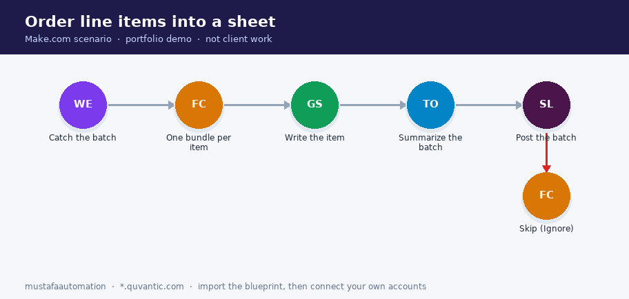
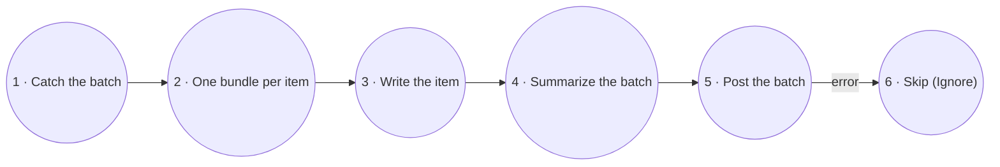

# Order line items into a sheet

Portfolio demo by Mustafa ([mustafaautomation](https://github.com/mustafaautomation)). Not client work. Connect your own accounts after import. Live walkthroughs, when published, sit on a subdomain of quvantic.com.

**Category:** E-commerce  
**Difficulty:** intermediate  
**Apps:** Webhooks, Google Sheets, Slack  
**Test status:** documented blueprint, structurally validated

## Problem

An order webhook has a lines array and the packing sheet wants one row per line. This demo iterates the array, writes sku, quantity, and name, and posts one summary. It does not talk to the shop.

## Who it's for

Packers whose sheet is by line, not by order.

## Module-by-module walkthrough

Ids match the blueprint. A router runs every route whose filter passes. An error handler runs only when that module throws.

### 1. Catch the batch

`gateway:CustomWebHook` · Custom webhook · Webhooks

The body contains an array. The iterator splits it.

No mapped fields. Configure the module after import, or it only passes the bundle through.

### 2. One bundle per item

`builtin:BasicFeeder` · Iterator · Flow control

One bundle per line item on the order.

- `array`: `"{{1.lines}}"`

### 3. Write the item

`google-sheets:addRow` · Add a row · Google Sheets

One row per item.

- `from`: `"drive"`
- `mode`: `"select"`
- `spreadsheetId`: `""`
- `sheetId`: `""`
- `includesHeaders`: `true`
- `insertDataOption`: `"INSERT_ROWS"`
- `valueInputOption`: `"USER_ENTERED"`
- `values`: `{"0": "{{1.order_number}}", "1": "{{2.sku}}", "2": "{{2.qty}}", "3": "{{2.name}}"}`

### 4. Summarize the batch

`util:TextAggregator` · Text aggregator · Tools

Feeds on the iterator so Slack gets one message.

- `value`: `"{{1.order_number}} {{2.sku}} x {{2.qty}}"`

### 5. Post the batch

`slack:CreateMessage` · Send a message · Slack

After every row is written.

- `channelWType`: `"list"`
- `channelType`: `"public"`
- `channel`: `""`
- `text`: `"*Lines for {{1.order_number}}*\n{{4.text}}"`
- `mrkdwn`: `true`
- `parse`: `false`

### 6. Skip (Ignore) — error handler

`builtin:Ignore` · Skip (Ignore) · Flow control

Slack failed. The rows stay.

No mapped fields. Configure the module after import, or it only passes the bundle through.

## Diagram

## Setup

1. In Make, create a scenario, open the three-dot menu at the bottom of the editor, and choose **Import Blueprint**. Select `blueprint.json`.
2. Open every red module and pick or create the connection. Red means the account is not selected yet.
3. Schedule: Immediately.
4. Create the spreadsheet tab this scenario expects, with a header row in row 1:
   - A order
   - B sku
   - C qty
   - D name
5. Select that spreadsheet and sheet on every Google Sheets module. The ids are blank in the file.
6. Run once with the bundled `sample-input.json`. Fictional payload. Paste it into the first module when you run the scenario once.
7. Check the output bundle of each module before you turn the schedule on.

## Connections

- **Google Sheets** — create a connection and select it on every Google Sheets module. The blueprint leaves `__IMTCONN__` unset on purpose.
- **Slack** — create a connection and select it on every Slack module. The blueprint leaves `__IMTCONN__` unset on purpose.

Nothing in the file is a live connection id, webhook URL, or API key. Make rejects another team's connection id at import, so the slots are empty on purpose.

## Data mapping

References use the module id: `{{1.subject}}` is the `subject` field of module 1. Sheets columns are zero-based and backticked (`{{1.`0`}}` is column A) so a renamed header does not break the map.

- The iterator's fields are the object keys inside the array. The aggregator feeds on the iterator, not on the sheet.

## Error handling

Scenario settings: `maxErrors` 3, `dlq` false, `sequential` false, `autoCommit` true. After this many consecutive failed runs Make deactivates a scheduled scenario.

- Module 5 (Post the batch) handles errors with `builtin:Ignore`. Slack failed. The rows stay.

## Customization

- If the array is nested under a different key, change the iterator's array mapping and nothing else.
- Duplicate the scenario before you change the prompt, so you can diff against this demo later.

## Time saved

About 2 minutes an order of splitting the lines.

## Files

| File | What it is |
| --- | --- |
| `blueprint.json` | Import this into Make. |
| `sample-input.json` | Fictional bundle for the first run. |
| `diagram.png` | Flow diagram. |
| `diagram.mmd` | Mermaid source for the same flow. |
