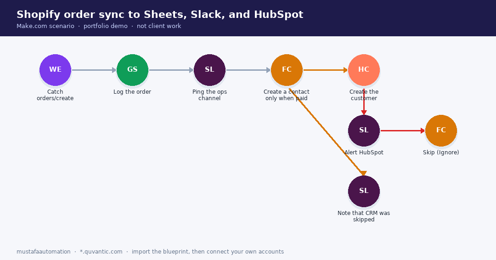
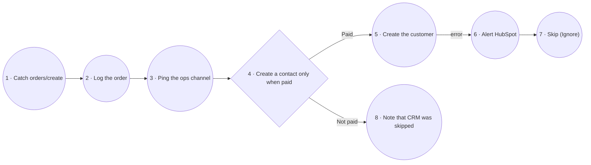

# Shopify order sync to Sheets, Slack, and HubSpot

Portfolio demo by Mustafa ([mustafaautomation](https://github.com/mustafaautomation)). Not client work. Connect your own accounts after import. Live walkthroughs, when published, sit on a subdomain of quvantic.com.

**Category:** E-commerce  
**Difficulty:** intermediate  
**Apps:** Webhooks, Google Sheets, Slack, HubSpot CRM  
**Test status:** documented blueprint, structurally validated

## Problem

Ops wants every order in a sheet and a Slack ping. Marketing wants the paid customer in HubSpot. Those are different audiences. This demo always logs and pings, and only creates the contact when financial_status is paid.

## Who it's for

Shopify stores that sell to people they also want in a CRM, without buying a native sync.

## Module-by-module walkthrough

Ids match the blueprint. A router runs every route whose filter passes. An error handler runs only when that module throws.

### 1. Catch orders/create

`gateway:CustomWebHook` · Custom webhook · Webhooks

Shopify posts the order. Make answers the hook as soon as the scenario is on.

No mapped fields. Configure the module after import, or it only passes the bundle through.

### 2. Log the order

`google-sheets:addRow` · Add a row · Google Sheets

Every financial status is logged.

- `from`: `"drive"`
- `mode`: `"select"`
- `spreadsheetId`: `""`
- `sheetId`: `""`
- `includesHeaders`: `true`
- `insertDataOption`: `"INSERT_ROWS"`
- `valueInputOption`: `"USER_ENTERED"`
- `values`: `{"0": "{{now}}", "1": "{{1.order_number}}", "2": "{{1.email}}", "3": "{{1.total_price}}", "4": "{{1.currency}}", "5": "{{1.financial_status}}"}`

### 3. Ping the ops channel

`slack:CreateMessage` · Send a message · Slack

Fulfillment sees paid and unpaid. The CRM does not.

- `channelWType`: `"list"`
- `channelType`: `"public"`
- `channel`: `""`
- `text`: `"*Order* {{1.order_number}} {{1.currency}} {{1.total_price}} — {{1.financial_status}} — {{1.email}}"`
- `mrkdwn`: `true`
- `parse`: `false`

### 4. Create a contact only when paid

`builtin:BasicRouter` · Router · Flow control

Unpaid orders still have the sheet row and the Slack ping from above.

### 5. Create the customer — route **Paid**

`hubspotcrm:createContact` · Create a contact · HubSpot CRM

Email is the key. The order number is not a HubSpot property in this demo.

Filter **Paid**: `[[{"a": "{{1.financial_status}}", "o": "text:equal", "b": "paid"}]]`

- `email`: `"{{1.email}}"`
- `firstname`: `"{{1.first_name}}"`
- `lastname`: `"{{1.last_name}}"`

### 6. Alert HubSpot — error handler

`slack:CreateMessage` · Send a message · Slack

HubSpot contact failed for order {{order.order_number}}.

- `channelWType`: `"list"`
- `channelType`: `"public"`
- `channel`: `""`
- `text`: `"HubSpot contact failed for order {{1.order_number}}."`
- `mrkdwn`: `true`
- `parse`: `false`

### 7. Skip (Ignore) — error handler

`builtin:Ignore` · Skip (Ignore) · Flow control

HubSpot failed. The order is already in the sheet. Skip so ops is not blocked.

No mapped fields. Configure the module after import, or it only passes the bundle through.

### 8. Note that CRM was skipped — route **Not paid**

`slack:CreateMessage` · Send a message · Slack

A second, quieter line so marketing does not expect a contact.

Filter **Not paid**: `[[{"a": "{{1.financial_status}}", "o": "text:notequal", "b": "paid"}]]`

- `channelWType`: `"list"`
- `channelType`: `"public"`
- `channel`: `""`
- `text`: `"No HubSpot contact for order {{1.order_number}} ({{1.financial_status}})."`
- `mrkdwn`: `true`
- `parse`: `false`

## Diagram

## Setup

1. In Make, create a scenario, open the three-dot menu at the bottom of the editor, and choose **Import Blueprint**. Select `blueprint.json`.
2. Open every red module and pick or create the connection. Red means the account is not selected yet.
3. Schedule: Immediately. In Shopify, subscribe orders/create to the Make webhook URL.
4. Create the spreadsheet tab this scenario expects, with a header row in row 1:
   - A received_at
   - B order number
   - C email
   - D total
   - E currency
   - F financial status
5. Select that spreadsheet and sheet on every Google Sheets module. The ids are blank in the file.
6. Run once with the bundled `sample-input.json`. Fictional payload. Paste it into the first module when you run the scenario once.
7. Check the output bundle of each module before you turn the schedule on.

## Connections

- **Google Sheets** — create a connection and select it on every Google Sheets module. The blueprint leaves `__IMTCONN__` unset on purpose.
- **Slack** — create a connection and select it on every Slack module. The blueprint leaves `__IMTCONN__` unset on purpose.
- **HubSpot CRM** — create a connection and select it on every HubSpot CRM module. The blueprint leaves `__IMTCONN__` unset on purpose.

Nothing in the file is a live connection id, webhook URL, or API key. Make rejects another team's connection id at import, so the slots are empty on purpose.

## Data mapping

References use the module id: `{{1.subject}}` is the `subject` field of module 1. Sheets columns are zero-based and backticked (`{{1.`0`}}` is column A) so a renamed header does not break the map.

- Shopify's real orders/create payload nests the customer. Flatten it in a Shopify Flow step, or remap email from `customer.email` after you inspect one live order. The sample is flat.
- HubSpot is only on the paid route. Pending and refunded orders stay in the sheet.

## Error handling

Scenario settings: `maxErrors` 3, `dlq` false, `sequential` false, `autoCommit` true. After this many consecutive failed runs Make deactivates a scheduled scenario.

- Router 4 (Create a contact only when paid) Unpaid orders still have the sheet row and the Slack ping from above.
  - **Paid.** Create the HubSpot contact. Filter: **Paid**.
  - **Not paid.** Say the contact was skipped. Filter: **Not paid**.
- Module 5 (Create the customer) handles errors with `builtin:Ignore`. HubSpot failed. The order is already in the sheet. Skip so ops is not blocked.
- Module 5 runs only when filter **Paid** passes. A blocked bundle stops on that path. It is not an error.
- Module 8 runs only when filter **Not paid** passes. A blocked bundle stops on that path. It is not an error.

## Customization

- Add line-item text to the Slack message once you have inspected `line_items[].title`.
- Raise a total filter if Slack should ignore small orders. Put it on the Slack module, not the webhook.
- The native Shopify watch-orders module can replace the webhook if you prefer polling. This demo uses the webhook because that is how orders/create is usually wired.
- Duplicate the scenario before you change the prompt, so you can diff against this demo later.

## Time saved

About 2 minutes per order of exporting CSV and pasting the customer.

## Files

| File | What it is |
| --- | --- |
| `blueprint.json` | Import this into Make. |
| `sample-input.json` | Fictional bundle for the first run. |
| `diagram.png` | Flow diagram. |
| `diagram.mmd` | Mermaid source for the same flow. |
