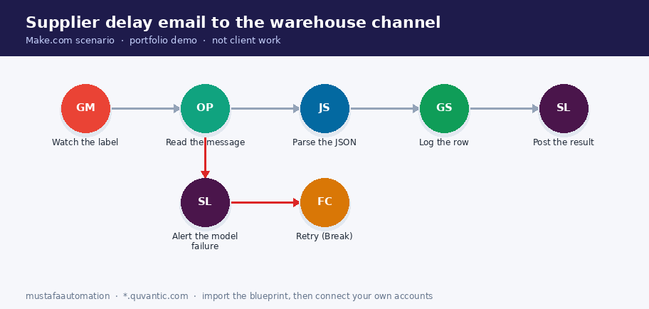
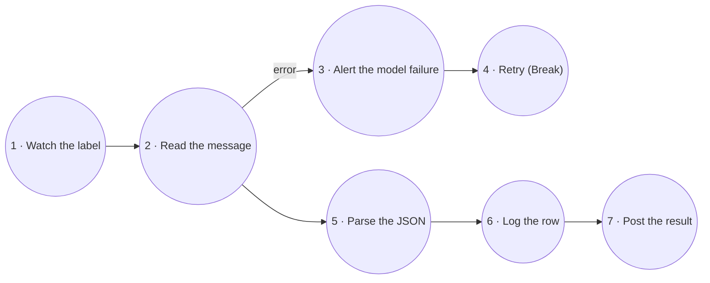

# Supplier delay email to the warehouse channel

Portfolio demo by Mustafa ([mustafaautomation](https://github.com/mustafaautomation)). Not client work. Connect your own accounts after import. Live walkthroughs, when published, sit on a subdomain of quvantic.com.

**Category:** E-commerce  
**Difficulty:** beginner  
**Apps:** Gmail, OpenAI, Google Sheets, Slack  
**Test status:** documented blueprint, structurally validated

## Problem

Delay emails from suppliers are prose. The warehouse needs a date. This demo extracts the order number and the new date, logs them, and posts to Slack only when a date was found.

## Who it's for

Warehouses that buy from suppliers who send delays as email, not as EDI.

## Module-by-module walkthrough

Ids match the blueprint. A router runs every route whose filter passes. An error handler runs only when that module throws.

### 1. Watch the label

`google-email:TriggerWatchEmails` · Watch emails · Gmail

A Gmail filter already applied this label. The scenario does not try to classify the whole inbox.

- `q`: `"label:supplier-delays newer_than:14d"`
- `maxResults`: `5`

### 2. Read the message

`openai-gpt-3:CreateCompletion` · Create a completion · OpenAI

The system prompt is the rubric. The email is the only source.

- `select`: `"chat"`
- `model`: `"gpt-4o-mini"`
- `max_tokens`: `"400"`
- `temperature`: `"0.2"`
- `messages`: `[{"role": "system", "content": "Extract a delay notice. Return JSON only: order_number, new_date (YYYY-MM-DD or empty), summary. Do not invent a date."}, {"role": "user", "content": "Email follows.\n\nFrom: {{1.from}}...`

### 3. Alert the model failure — error handler

`slack:CreateMessage` · Send a message · Slack

Model failed for {{mail.subject}}.

- `channelWType`: `"list"`
- `channelType`: `"public"`
- `channel`: `""`
- `text`: `"Model failed for {{1.subject}}."`
- `mrkdwn`: `true`
- `parse`: `false`

### 4. Retry (Break) — error handler

`builtin:Break` · Retry (Break) · Flow control

The model failed. Retry before writing a bad row.

- `retry`: `true`
- `count`: `3`
- `interval`: `15`

### 5. Parse the JSON

`json:ParseJSON` · Parse JSON · JSON

The prompt asks for one JSON object. This module exposes its keys.

- `json`: `"{{2.result}}"`

### 6. Log the row

`google-sheets:addRow` · Add a row · Google Sheets

Every message is logged, whether or not Slack fires.

- `from`: `"drive"`
- `mode`: `"select"`
- `spreadsheetId`: `""`
- `sheetId`: `""`
- `includesHeaders`: `true`
- `insertDataOption`: `"INSERT_ROWS"`
- `valueInputOption`: `"USER_ENTERED"`
- `values`: `{"0": "{{now}}", "1": "{{1.from}}", "2": "{{5.order_number}}", "3": "{{5.new_date}}", "4": "{{5.summary}}"}`

### 7. Post the result

`slack:CreateMessage` · Send a message · Slack

The channel sees the extracted fields, not the whole email.

Filter **Date present**: `[[{"a": "{{5.new_date}}", "o": "exist"}]]`

- `channelWType`: `"list"`
- `channelType`: `"public"`
- `channel`: `""`
- `text`: `"Delay on {{5.order_number}}: now {{5.new_date}}. {{5.summary}}"`
- `mrkdwn`: `true`
- `parse`: `false`

## Diagram

## Setup

1. In Make, create a scenario, open the three-dot menu at the bottom of the editor, and choose **Import Blueprint**. Select `blueprint.json`.
2. Open every red module and pick or create the connection. Red means the account is not selected yet.
3. Schedule: Every 30 minutes.
4. Create the spreadsheet tab this scenario expects, with a header row in row 1:
   - A received_at
   - B from
   - C order_number
   - D new_date
   - E summary
5. Select that spreadsheet and sheet on every Google Sheets module. The ids are blank in the file.
6. Run once with the bundled `sample-input.json`. Fictional payload. Paste it into the first module when you run the scenario once.
7. Check the output bundle of each module before you turn the schedule on.

## Connections

- **Gmail** — create a connection and select it on every Gmail module. The blueprint leaves `__IMTCONN__` unset on purpose.
- **OpenAI** — create a connection and select it on every OpenAI module. The blueprint leaves `__IMTCONN__` unset on purpose.
- **Slack** — create a connection and select it on every Slack module. The blueprint leaves `__IMTCONN__` unset on purpose.
- **Google Sheets** — create a connection and select it on every Google Sheets module. The blueprint leaves `__IMTCONN__` unset on purpose.

Nothing in the file is a live connection id, webhook URL, or API key. Make rejects another team's connection id at import, so the slots are empty on purpose.

## Data mapping

References use the module id: `{{1.subject}}` is the `subject` field of module 1. Sheets columns are zero-based and backticked (`{{1.`0`}}` is column A) so a renamed header does not break the map.

- Parsed JSON keys match the prompt. Sheet columns are positional, starting at values["0"].
- The Slack filter is on the last module, so the sheet row is written even when Slack does not fire.

## Error handling

Scenario settings: `maxErrors` 3, `dlq` true, `sequential` false, `autoCommit` true. After this many consecutive failed runs Make deactivates a scheduled scenario.

- Module 2 (Read the message) handles errors with `builtin:Break`. The model failed. Retry before writing a bad row.
- Module 7 runs only when filter **Date present** passes. A blocked bundle stops on that path. It is not an error.

## Customization

- Point the Gmail query at your label. The demo uses `label:supplier-delays newer_than:14d`.
- Keep the model on JSON-only output. A preamble breaks Parse JSON.
- Duplicate the scenario before you change the prompt, so you can diff against this demo later.

## Time saved

About 3 minutes a delay email.

## Files

| File | What it is |
| --- | --- |
| `blueprint.json` | Import this into Make. |
| `sample-input.json` | Fictional bundle for the first run. |
| `diagram.png` | Flow diagram. |
| `diagram.mmd` | Mermaid source for the same flow. |
