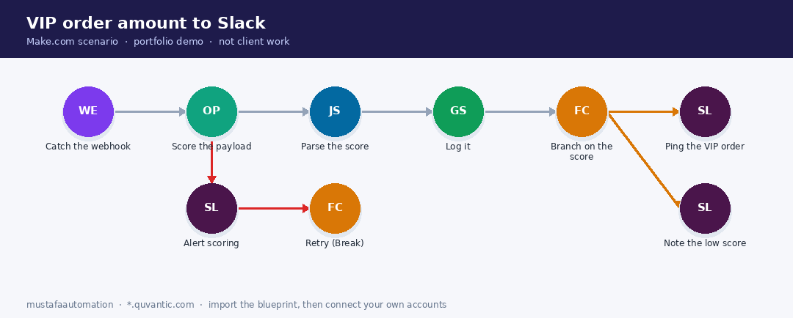
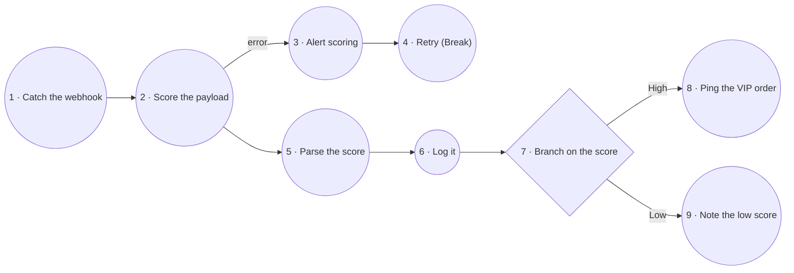

# VIP order amount to Slack

Portfolio demo by Mustafa ([mustafaautomation](https://github.com/mustafaautomation)). Not client work. Connect your own accounts after import. Live walkthroughs, when published, sit on a subdomain of quvantic.com.

**Category:** E-commerce  
**Difficulty:** beginner  
**Apps:** Webhooks, OpenAI, Google Sheets, Slack  
**Test status:** documented blueprint, structurally validated

## Problem

Large orders deserve a person, and the order feed treats 20 and 2000 the same. This demo logs every order and pings Slack at 500 or more. The model copies the total into the score so the router can use a number filter.

## Who it's for

Stores where a 500 order should wake a person and a 20 order should not.

## Module-by-module walkthrough

Ids match the blueprint. A router runs every route whose filter passes. An error handler runs only when that module throws.

### 1. Catch the webhook

`gateway:CustomWebHook` · Custom webhook · Webhooks

The form posts JSON to this hook. Parameters stay empty so Make creates the hook on import.

No mapped fields. Configure the module after import, or it only passes the bundle through.

### 2. Score the payload

`openai-gpt-3:CreateCompletion` · Create a completion · OpenAI

Returns JSON with a numeric score and a one-sentence reason.

- `select`: `"chat"`
- `model`: `"gpt-4o-mini"`
- `max_tokens`: `"300"`
- `temperature`: `"0.2"`
- `messages`: `[{"role": "system", "content": "Copy the order total into score as a number. Return JSON only: score, reason. If the total is not numeric, score is 0."}, {"role": "user", "content": "Order {{1.order_number}} total {{1...`

### 3. Alert scoring — error handler

`slack:CreateMessage` · Send a message · Slack

Scoring failed.

- `channelWType`: `"list"`
- `channelType`: `"public"`
- `channel`: `""`
- `text`: `"Scoring failed."`
- `mrkdwn`: `true`
- `parse`: `false`

### 4. Retry (Break) — error handler

`builtin:Break` · Retry (Break) · Flow control

Scoring failed. Retry before the router picks a side.

- `retry`: `true`
- `count`: `3`
- `interval`: `15`

### 5. Parse the score

`json:ParseJSON` · Parse JSON · JSON

Exposes the numeric field the routes compare.

- `json`: `"{{2.result}}"`

### 6. Log it

`google-sheets:addRow` · Add a row · Google Sheets

The row is written before the route, so both outcomes have an audit line.

- `from`: `"drive"`
- `mode`: `"select"`
- `spreadsheetId`: `""`
- `sheetId`: `""`
- `includesHeaders`: `true`
- `insertDataOption`: `"INSERT_ROWS"`
- `valueInputOption`: `"USER_ENTERED"`
- `values`: `{"0": "{{now}}", "1": "{{1.order_number}}", "2": "{{1.email}}", "3": "{{1.total}}", "4": "{{5.reason}}"}`

### 7. Branch on the score

`builtin:BasicRouter` · Router · Flow control

The two number filters are mutually exclusive.

### 8. Ping the VIP order — route **High**

`slack:CreateMessage` · Send a message · Slack

500 is the line, in the currency of the payload.

Filter **At or above the line**: `[[{"a": "{{5.score}}", "o": "number:greaterorequal", "b": "500"}]]`

- `channelWType`: `"list"`
- `channelType`: `"public"`
- `channel`: `""`
- `text`: `"*Large order* {{1.order_number}} {{1.currency}} {{1.total}} for {{1.email}}."`
- `mrkdwn`: `true`
- `parse`: `false`

### 9. Note the low score — route **Low**

`slack:CreateMessage` · Send a message · Slack

So the channel can see the lead was stored and not contacted.

Filter **Below the line**: `[[{"a": "{{5.score}}", "o": "number:less", "b": "500"}]]`

- `channelWType`: `"list"`
- `channelType`: `"public"`
- `channel`: `""`
- `text`: `"Order {{1.order_number}} logged at {{1.total}}. Under 500."`
- `mrkdwn`: `true`
- `parse`: `false`

## Diagram

## Setup

1. In Make, create a scenario, open the three-dot menu at the bottom of the editor, and choose **Import Blueprint**. Select `blueprint.json`.
2. Open every red module and pick or create the connection. Red means the account is not selected yet.
3. Schedule: Immediately.
4. Create the spreadsheet tab this scenario expects, with a header row in row 1:
   - A received_at
   - B order
   - C email
   - D total
   - E reason
5. Select that spreadsheet and sheet on every Google Sheets module. The ids are blank in the file.
6. Run once with the bundled `sample-input.json`. Fictional payload. Paste it into the first module when you run the scenario once.
7. Check the output bundle of each module before you turn the schedule on.

## Connections

- **OpenAI** — create a connection and select it on every OpenAI module. The blueprint leaves `__IMTCONN__` unset on purpose.
- **Slack** — create a connection and select it on every Slack module. The blueprint leaves `__IMTCONN__` unset on purpose.
- **Google Sheets** — create a connection and select it on every Google Sheets module. The blueprint leaves `__IMTCONN__` unset on purpose.

Nothing in the file is a live connection id, webhook URL, or API key. Make rejects another team's connection id at import, so the slots are empty on purpose.

## Data mapping

References use the module id: `{{1.subject}}` is the `subject` field of module 1. Sheets columns are zero-based and backticked (`{{1.`0`}}` is column A) so a renamed header does not break the map.

- Routes compare `{{parsed.score}}` with 500 using number operators, so the two routes do not both run.

## Error handling

Scenario settings: `maxErrors` 3, `dlq` true, `sequential` false, `autoCommit` true. After this many consecutive failed runs Make deactivates a scheduled scenario.

- Module 2 (Score the payload) handles errors with `builtin:Break`. Scoring failed. Retry before the router picks a side.
- Router 7 (Branch on the score) The two number filters are mutually exclusive.
  - **High.** The score cleared the line. Filter: **At or above the line**.
  - **Low.** The score stayed under the line. Filter: **Below the line**.
- Module 8 runs only when filter **At or above the line** passes. A blocked bundle stops on that path. It is not an error.
- Module 9 runs only when filter **Below the line** passes. A blocked bundle stops on that path. It is not an error.

## Customization

- Edit the rubric in the system prompt before you reuse this for a different offer.
- The webhook parameters are empty. Make creates the hook when you import.
- Duplicate the scenario before you change the prompt, so you can diff against this demo later.

## Time saved

The large order is seen in the same run instead of the next export.

## Files

| File | What it is |
| --- | --- |
| `blueprint.json` | Import this into Make. |
| `sample-input.json` | Fictional bundle for the first run. |
| `diagram.png` | Flow diagram. |
| `diagram.mmd` | Mermaid source for the same flow. |
