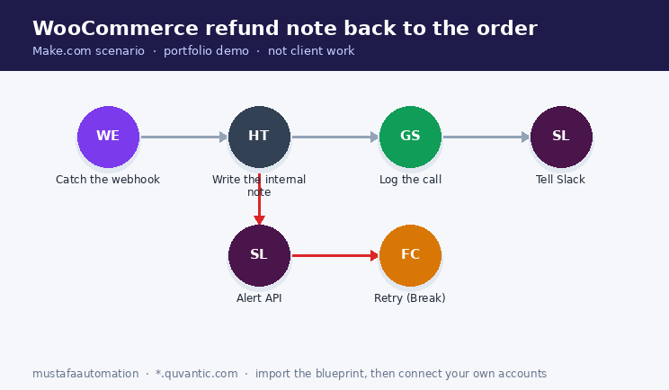

# WooCommerce refund note back to the order

Portfolio demo by Mustafa ([mustafaautomation](https://github.com/mustafaautomation)). Not client work. Connect your own accounts after import. Live walkthroughs, when published, sit on a subdomain of quvantic.com.

**Category:** E-commerce  
**Difficulty:** intermediate  
**Apps:** Webhooks, WooCommerce, Google Sheets, Slack  
**Test status:** documented blueprint, structurally validated

## Problem

Woo refunds are easy to miss in wp-admin. This demo logs the refund and writes an internal note on the order so the next person sees that the webhook arrived. Slack fires for every refund in this one. There is no amount gate.

## Who it's for

WordPress shops that already emit a refund webhook.

## Module-by-module walkthrough

Ids match the blueprint. A router runs every route whose filter passes. An error handler runs only when that module throws.

### 1. Catch the webhook

`gateway:CustomWebHook` · Custom webhook · Webhooks

Woo posts the refund. The sample is flat.

No mapped fields. Configure the module after import, or it only passes the bundle through.

### 2. Write the internal note

`http:ActionSendData` · Make a request · HTTP

POST an order note. customer_note is false so the buyer does not see it.

- `url`: `"https://shop.example.com/wp-json/wc/v3/orders/{{1.order_id}}/notes"`
- `serializeUrl`: `false`
- `method`: `"post"`
- `headers`: `[{"name": "Accept", "value": "application/json"}, {"name": "Content-Type", "value": "application/json"}]`
- `qs`: `[{"name": "consumer_key", "value": "YOUR_WOO_CONSUMER_KEY"}, {"name": "consumer_secret", "value": "YOUR_WOO_CONSUMER_SECRET"}]`
- `bodyType`: `"raw"`
- `parseResponse`: `true`
- `contentType`: `"application/json"`
- `data`: `"{\"note\":\"Refund webhook received for {{1.amount}} {{1.currency}}.\",\"customer_note\":false}"`
- `timeout`: `""`
- `shareCookies`: `false`
- `ca`: `""`
- `rejectUnauthorized`: `true`
- `followRedirect`: `true`
- `useQuerystring`: `false`
- `gzip`: `true`
- `useMtls`: `false`
- `followAllRedirects`: `false`

### 3. Alert API — error handler

`slack:CreateMessage` · Send a message · Slack

API call failed.

- `channelWType`: `"list"`
- `channelType`: `"public"`
- `channel`: `""`
- `text`: `"API call failed."`
- `mrkdwn`: `true`
- `parse`: `false`

### 4. Retry (Break) — error handler

`builtin:Break` · Retry (Break) · Flow control

The API call failed.

- `retry`: `true`
- `count`: `3`
- `interval`: `15`

### 5. Log the call

`google-sheets:addRow` · Add a row · Google Sheets

A row even when the later Slack filter blocks.

- `from`: `"drive"`
- `mode`: `"select"`
- `spreadsheetId`: `""`
- `sheetId`: `""`
- `includesHeaders`: `true`
- `insertDataOption`: `"INSERT_ROWS"`
- `valueInputOption`: `"USER_ENTERED"`
- `values`: `{"0": "{{now}}", "1": "{{1.order_id}}", "2": "{{1.amount}}", "3": "{{1.currency}}"}`

### 6. Tell Slack

`slack:CreateMessage` · Send a message · Slack

The channel sees the outcome.

- `channelWType`: `"list"`
- `channelType`: `"public"`
- `channel`: `""`
- `text`: `"Woo refund on order {{1.order_id}}: {{1.amount}} {{1.currency}}."`
- `mrkdwn`: `true`
- `parse`: `false`

## Diagram



```mermaid
flowchart LR
  hook(("1 · Catch the webhook"))
  call(("2 · Write the internal note"))
  hook --> call
  call -->|"error"| call_alert
  call_alert(("3 · Alert API"))
  call_directive(("4 · Retry (Break)"))
  call_alert --> call_directive
  log(("5 · Log the call"))
  call --> log
  ping(("6 · Tell Slack"))
  log --> ping
```

## Setup

1. In Make, create a scenario, open the three-dot menu at the bottom of the editor, and choose **Import Blueprint**. Select `blueprint.json`.
2. Open every red module and pick or create the connection. Red means the account is not selected yet.
3. Schedule: Immediately.
4. Create the spreadsheet tab this scenario expects, with a header row in row 1:
   - A received_at
   - B order
   - C amount
   - D currency
5. Select that spreadsheet and sheet on every Google Sheets module. The ids are blank in the file.
6. Run once with the bundled `sample-input.json`. Fictional payload. Paste it into the first module when you run the scenario once.
7. Check the output bundle of each module before you turn the schedule on.

## Connections

- **Slack** — create a connection and select it on every Slack module. The blueprint leaves `__IMTCONN__` unset on purpose.
- **Google Sheets** — create a connection and select it on every Google Sheets module. The blueprint leaves `__IMTCONN__` unset on purpose.

Replace these placeholders in the HTTP modules before the first live run:
- `YOUR_WOO_CONSUMER_KEY`
- `YOUR_WOO_CONSUMER_SECRET`

Nothing in the file is a live connection id, webhook URL, or API key. Make rejects another team's connection id at import, so the slots are empty on purpose.

## Data mapping

References use the module id: `{{1.subject}}` is the `subject` field of module 1. Sheets columns are zero-based and backticked (`{{1.`0`}}` is column A) so a renamed header does not break the map.

- The HTTP module uses parseResponse. Map the id from the output bundle you see on the first run if the path differs.

## Error handling

Scenario settings: `maxErrors` 3, `dlq` true, `sequential` false, `autoCommit` true. After this many consecutive failed runs Make deactivates a scheduled scenario.

- Module 2 (Write the internal note) handles errors with `builtin:Break`. The API call failed.

## Customization

- Replace every YOUR_* token before the first live call. Do not commit the filled-in blueprint.
- Swap any `YOUR_*` value for the id from your own account. Do not commit the filled-in file.
- Duplicate the scenario before you change the prompt, so you can diff against this demo later.

## Time saved

About 3 minutes a refund of finding the order and typing the note.

## Files

| File | What it is |
| --- | --- |
| `blueprint.json` | Import this into Make. |
| `sample-input.json` | Fictional bundle for the first run. |
| `diagram.png` | Flow diagram. |
| `diagram.mmd` | Mermaid source for the same flow. |
