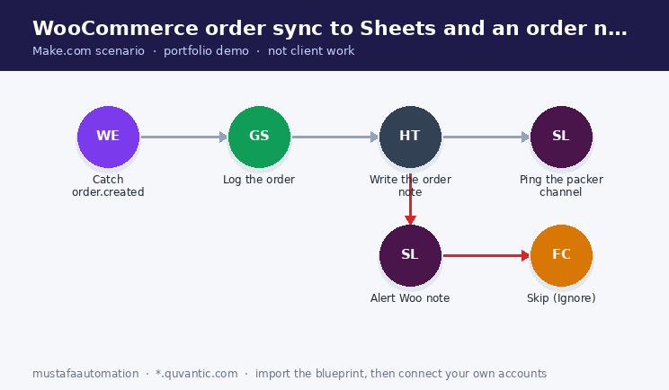
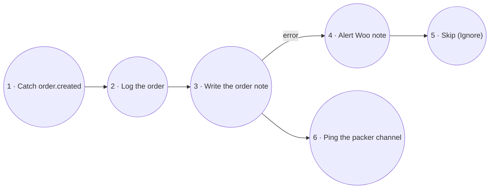

# WooCommerce order sync to Sheets and an order note

Portfolio demo by Mustafa ([mustafaautomation](https://github.com/mustafaautomation)). Not client work. Connect your own accounts after import. Live walkthroughs, when published, sit on a subdomain of quvantic.com.

**Category:** E-commerce  
**Difficulty:** intermediate  
**Apps:** Webhooks, Google Sheets, Slack, WooCommerce  
**Test status:** documented blueprint, structurally validated

## Problem

WooCommerce stores often run on a host that already has webhooks, and the office still exports orders to a sheet for the packer. This demo logs the order, pings Slack, and writes a note back onto the order so the shop admin shows that Make saw it.

## Who it's for

WordPress shops whose packer lives in a spreadsheet, not in wp-admin.

## Module-by-module walkthrough

Ids match the blueprint. A router runs every route whose filter passes. An error handler runs only when that module throws.

### 1. Catch order.created

`gateway:CustomWebHook` · Custom webhook · Webhooks

WooCommerce posts the order JSON to the hook.

No mapped fields. Configure the module after import, or it only passes the bundle through.

### 2. Log the order

`google-sheets:addRow` · Add a row · Google Sheets

Uses the billing email, which is what the packer needs.

- `from`: `"drive"`
- `mode`: `"select"`
- `spreadsheetId`: `""`
- `sheetId`: `""`
- `includesHeaders`: `true`
- `insertDataOption`: `"INSERT_ROWS"`
- `valueInputOption`: `"USER_ENTERED"`
- `values`: `{"0": "{{now}}", "1": "{{1.number}}", "2": "{{1.billing.email}}", "3": "{{1.total}}", "4": "{{1.status}}"}`

### 3. Write the order note

`http:ActionSendData` · Make a request · HTTP

Shows in wp-admin that the scenario ran. Customer notes stay false so the buyer does not see it.

- `url`: `"https://shop.example.com/wp-json/wc/v3/orders/{{1.id}}/notes"`
- `serializeUrl`: `false`
- `method`: `"post"`
- `headers`: `[{"name": "Accept", "value": "application/json"}, {"name": "Content-Type", "value": "application/json"}]`
- `qs`: `[{"name": "consumer_key", "value": "YOUR_WOO_CONSUMER_KEY"}, {"name": "consumer_secret", "value": "YOUR_WOO_CONSUMER_SECRET"}]`
- `bodyType`: `"raw"`
- `parseResponse`: `true`
- `contentType`: `"application/json"`
- `data`: `"{\"note\":\"Logged to the packing sheet by the portfolio demo scenario.\",\"customer_note\":false}"`
- `timeout`: `""`
- `shareCookies`: `false`
- `ca`: `""`
- `rejectUnauthorized`: `true`
- `followRedirect`: `true`
- `useQuerystring`: `false`
- `gzip`: `true`
- `useMtls`: `false`
- `followAllRedirects`: `false`

### 4. Alert Woo note — error handler

`slack:CreateMessage` · Send a message · Slack

Order note failed for Woo order {{order.number}}.

- `channelWType`: `"list"`
- `channelType`: `"public"`
- `channel`: `""`
- `text`: `"Order note failed for Woo order {{1.number}}."`
- `mrkdwn`: `true`
- `parse`: `false`

### 5. Skip (Ignore) — error handler

`builtin:Ignore` · Skip (Ignore) · Flow control

The note failed. The sheet row is already there. Skip.

No mapped fields. Configure the module after import, or it only passes the bundle through.

### 6. Ping the packer channel

`slack:CreateMessage` · Send a message · Slack

Only processing orders reach the channel. The sheet row and the order note already happened.

Filter **Processing orders**: `[[{"a": "{{1.status}}", "o": "text:equal", "b": "processing"}]]`

- `channelWType`: `"list"`
- `channelType`: `"public"`
- `channel`: `""`
- `text`: `"*Woo order* {{1.number}} {{1.currency}} {{1.total}} — {{1.status}} — {{1.billing.email}}"`
- `mrkdwn`: `true`
- `parse`: `false`

## Diagram

## Setup

1. In Make, create a scenario, open the three-dot menu at the bottom of the editor, and choose **Import Blueprint**. Select `blueprint.json`.
2. Open every red module and pick or create the connection. Red means the account is not selected yet.
3. Schedule: Immediately. WooCommerce webhook topic order.created.
4. Create the spreadsheet tab this scenario expects, with a header row in row 1:
   - A received_at
   - B order id
   - C email
   - D total
   - E status
5. Select that spreadsheet and sheet on every Google Sheets module. The ids are blank in the file.
6. Run once with the bundled `sample-input.json`. Fictional payload. Paste it into the first module when you run the scenario once.
7. Check the output bundle of each module before you turn the schedule on.

## Connections

- **Google Sheets** — create a connection and select it on every Google Sheets module. The blueprint leaves `__IMTCONN__` unset on purpose.
- **Slack** — create a connection and select it on every Slack module. The blueprint leaves `__IMTCONN__` unset on purpose.

Replace these placeholders in the HTTP modules before the first live run:
- `YOUR_WOO_CONSUMER_KEY`
- `YOUR_WOO_CONSUMER_SECRET`

Nothing in the file is a live connection id, webhook URL, or API key. Make rejects another team's connection id at import, so the slots are empty on purpose.

## Data mapping

References use the module id: `{{1.subject}}` is the `subject` field of module 1. Sheets columns are zero-based and backticked (`{{1.`0`}}` is column A) so a renamed header does not break the map.

- Billing email is nested: `{{order.billing.email}}`.
- The note call is POST /wp-json/wc/v3/orders/{{order.id}}/notes with consumer key and secret on the query string. Replace both YOUR_ values and the shop host.

## Error handling

Scenario settings: `maxErrors` 3, `dlq` false, `sequential` false, `autoCommit` true. After this many consecutive failed runs Make deactivates a scheduled scenario.

- Module 3 (Write the order note) handles errors with `builtin:Ignore`. The note failed. The sheet row is already there. Skip.
- Module 6 runs only when filter **Processing orders** passes. A blocked bundle stops on that path. It is not an error.

## Customization

- Change shop.example.com to your store.
- Filter the Slack module on status processing if you do not want pending orders in the channel.
- Add line items once you have seen the real payload's line_items array.
- Swap any `YOUR_*` value for the id from your own account. Do not commit the filled-in file.
- Duplicate the scenario before you change the prompt, so you can diff against this demo later.

## Time saved

About 2 minutes per order of export and copy, plus the note that used to be typed by hand.

## Files

| File | What it is |
| --- | --- |
| `blueprint.json` | Import this into Make. |
| `sample-input.json` | Fictional bundle for the first run. |
| `diagram.png` | Flow diagram. |
| `diagram.mmd` | Mermaid source for the same flow. |
