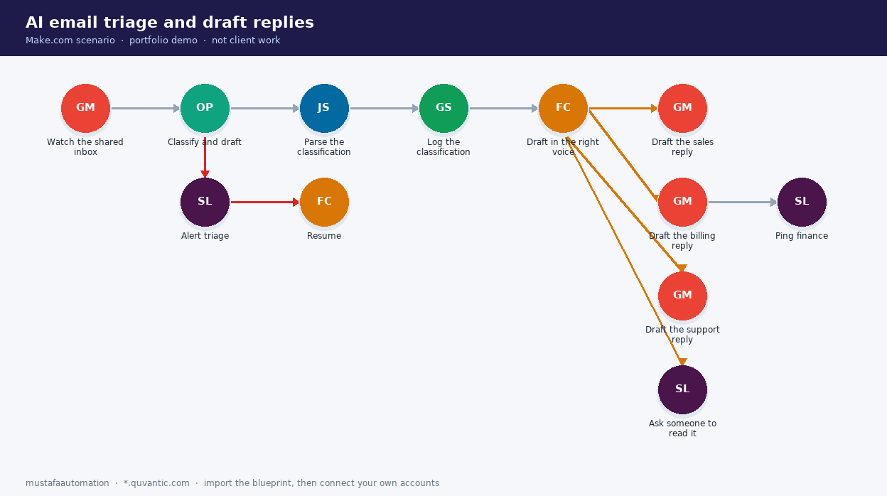
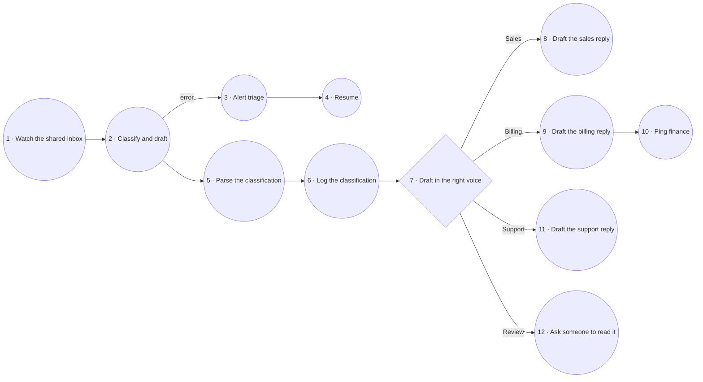

# AI email triage and draft replies

Portfolio demo by Mustafa ([mustafaautomation](https://github.com/mustafaautomation)). Not client work. Connect your own accounts after import. Live walkthroughs, when published, sit on a subdomain of quvantic.com.

**Category:** Email  
**Difficulty:** intermediate  
**Apps:** Gmail, OpenAI, Slack, Google Sheets  
**Test status:** documented blueprint, structurally validated

## Problem

A shared inbox mixes quotes, invoices, and password resets. People answer the loud ones and miss the quotes. This demo classifies each message and writes a draft in the right voice. It does not send. A human still hits send, which is the point.

## Who it's for

Operators who share one Gmail mailbox across sales and support and are nervous about auto-send.

## Module-by-module walkthrough

Ids match the blueprint. A router runs every route whose filter passes. An error handler runs only when that module throws.

### 1. Watch the shared inbox

`google-email:TriggerWatchEmails` · Watch emails · Gmail

Unread mail in the inbox, five at a time.

- `q`: `"in:inbox is:unread -category:promotions"`
- `maxResults`: `5`

### 2. Classify and draft

`openai-gpt-3:CreateCompletion` · Create a completion · OpenAI

One JSON object with intent and a short reply in plain sentences. No markdown.

- `select`: `"chat"`
- `model`: `"gpt-4o-mini"`
- `max_tokens`: `"600"`
- `temperature`: `"0.2"`
- `messages`: `[{"role": "system", "content": "You triage a shared inbox. Return JSON only with keys intent (sales, billing, support, or review), summary (one sentence), and reply (a short plain-text email body). Do not promise refu...`

### 3. Alert triage — error handler

`slack:CreateMessage` · Send a message · Slack

Email triage model failed for {{mail.subject}}.

- `channelWType`: `"list"`
- `channelType`: `"public"`
- `channel`: `""`
- `text`: `"Email triage model failed for {{1.subject}}."`
- `mrkdwn`: `true`
- `parse`: `false`

### 4. Resume — error handler

`builtin:Resume` · Resume · Flow control

The model failed. Substitute a review classification so the message is still drafted for a person.

- `result`: `"{\"intent\":\"review\",\"summary\":\"Model unavailable\",\"reply\":\"Thanks for the note. A person on the team will reply shortly.\"}"`

### 5. Parse the classification

`json:ParseJSON` · Parse JSON · JSON

Exposes intent, summary, and reply.

- `json`: `"{{2.result}}"`

### 6. Log the classification

`google-sheets:addRow` · Add a row · Google Sheets

You can audit what the model thought before anyone edits the draft.

- `from`: `"drive"`
- `mode`: `"select"`
- `spreadsheetId`: `""`
- `sheetId`: `""`
- `includesHeaders`: `true`
- `insertDataOption`: `"INSERT_ROWS"`
- `valueInputOption`: `"USER_ENTERED"`
- `values`: `{"0": "{{now}}", "1": "{{1.from}}", "2": "{{1.subject}}", "3": "{{5.intent}}", "4": "{{5.summary}}"}`

### 7. Draft in the right voice

`builtin:BasicRouter` · Router · Flow control

Three intent routes plus a catch-all. Routes are filtered, so only one draft is created.

### 8. Draft the sales reply — route **Sales**

`google-email:ActionCreateDraft` · Create a draft · Gmail

Uses the model's reply body. Subject keeps the original thread subject.

Filter **Sales**: `[[{"a": "{{5.intent}}", "o": "text:equal", "b": "sales"}]]`

- `from`: `""`
- `to`: `["{{1.from}}"]`
- `cc`: `[]`
- `bcc`: `[]`
- `replyTo`: `""`
- `subject`: `"Re: {{1.subject}}"`
- `html`: `"
{{5.reply}}
"`
- `attachments`: `[]`

### 9. Draft the billing reply — route **Billing**

`google-email:ActionCreateDraft` · Create a draft · Gmail

Same reply field, different route so finance can be notified.

Filter **Billing**: `[[{"a": "{{5.intent}}", "o": "text:equal", "b": "billing"}]]`

- `from`: `""`
- `to`: `["{{1.from}}"]`
- `cc`: `[]`
- `bcc`: `[]`
- `replyTo`: `""`
- `subject`: `"Re: {{1.subject}}"`
- `html`: `"
{{5.reply}}
"`
- `attachments`: `[]`

### 10. Ping finance — route **Billing**

`slack:CreateMessage` · Send a message · Slack

Billing mail should not wait on the sales channel.

- `channelWType`: `"list"`
- `channelType`: `"public"`
- `channel`: `""`
- `text`: `"*Billing mail* from {{1.from}}: {{5.summary}}"`
- `mrkdwn`: `true`
- `parse`: `false`

### 11. Draft the support reply — route **Support**

`google-email:ActionCreateDraft` · Create a draft · Gmail

Support copy stays in the draft. No ticket is opened in this scenario.

Filter **Support**: `[[{"a": "{{5.intent}}", "o": "text:equal", "b": "support"}]]`

- `from`: `""`
- `to`: `["{{1.from}}"]`
- `cc`: `[]`
- `bcc`: `[]`
- `replyTo`: `""`
- `subject`: `"Re: {{1.subject}}"`
- `html`: `"
{{5.reply}}
"`
- `attachments`: `[]`

### 12. Ask someone to read it — route **Review**

`slack:CreateMessage` · Send a message · Slack

Runs only when the model returned review. The sheet still has a row if the label is something else.

Filter **Review**: `[[{"a": "{{5.intent}}", "o": "text:equal", "b": "review"}]]`

- `channelWType`: `"list"`
- `channelType`: `"public"`
- `channel`: `""`
- `text`: `"*Read this mail* {{1.subject}} from {{1.from}}. {{5.summary}}"`
- `mrkdwn`: `true`
- `parse`: `false`

## Diagram

## Setup

1. In Make, create a scenario, open the three-dot menu at the bottom of the editor, and choose **Import Blueprint**. Select `blueprint.json`.
2. Open every red module and pick or create the connection. Red means the account is not selected yet.
3. Schedule: Every 10 minutes.
4. Create the spreadsheet tab this scenario expects, with a header row in row 1:
   - A received_at
   - B from
   - C subject
   - D intent
   - E summary
5. Select that spreadsheet and sheet on every Google Sheets module. The ids are blank in the file.
6. Run once with the bundled `sample-input.json`. Fictional payload. Paste it into the first module when you run the scenario once.
7. Check the output bundle of each module before you turn the schedule on.

## Connections

- **Gmail** — create a connection and select it on every Gmail module. The blueprint leaves `__IMTCONN__` unset on purpose.
- **OpenAI** — create a connection and select it on every OpenAI module. The blueprint leaves `__IMTCONN__` unset on purpose.
- **Slack** — create a connection and select it on every Slack module. The blueprint leaves `__IMTCONN__` unset on purpose.
- **Google Sheets** — create a connection and select it on every Google Sheets module. The blueprint leaves `__IMTCONN__` unset on purpose.

Nothing in the file is a live connection id, webhook URL, or API key. Make rejects another team's connection id at import, so the slots are empty on purpose.

## Data mapping

References use the module id: `{{1.subject}}` is the `subject` field of module 1. Sheets columns are zero-based and backticked (`{{1.`0`}}` is column A) so a renamed header does not break the map.

- Intent is one of sales, billing, support, or review. Each route uses text:equal, so a message takes one route. An unexpected label is only in the sheet.
- If the model is down, Resume feeds a fixed JSON document so the mail is drafted as a review instead of vanishing.

## Error handling

Scenario settings: `maxErrors` 3, `dlq` false, `sequential` false, `autoCommit` true. After this many consecutive failed runs Make deactivates a scheduled scenario.

- Module 2 (Classify and draft) handles errors with `builtin:Resume`. The model failed. Substitute a review classification so the message is still drafted for a person.
- Router 7 (Draft in the right voice) Three intent routes plus a catch-all. Routes are filtered, so only one draft is created.
  - **Sales.** Draft a sales reply. Filter: **Sales**.
  - **Billing.** Draft a billing reply and ping finance. Filter: **Billing**.
  - **Support.** Draft a support reply. Filter: **Support**.
  - **Review.** Do not guess. Ask a person. Filter: **Review**.
- Module 8 runs only when filter **Sales** passes. A blocked bundle stops on that path. It is not an error.
- Module 9 runs only when filter **Billing** passes. A blocked bundle stops on that path. It is not an error.
- Module 11 runs only when filter **Support** passes. A blocked bundle stops on that path. It is not an error.
- Module 12 runs only when filter **Review** passes. A blocked bundle stops on that path. It is not an error.

## Customization

- Tighten the Gmail query so newsletters never enter, for example `-category:promotions`.
- Replace each draft body with your own snippets. The structure of the router can stay.
- Turn a draft module into Send an email only after you have watched a week of drafts.
- Duplicate the scenario before you change the prompt, so you can diff against this demo later.

## Time saved

Sorting plus a first draft is about 4 minutes a message. A 30-message morning is two hours.

## Files

| File | What it is |
| --- | --- |
| `blueprint.json` | Import this into Make. |
| `sample-input.json` | Fictional bundle for the first run. |
| `diagram.png` | Flow diagram. |
| `diagram.mmd` | Mermaid source for the same flow. |
