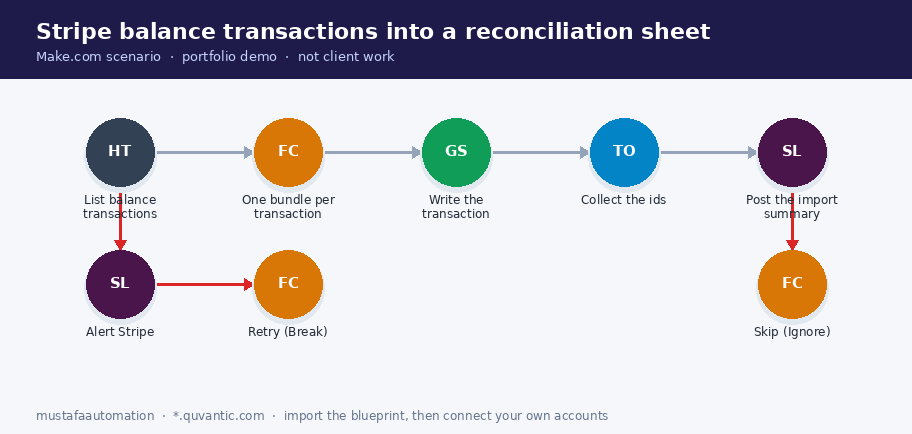
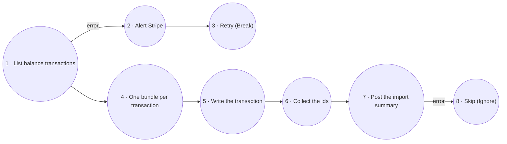

# Stripe balance transactions into a reconciliation sheet

Portfolio demo by Mustafa ([mustafaautomation](https://github.com/mustafaautomation)). Not client work. Connect your own accounts after import. Live walkthroughs, when published, sit on a subdomain of quvantic.com.

**Category:** Finance  
**Difficulty:** advanced  
**Apps:** Stripe, HTTP, Google Sheets, Slack  
**Test status:** documented blueprint, structurally validated

## Problem

Payouts do not match the bank until someone exports Stripe and lines it up. This demo pulls balance transactions, writes each one to a sheet a human can tick off against the bank feed, and posts the id list so you can see the run worked. It does not move money.

## Who it's for

Finance operators who reconcile Stripe payouts to a bank account and already keep that checklist in a sheet.

## Module-by-module walkthrough

Ids match the blueprint. A router runs every route whose filter passes. An error handler runs only when that module throws.

### 1. List balance transactions

`http:ActionSendData` · Make a request · HTTP

The last 20 transactions. Raise the limit only after you have seen a full run.

- `url`: `"https://api.stripe.com/v1/balance_transactions?limit=20"`
- `serializeUrl`: `false`
- `method`: `"get"`
- `headers`: `[{"name": "Accept", "value": "application/json"}, {"name": "Content-Type", "value": "application/json"}, {"name": "Authorization", "value": "Bearer YOUR_API_KEY"}]`
- `qs`: `[]`
- `bodyType`: `"raw"`
- `parseResponse`: `true`
- `contentType`: `"application/json"`
- `data`: `""`
- `timeout`: `""`
- `shareCookies`: `false`
- `ca`: `""`
- `rejectUnauthorized`: `true`
- `followRedirect`: `true`
- `useQuerystring`: `false`
- `gzip`: `true`
- `useMtls`: `false`
- `followAllRedirects`: `false`

### 2. Alert Stripe — error handler

`slack:CreateMessage` · Send a message · Slack

Balance transaction list failed.

- `channelWType`: `"list"`
- `channelType`: `"public"`
- `channel`: `""`
- `text`: `"Balance transaction list failed."`
- `mrkdwn`: `true`
- `parse`: `false`

### 3. Retry (Break) — error handler

`builtin:Break` · Retry (Break) · Flow control

Stripe did not return the list. Retry before writing a partial page.

- `retry`: `true`
- `count`: `3`
- `interval`: `15`

### 4. One bundle per transaction

`builtin:BasicFeeder` · Iterator · Flow control

The array is the data list inside the list response.

- `array`: `"{{1.data.data}}"`

### 5. Write the transaction

`google-sheets:addRow` · Add a row · Google Sheets

Column G is left blank for the person doing the match.

- `from`: `"drive"`
- `mode`: `"select"`
- `spreadsheetId`: `""`
- `sheetId`: `""`
- `includesHeaders`: `true`
- `insertDataOption`: `"INSERT_ROWS"`
- `valueInputOption`: `"USER_ENTERED"`
- `values`: `{"0": "{{now}}", "1": "{{4.id}}", "2": "{{4.type}}", "3": "{{4.amount}}", "4": "{{4.currency}}", "5": "{{4.created}}", "6": ""}`

### 6. Collect the ids

`util:TextAggregator` · Text aggregator · Tools

One line per transaction for the Slack message.

- `value`: `"{{4.id}} {{4.type}} {{4.amount}} {{4.currency}}"`

### 7. Post the import summary

`slack:CreateMessage` · Send a message · Slack

If Slack fails, the rows are already written. Skip rather than rolling anything back. Sheets is not transactional.

- `channelWType`: `"list"`
- `channelType`: `"public"`
- `channel`: `""`
- `text`: `"*Stripe import*\n{{6.text}}"`
- `mrkdwn`: `true`
- `parse`: `false`

### 8. Skip (Ignore) — error handler

`builtin:Ignore` · Skip (Ignore) · Flow control

Slack failed. The sheet rows stand.

No mapped fields. Configure the module after import, or it only passes the bundle through.

## Diagram

## Setup

1. In Make, create a scenario, open the three-dot menu at the bottom of the editor, and choose **Import Blueprint**. Select `blueprint.json`.
2. Open every red module and pick or create the connection. Red means the account is not selected yet.
3. Schedule: Weekday mornings. The HTTP module is the first module, so the schedule is the trigger. Sequential is on so two runs cannot write the same page at once.
4. Create the spreadsheet tab this scenario expects, with a header row in row 1:
   - A imported_at
   - B id
   - C type
   - D amount
   - E currency
   - F created
   - G matched — left blank for the human
5. Select that spreadsheet and sheet on every Google Sheets module. The ids are blank in the file.
6. Run once with the bundled `sample-input.json`. Fictional payload. Paste it into the first module when you run the scenario once.
7. Check the output bundle of each module before you turn the schedule on.

## Connections

- **Slack** — create a connection and select it on every Slack module. The blueprint leaves `__IMTCONN__` unset on purpose.
- **Google Sheets** — create a connection and select it on every Google Sheets module. The blueprint leaves `__IMTCONN__` unset on purpose.

Replace these placeholders in the HTTP modules before the first live run:
- `YOUR_API_KEY`

Nothing in the file is a live connection id, webhook URL, or API key. Make rejects another team's connection id at import, so the slots are empty on purpose.

## Data mapping

References use the module id: `{{1.subject}}` is the `subject` field of module 1. Sheets columns are zero-based and backticked (`{{1.`0`}}` is column A) so a renamed header does not break the map.

- Stripe lists transactions at GET /v1/balance_transactions. The iterator walks `{{tx.data.data}}`. If the first run shows the array on `data` instead, change the iterator's array field.
- Amount is in the smallest currency unit, the way Stripe sends it. Divide in a sheet formula, not in the prompt.
- The text aggregator feeds on the iterator, so Slack gets one message after every row is written.

## Error handling

Scenario settings: `maxErrors` 3, `dlq` true, `sequential` true, `autoCommit` true. After this many consecutive failed runs Make deactivates a scheduled scenario.

- Module 1 (List balance transactions) handles errors with `builtin:Break`. Stripe did not return the list. Retry before writing a partial page.
- Module 7 (Post the import summary) handles errors with `builtin:Ignore`. Slack failed. The sheet rows stand.

## Customization

- Add created[gte] to the query string once you know the last payout date you already reconciled.
- A second scenario can watch the sheet for rows whose matched column is still blank and nudge Slack. This one only imports.
- stripe:CreateCharge is a different module. It creates a charge. It is the wrong tool for reading history, so this scenario uses the REST list.
- Swap any `YOUR_*` value for the id from your own account. Do not commit the filled-in file.
- Duplicate the scenario before you change the prompt, so you can diff against this demo later.

## Time saved

About 30 minutes per payout cycle of exporting, renaming columns, and pasting.

## Files

| File | What it is |
| --- | --- |
| `blueprint.json` | Import this into Make. |
| `sample-input.json` | Fictional bundle for the first run. |
| `diagram.png` | Flow diagram. |
| `diagram.mmd` | Mermaid source for the same flow. |
