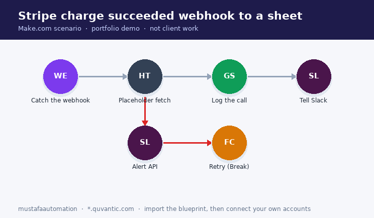

# Stripe charge succeeded webhook to a sheet

Portfolio demo by Mustafa ([mustafaautomation](https://github.com/mustafaautomation)). Not client work. Connect your own accounts after import. Live walkthroughs, when published, sit on a subdomain of quvantic.com.

**Category:** Finance  
**Difficulty:** beginner  
**Apps:** Webhooks, Google Sheets, Slack  
**Test status:** documented blueprint, structurally validated

## Problem

The reconciliation scenario pulls history on a schedule. This one is the live charge. It logs amount and customer email, and pings Slack when the amount is at least 1000 in the smallest currency unit Stripe sent, which you should treat as cents until you confirm.

## Who it's for

Finance operators who want a live line for big charges and a sheet for all of them.

## Module-by-module walkthrough

Ids match the blueprint. A router runs every route whose filter passes. An error handler runs only when that module throws.

### 1. Catch the webhook

`gateway:CustomWebHook` · Custom webhook · Webhooks

Stripe posts the charge. Use a flattened payload or map amount from data.object.amount after the first real event.

No mapped fields. Configure the module after import, or it only passes the bundle through.

### 2. Placeholder fetch

`http:ActionSendData` · Make a request · HTTP

Replace with a Stripe retrieve call if you need the full charge. The webhook already has the fields this demo uses.

- `url`: `"https://example.com"`
- `serializeUrl`: `false`
- `method`: `"get"`
- `headers`: `[{"name": "Accept", "value": "application/json"}]`
- `qs`: `[]`
- `bodyType`: `"raw"`
- `parseResponse`: `true`
- `contentType`: `"application/json"`
- `data`: `""`
- `timeout`: `""`
- `shareCookies`: `false`
- `ca`: `""`
- `rejectUnauthorized`: `true`
- `followRedirect`: `true`
- `useQuerystring`: `false`
- `gzip`: `true`
- `useMtls`: `false`
- `followAllRedirects`: `false`

### 3. Alert API — error handler

`slack:CreateMessage` · Send a message · Slack

API call failed.

- `channelWType`: `"list"`
- `channelType`: `"public"`
- `channel`: `""`
- `text`: `"API call failed."`
- `mrkdwn`: `true`
- `parse`: `false`

### 4. Retry (Break) — error handler

`builtin:Break` · Retry (Break) · Flow control

The API call failed.

- `retry`: `true`
- `count`: `3`
- `interval`: `15`

### 5. Log the call

`google-sheets:addRow` · Add a row · Google Sheets

A row even when the later Slack filter blocks.

- `from`: `"drive"`
- `mode`: `"select"`
- `spreadsheetId`: `""`
- `sheetId`: `""`
- `includesHeaders`: `true`
- `insertDataOption`: `"INSERT_ROWS"`
- `valueInputOption`: `"USER_ENTERED"`
- `values`: `{"0": "{{now}}", "1": "{{1.id}}", "2": "{{1.amount}}", "3": "{{1.currency}}", "4": "{{1.email}}"}`

### 6. Tell Slack

`slack:CreateMessage` · Send a message · Slack

The channel sees the outcome.

Filter **Amount at least 1000**: `[[{"a": "{{1.amount}}", "o": "number:greaterorequal", "b": "1000"}]]`

- `channelWType`: `"list"`
- `channelType`: `"public"`
- `channel`: `""`
- `text`: `"*Charge* {{1.id}} {{1.amount}} {{1.currency}} {{1.email}}"`
- `mrkdwn`: `true`
- `parse`: `false`

## Diagram



```mermaid
flowchart LR
  hook(("1 · Catch the webhook"))
  call(("2 · Placeholder fetch"))
  hook --> call
  call -->|"error"| call_alert
  call_alert(("3 · Alert API"))
  call_directive(("4 · Retry (Break)"))
  call_alert --> call_directive
  log(("5 · Log the call"))
  call --> log
  ping(("6 · Tell Slack"))
  log --> ping
```

## Setup

1. In Make, create a scenario, open the three-dot menu at the bottom of the editor, and choose **Import Blueprint**. Select `blueprint.json`.
2. Open every red module and pick or create the connection. Red means the account is not selected yet.
3. Schedule: Immediately. Stripe webhook event charge.succeeded, flattened.
4. Create the spreadsheet tab this scenario expects, with a header row in row 1:
   - A received_at
   - B charge
   - C amount
   - D currency
   - E email
5. Select that spreadsheet and sheet on every Google Sheets module. The ids are blank in the file.
6. Run once with the bundled `sample-input.json`. Fictional payload. Paste it into the first module when you run the scenario once.
7. Check the output bundle of each module before you turn the schedule on.

## Connections

- **Slack** — create a connection and select it on every Slack module. The blueprint leaves `__IMTCONN__` unset on purpose.
- **Google Sheets** — create a connection and select it on every Google Sheets module. The blueprint leaves `__IMTCONN__` unset on purpose.

Nothing in the file is a live connection id, webhook URL, or API key. Make rejects another team's connection id at import, so the slots are empty on purpose.

## Data mapping

References use the module id: `{{1.subject}}` is the `subject` field of module 1. Sheets columns are zero-based and backticked (`{{1.`0`}}` is column A) so a renamed header does not break the map.

- The HTTP module uses parseResponse. Map the id from the output bundle you see on the first run if the path differs.

## Error handling

Scenario settings: `maxErrors` 3, `dlq` true, `sequential` false, `autoCommit` true. After this many consecutive failed runs Make deactivates a scheduled scenario.

- Module 2 (Placeholder fetch) handles errors with `builtin:Break`. The API call failed.
- Module 6 runs only when filter **Amount at least 1000** passes. A blocked bundle stops on that path. It is not an error.

## Customization

- Replace every YOUR_* token before the first live call. Do not commit the filled-in blueprint.
- Duplicate the scenario before you change the prompt, so you can diff against this demo later.

## Time saved

The big charge is visible without opening Stripe.

## Files

| File | What it is |
| --- | --- |
| `blueprint.json` | Import this into Make. |
| `sample-input.json` | Fictional bundle for the first run. |
| `diagram.png` | Flow diagram. |
| `diagram.mmd` | Mermaid source for the same flow. |
