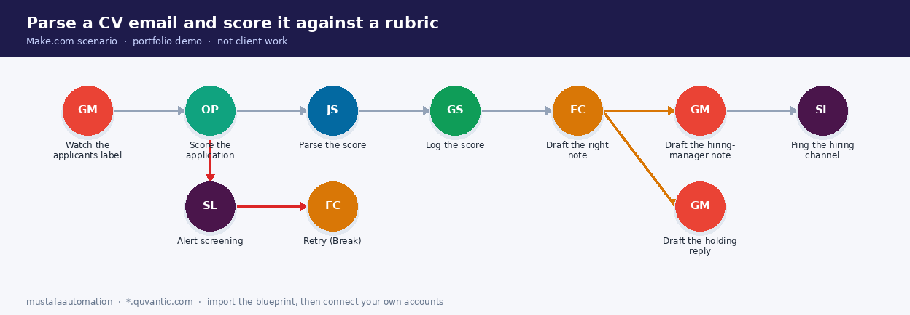
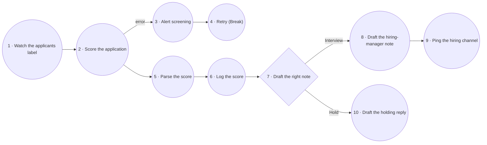

# Parse a CV email and score it against a rubric

Portfolio demo by Mustafa ([mustafaautomation](https://github.com/mustafaautomation)). Not client work. Connect your own accounts after import. Live walkthroughs, when published, sit on a subdomain of quvantic.com.

**Category:** HR and recruiting  
**Difficulty:** advanced  
**Apps:** Gmail, OpenAI, Google Sheets, Slack  
**Test status:** documented blueprint, structurally validated

## Problem

Applications arrive as email with the CV pasted or described in the body. Someone scores them in their head. This demo extracts a structured score, logs it, and drafts either an interview note or a polite holding reply. Drafts only. The scenario never sends mail to a candidate.

## Who it's for

Hiring managers and recruiting coordinators who still receive applications in a Gmail label.

## Module-by-module walkthrough

Ids match the blueprint. A router runs every route whose filter passes. An error handler runs only when that module throws.

### 1. Watch the applicants label

`google-email:TriggerWatchEmails` · Watch emails · Gmail

Query label:applicants. Five at a time.

- `q`: `"label:applicants newer_than:21d"`
- `maxResults`: `5`

### 2. Score the application

`openai-gpt-3:CreateCompletion` · Create a completion · OpenAI

The rubric is explicit. Missing years means score under 50.

- `select`: `"chat"`
- `model`: `"gpt-4o-mini"`
- `max_tokens`: `"400"`
- `temperature`: `"0.2"`
- `messages`: `[{"role": "system", "content": "You screen applications for an operations generalist. Return JSON only: years (number or 0), location (string), score (0-100), gaps (one sentence), recommendation (interview or hold). I...`

### 3. Alert screening — error handler

`slack:CreateMessage` · Send a message · Slack

CV scoring failed for {{mail.subject}}.

- `channelWType`: `"list"`
- `channelType`: `"public"`
- `channel`: `""`
- `text`: `"CV scoring failed for {{1.subject}}."`
- `mrkdwn`: `true`
- `parse`: `false`

### 4. Retry (Break) — error handler

`builtin:Break` · Retry (Break) · Flow control

Scoring failed. Do not draft a rejection on a failure.

- `retry`: `true`
- `count`: `3`
- `interval`: `15`

### 5. Parse the score

`json:ParseJSON` · Parse JSON · JSON

Exposes years, location, score, gaps, and recommendation.

- `json`: `"{{2.result}}"`

### 6. Log the score

`google-sheets:addRow` · Add a row · Google Sheets

Every application is logged before any draft.

- `from`: `"drive"`
- `mode`: `"select"`
- `spreadsheetId`: `""`
- `sheetId`: `""`
- `includesHeaders`: `true`
- `insertDataOption`: `"INSERT_ROWS"`
- `valueInputOption`: `"USER_ENTERED"`
- `values`: `{"0": "{{now}}", "1": "{{1.from}}", "2": "{{5.years}}", "3": "{{5.location}}", "4": "{{5.score}}", "5": "{{5.gaps}}", "6": "{{5.recommendation}}"}`

### 7. Draft the right note

`builtin:BasicRouter` · Router · Flow control

Interview drafts go to the hiring manager. Hold drafts go to the candidate and stay unsent.

### 8. Draft the hiring-manager note — route **Interview**

`google-email:ActionCreateDraft` · Create a draft · Gmail

Sent to hiring-manager@example.com, which you replace. The candidate is not on this email.

Filter **Score at least 75**: `[[{"a": "{{5.score}}", "o": "number:greaterorequal", "b": "75"}]]`

- `from`: `""`
- `to`: `["hiring-manager@example.com"]`
- `cc`: `[]`
- `bcc`: `[]`
- `replyTo`: `""`
- `subject`: `"Screen: {{1.subject}}"`
- `html`: `"
{{1.from}} scored {{5.score}}. {{5.gaps}}

Location: {{5.location}}. Years: {{5.years}}.
"`
- `attachments`: `[]`

### 9. Ping the hiring channel — route **Interview**

`slack:CreateMessage` · Send a message · Slack

So the draft is not the only signal.

- `channelWType`: `"list"`
- `channelType`: `"public"`
- `channel`: `""`
- `text`: `"*Interview draft ready* {{1.from}} — {{5.score}}. {{5.gaps}}"`
- `mrkdwn`: `true`
- `parse`: `false`

### 10. Draft the holding reply — route **Hold**

`google-email:ActionCreateDraft` · Create a draft · Gmail

A short, neutral note. No critique of the candidate in the draft they might later receive.

Filter **Under 75**: `[[{"a": "{{5.score}}", "o": "number:less", "b": "75"}]]`

- `from`: `""`
- `to`: `["{{1.from}}"]`
- `cc`: `[]`
- `bcc`: `[]`
- `replyTo`: `""`
- `subject`: `"Re: {{1.subject}}"`
- `html`: `"
Thank you for the application. We have it, and we will write back if we move forward.
"`
- `attachments`: `[]`

## Diagram

## Setup

1. In Make, create a scenario, open the three-dot menu at the bottom of the editor, and choose **Import Blueprint**. Select `blueprint.json`.
2. Open every red module and pick or create the connection. Red means the account is not selected yet.
3. Schedule: Every 30 minutes.
4. Create the spreadsheet tab this scenario expects, with a header row in row 1:
   - A received_at
   - B email
   - C years
   - D location
   - E score
   - F gaps
   - G recommendation — interview or hold
5. Select that spreadsheet and sheet on every Google Sheets module. The ids are blank in the file.
6. Run once with the bundled `sample-input.json`. Fictional payload. Paste it into the first module when you run the scenario once.
7. Check the output bundle of each module before you turn the schedule on.

## Connections

- **Gmail** — create a connection and select it on every Gmail module. The blueprint leaves `__IMTCONN__` unset on purpose.
- **OpenAI** — create a connection and select it on every OpenAI module. The blueprint leaves `__IMTCONN__` unset on purpose.
- **Slack** — create a connection and select it on every Slack module. The blueprint leaves `__IMTCONN__` unset on purpose.
- **Google Sheets** — create a connection and select it on every Google Sheets module. The blueprint leaves `__IMTCONN__` unset on purpose.

Nothing in the file is a live connection id, webhook URL, or API key. Make rejects another team's connection id at import, so the slots are empty on purpose.

## Data mapping

References use the module id: `{{1.subject}}` is the `subject` field of module 1. Sheets columns are zero-based and backticked (`{{1.`0`}}` is column A) so a renamed header does not break the map.

- The model returns JSON: years, location, score (0-100), gaps, recommendation (interview or hold). The rubric in the prompt is the whole policy.
- 75 and above drafts an interview note to the hiring manager, not to the candidate. Below 75 drafts a holding reply to the candidate. Neither module sends.

## Error handling

Scenario settings: `maxErrors` 3, `dlq` true, `sequential` false, `autoCommit` true. After this many consecutive failed runs Make deactivates a scheduled scenario.

- Module 2 (Score the application) handles errors with `builtin:Break`. Scoring failed. Do not draft a rejection on a failure.
- Router 7 (Draft the right note) Interview drafts go to the hiring manager. Hold drafts go to the candidate and stay unsent.
  - **Interview.** Draft a note to the hiring manager. Filter: **Score at least 75**.
  - **Hold.** Draft a holding reply. Do not send it. Filter: **Under 75**.
- Module 8 runs only when filter **Score at least 75** passes. A blocked bundle stops on that path. It is not an error.
- Module 10 runs only when filter **Under 75** passes. A blocked bundle stops on that path. It is not an error.

## Customization

- Replace the rubric. The demo looks for vendor coordination and spreadsheet work. Your role is different.
- Do not flip the candidate-facing module to Send until a person has read a week of drafts.
- Attachments are not parsed. If the CV is only a PDF, add a Drive or HTTP download in front of the prompt and map the extracted text.
- Duplicate the scenario before you change the prompt, so you can diff against this demo later.

## Time saved

About 8 minutes per application of reading and writing the first response. The score sheet is a side effect.

## Files

| File | What it is |
| --- | --- |
| `blueprint.json` | Import this into Make. |
| `sample-input.json` | Fictional bundle for the first run. |
| `diagram.png` | Flow diagram. |
| `diagram.mmd` | Mermaid source for the same flow. |
