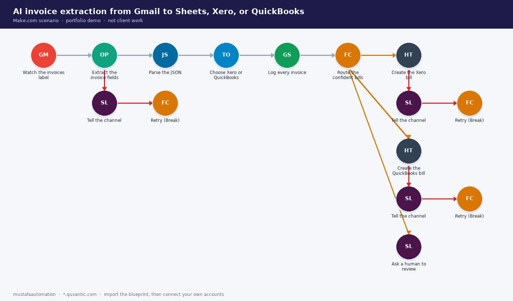
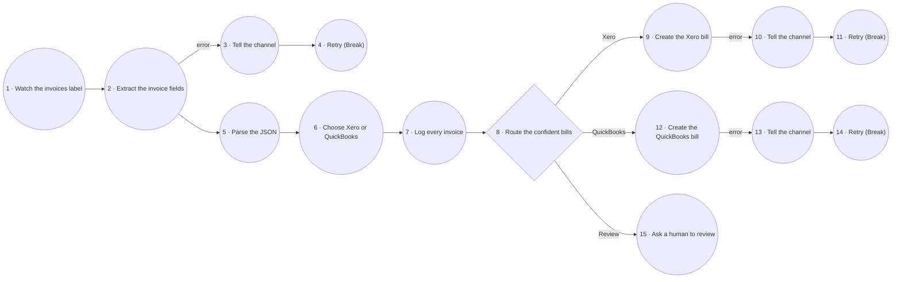

# AI invoice extraction from Gmail to Sheets, Xero, or QuickBooks

Portfolio demo by Mustafa ([mustafaautomation](https://github.com/mustafaautomation)). Not client work. Connect your own accounts after import. Live walkthroughs, when published, sit on a subdomain of quvantic.com.

**Category:** Invoices and documents  
**Difficulty:** intermediate  
**Apps:** Gmail, OpenAI, Google Sheets, Xero, QuickBooks, Slack  
**Test status:** documented blueprint, structurally validated

## Problem

A bookkeeper still opens every supplier email, retypes the vendor, number, total, and due date, then creates the bill in the accounting tool. The mistakes show up at month end, when the sheet and the ledger disagree. This demo watches a Gmail label, asks OpenAI for those fields as JSON, logs every attempt, and only calls the accounting API when confidence is at least 0.8.

## Who it's for

Freelance bookkeepers and finance operators who already live in Gmail plus Xero or QuickBooks. It is a portfolio demo, so the companies in the sample (Harbor Goods, Northwind Studio) are fictional.

## Module-by-module walkthrough

Ids match the blueprint. A router runs every route whose filter passes. An error handler runs only when that module throws.

### 1. Watch the invoices label

`google-email:TriggerWatchEmails` · Watch emails · Gmail

Polls Gmail for mail that already landed in the invoices label. Limit 5 so a backlog cannot drain the operation quota in one run.

- `q`: `"label:invoices newer_than:14d"`
- `maxResults`: `5`

### 2. Extract the invoice fields

`openai-gpt-3:CreateCompletion` · Create a completion · OpenAI

Asks for a single JSON object. The low temperature is deliberate: this is extraction, not copywriting.

- `select`: `"chat"`
- `model`: `"gpt-4o-mini"`
- `max_tokens`: `"500"`
- `temperature`: `"0.2"`
- `messages`: `[{"role": "system", "content": "You are a careful accounts-payable clerk."}, {"role": "user", "content": "You extract supplier invoices. Return one JSON object and no other text. Keys: vendor (string), invoice_number ...`

### 3. Tell the channel — error handler

`slack:CreateMessage` · Send a message · Slack

Invoice extraction failed for {{mail.subject}}. The run will retry.

- `channelWType`: `"list"`
- `channelType`: `"public"`
- `channel`: `""`
- `text`: `"Invoice extraction failed for {{1.subject}}. The run will retry."`
- `mrkdwn`: `true`
- `parse`: `false`

### 4. Retry (Break) — error handler

`builtin:Break` · Retry (Break) · Flow control

The model call failed. Retry three times, 15 minutes apart, and keep the incomplete execution.

- `retry`: `true`
- `count`: `3`
- `interval`: `15`

### 5. Parse the JSON

`json:ParseJSON` · Parse JSON · JSON

Turns the model text into fields the sheet and the accounting calls can map one by one.

- `json`: `"{{2.result}}"`

### 6. Choose Xero or QuickBooks

`util:SetVariable2` · Set a variable · Tools

One switch for the whole scenario. Leave the value as xero, or set it to quickbooks. Routes read this variable, not a hard-coded module.

- `name`: `"books"`
- `scope`: `"roundtrip"`
- `value`: `"xero"`

### 7. Log every invoice

`google-sheets:addRow` · Add a row · Google Sheets

Writes the row before any accounting call. A failed API call still leaves a paper trail with status `logged`.

- `from`: `"drive"`
- `mode`: `"select"`
- `spreadsheetId`: `""`
- `sheetId`: `""`
- `includesHeaders`: `true`
- `insertDataOption`: `"INSERT_ROWS"`
- `valueInputOption`: `"USER_ENTERED"`
- `values`: `{"0": "{{now}}", "1": "{{1.from}}", "2": "{{5.vendor}}", "3": "{{5.invoice_number}}", "4": "{{5.currency}}", "5": "{{5.total}}", "6": "{{5.due_date}}", "7": "{{5.confidence}}", "8": "logged"}`

### 8. Route the confident bills

`builtin:BasicRouter` · Router · Flow control

Every matching route runs. Confidence and the books variable are AND-ed so a low-confidence bill never becomes a live invoice.

### 9. Create the Xero bill — route **Xero**

`http:ActionSendData` · Make a request · HTTP

POST /Invoices with Type ACCPAY. The tenant header is a placeholder until you paste your own.

Filter **Confident and Xero**: `[[{"a": "{{5.confidence}}", "o": "number:greaterorequal", "b": "0.8"}, {"a": "{{6.books}}", "o": "text:equal", "b": "xero"}]]`

- `url`: `"https://api.xero.com/api.xro/2.0/Invoices"`
- `serializeUrl`: `false`
- `method`: `"post"`
- `headers`: `[{"name": "Accept", "value": "application/json"}, {"name": "Content-Type", "value": "application/json"}, {"name": "Authorization", "value": "Bearer YOUR_API_KEY"}, {"name": "xero-tenant-id", "value": "YOUR_XERO_TENANT...`
- `qs`: `[]`
- `bodyType`: `"raw"`
- `parseResponse`: `true`
- `contentType`: `"application/json"`
- `data`: `"{\"Type\":\"ACCPAY\",\"Contact\":{\"Name\":\"{{5.vendor}}\"},\"InvoiceNumber\":\"{{5.invoice_number}}\",\"DueDate\":\"{{5.due_date}}\",\"CurrencyCode\":\"{{5.currency}}\",\"LineItems\":[{\"Description\":\"Imported fr...`
- `timeout`: `""`
- `shareCookies`: `false`
- `ca`: `""`
- `rejectUnauthorized`: `true`
- `followRedirect`: `true`
- `useQuerystring`: `false`
- `gzip`: `true`
- `useMtls`: `false`
- `followAllRedirects`: `false`

### 10. Tell the channel — error handler

`slack:CreateMessage` · Send a message · Slack

Xero bill failed for {{parsed.invoice_number}} ({{parsed.vendor}}).

- `channelWType`: `"list"`
- `channelType`: `"public"`
- `channel`: `""`
- `text`: `"Xero bill failed for {{5.invoice_number}} ({{5.vendor}})."`
- `mrkdwn`: `true`
- `parse`: `false`

### 11. Retry (Break) — error handler

`builtin:Break` · Retry (Break) · Flow control

Xero returned an error. Retry the bill, and ping Slack so the row is not forgotten.

- `retry`: `true`
- `count`: `3`
- `interval`: `15`

### 12. Create the QuickBooks bill — route **QuickBooks**

`http:ActionSendData` · Make a request · HTTP

POST /bill on the company id you paste in. The body is a single expense line for the extracted total.

Filter **Confident and QuickBooks**: `[[{"a": "{{5.confidence}}", "o": "number:greaterorequal", "b": "0.8"}, {"a": "{{6.books}}", "o": "text:equal", "b": "quickbooks"}]]`

- `url`: `"https://quickbooks.api.intuit.com/v3/company/YOUR_COMPANY_ID/bill"`
- `serializeUrl`: `false`
- `method`: `"post"`
- `headers`: `[{"name": "Accept", "value": "application/json"}, {"name": "Content-Type", "value": "application/json"}, {"name": "Authorization", "value": "Bearer YOUR_API_KEY"}]`
- `qs`: `[]`
- `bodyType`: `"raw"`
- `parseResponse`: `true`
- `contentType`: `"application/json"`
- `data`: `"{\"VendorRef\":{\"name\":\"{{5.vendor}}\"},\"DocNumber\":\"{{5.invoice_number}}\",\"CurrencyRef\":{\"value\":\"{{5.currency}}\"},\"Line\":[{\"DetailType\":\"AccountBasedExpenseLineDetail\",\"Amount\":\"{{5.total}}\",...`
- `timeout`: `""`
- `shareCookies`: `false`
- `ca`: `""`
- `rejectUnauthorized`: `true`
- `followRedirect`: `true`
- `useQuerystring`: `false`
- `gzip`: `true`
- `useMtls`: `false`
- `followAllRedirects`: `false`

### 13. Tell the channel — error handler

`slack:CreateMessage` · Send a message · Slack

QuickBooks bill failed for {{parsed.invoice_number}}.

- `channelWType`: `"list"`
- `channelType`: `"public"`
- `channel`: `""`
- `text`: `"QuickBooks bill failed for {{5.invoice_number}}."`
- `mrkdwn`: `true`
- `parse`: `false`

### 14. Retry (Break) — error handler

`builtin:Break` · Retry (Break) · Flow control

QuickBooks rejected the bill. Retry and alert.

- `retry`: `true`
- `count`: `3`
- `interval`: `15`

### 15. Ask a human to review — route **Review**

`slack:CreateMessage` · Send a message · Slack

Posts the extracted fields and the original subject. The sheet row already exists.

Filter **Low confidence**: `[[{"a": "{{5.confidence}}", "o": "number:less", "b": "0.8"}]]`

- `channelWType`: `"list"`
- `channelType`: `"public"`
- `channel`: `""`
- `text`: `"*Invoice needs review* — {{5.vendor}} {{5.invoice_number}} {{5.currency}} {{5.total}} (confidence {{5.confidence}}). Subject: {{1.subject}}"`
- `mrkdwn`: `true`
- `parse`: `false`

## Diagram

## Setup

1. In Make, create a scenario, open the three-dot menu at the bottom of the editor, and choose **Import Blueprint**. Select `blueprint.json`.
2. Open every red module and pick or create the connection. Red means the account is not selected yet.
3. Schedule: Every 15 minutes. Gmail's watch module is polling, so the schedule is what wakes the scenario.
4. Create the spreadsheet tab this scenario expects, with a header row in row 1:
   - A received_at — {{now}}
   - B from — sender
   - C vendor
   - D invoice_number
   - E currency
   - F total
   - G due_date
   - H confidence
   - I status — logged, xero, quickbooks, or review
5. Select that spreadsheet and sheet on every Google Sheets module. The ids are blank in the file.
6. Run once with the bundled `sample-input.json`. Fictional payload. Paste it into the first module when you run the scenario once.
7. Check the output bundle of each module before you turn the schedule on.

## Connections

- **Gmail** — create a connection and select it on every Gmail module. The blueprint leaves `__IMTCONN__` unset on purpose.
- **OpenAI** — create a connection and select it on every OpenAI module. The blueprint leaves `__IMTCONN__` unset on purpose.
- **Slack** — create a connection and select it on every Slack module. The blueprint leaves `__IMTCONN__` unset on purpose.
- **Google Sheets** — create a connection and select it on every Google Sheets module. The blueprint leaves `__IMTCONN__` unset on purpose.

Replace these placeholders in the HTTP modules before the first live run:
- `YOUR_API_KEY`
- `YOUR_COMPANY_ID`
- `YOUR_XERO_TENANT_ID`

Nothing in the file is a live connection id, webhook URL, or API key. Make rejects another team's connection id at import, so the slots are empty on purpose.

## Data mapping

References use the module id: `{{1.subject}}` is the `subject` field of module 1. Sheets columns are zero-based and backticked (`{{1.`0`}}` is column A) so a renamed header does not break the map.

- The model must return raw JSON. Module 3 parses `{{2.result}}` into vendor, invoice_number, currency, total, due_date, and confidence.
- Column letters in the sheet are positional. Column A is values["0"]. Do not switch the mapper to header names or a renamed header silently shifts every cell.
- Change the Set variable module from `xero` to `quickbooks` to send the bill to QuickBooks instead. Both HTTP modules stay in the blueprint so you can see the payload.

## Error handling

Scenario settings: `maxErrors` 3, `dlq` true, `sequential` false, `autoCommit` true. After this many consecutive failed runs Make deactivates a scheduled scenario.

- Module 2 (Extract the invoice fields) handles errors with `builtin:Break`. The model call failed. Retry three times, 15 minutes apart, and keep the incomplete execution.
- Router 8 (Route the confident bills) Every matching route runs. Confidence and the books variable are AND-ed so a low-confidence bill never becomes a live invoice.
  - **Xero.** Create an accounts-payable invoice in Xero. Filter: **Confident and Xero**.
  - **QuickBooks.** Create a bill in QuickBooks Online. Filter: **Confident and QuickBooks**.
  - **Review.** A person should read this one before it becomes a bill. Filter: **Low confidence**.
- Module 9 (Create the Xero bill) handles errors with `builtin:Break`. Xero returned an error. Retry the bill, and ping Slack so the row is not forgotten.
- Module 9 runs only when filter **Confident and Xero** passes. A blocked bundle stops on that path. It is not an error.
- Module 12 (Create the QuickBooks bill) handles errors with `builtin:Break`. QuickBooks rejected the bill. Retry and alert.
- Module 12 runs only when filter **Confident and QuickBooks** passes. A blocked bundle stops on that path. It is not an error.
- Module 15 runs only when filter **Low confidence** passes. A blocked bundle stops on that path. It is not an error.

## Customization

- Point the Gmail search at your label, for example `label:invoices newer_than:14d`.
- Xero needs the tenant id header and a bill payload that matches your chart of accounts. The demo uses one line for the total.
- QuickBooks company id sits in the URL path. Replace YOUR_COMPANY_ID.
- Raise the 0.8 cutoff if the model is guessing vendor names on forwarded threads.
- Swap any `YOUR_*` value for the id from your own account. Do not commit the filled-in file.
- Duplicate the scenario before you change the prompt, so you can diff against this demo later.

## Time saved

About 4 to 6 minutes per invoice. At 80 invoices a month that is roughly 6 to 8 hours of retyping.

## Files

| File | What it is |
| --- | --- |
| `blueprint.json` | Import this into Make. |
| `sample-input.json` | Fictional bundle for the first run. |
| `diagram.png` | Flow diagram. |
| `diagram.mmd` | Mermaid source for the same flow. |
