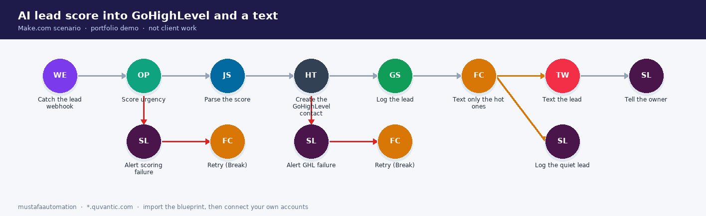
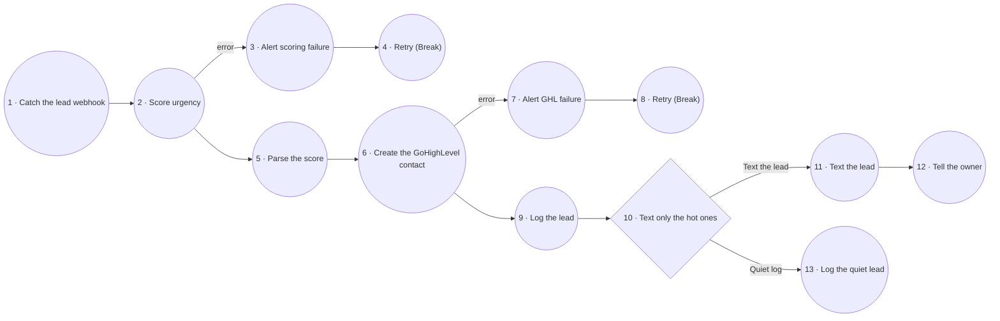

# AI lead score into GoHighLevel and a text

Portfolio demo by Mustafa ([mustafaautomation](https://github.com/mustafaautomation)). Not client work. Connect your own accounts after import. Live walkthroughs, when published, sit on a subdomain of quvantic.com.

**Category:** Lead gen and CRM  
**Difficulty:** intermediate  
**Apps:** Webhooks, OpenAI, GoHighLevel, Twilio, Slack, Google Sheets  
**Test status:** documented blueprint, structurally validated

## Problem

Agencies running GoHighLevel still paste Facebook and website leads in by hand, then forget the text. This demo scores the message, creates the contact through the LeadConnector API, and sends one SMS only when the score is high enough to deserve a same-hour reply.

## Who it's for

Automation freelancers building speed-to-lead for agencies that live in GoHighLevel rather than HubSpot.

## Module-by-module walkthrough

Ids match the blueprint. A router runs every route whose filter passes. An error handler runs only when that module throws.

### 1. Catch the lead webhook

`gateway:CustomWebHook` · Custom webhook · Webhooks

A form, a funnel, or a Make-friendly ads tool posts the lead here.

No mapped fields. Configure the module after import, or it only passes the bundle through.

### 2. Score urgency

`openai-gpt-3:CreateCompletion` · Create a completion · OpenAI

Looks for a same-day ask, a headcount, or a budget. Returns JSON.

- `select`: `"chat"`
- `model`: `"gpt-4o-mini"`
- `max_tokens`: `"250"`
- `temperature`: `"0.2"`
- `messages`: `[{"role": "system", "content": "You score inbound leads for a GoHighLevel agency. Return JSON only: score (0-100), reason (one sentence)."}, {"role": "user", "content": "Lead: {{1.first_name}} {{1.last_name}}, {{1.ema...`

### 3. Alert scoring failure — error handler

`slack:CreateMessage` · Send a message · Slack

GHL lead scoring failed for {{lead.email}}.

- `channelWType`: `"list"`
- `channelType`: `"public"`
- `channel`: `""`
- `text`: `"GHL lead scoring failed for {{1.email}}."`
- `mrkdwn`: `true`
- `parse`: `false`

### 4. Retry (Break) — error handler

`builtin:Break` · Retry (Break) · Flow control

Scoring failed. Retry so the contact is not created blind.

- `retry`: `true`
- `count`: `3`
- `interval`: `15`

### 5. Parse the score

`json:ParseJSON` · Parse JSON · JSON

Exposes score and reason.

- `json`: `"{{2.result}}"`

### 6. Create the GoHighLevel contact

`http:ActionSendData` · Make a request · HTTP

Creates the contact even when the score is modest. The text is the part that stays gated.

- `url`: `"https://services.leadconnectorhq.com/contacts/"`
- `serializeUrl`: `false`
- `method`: `"post"`
- `headers`: `[{"name": "Accept", "value": "application/json"}, {"name": "Content-Type", "value": "application/json"}, {"name": "Authorization", "value": "Bearer YOUR_API_KEY"}, {"name": "Version", "value": "2021-07-28"}]`
- `qs`: `[]`
- `bodyType`: `"raw"`
- `parseResponse`: `true`
- `contentType`: `"application/json"`
- `data`: `"{\"firstName\":\"{{1.first_name}}\",\"lastName\":\"{{1.last_name}}\",\"email\":\"{{1.email}}\",\"phone\":\"{{1.phone}}\",\"source\":\"{{1.source}}\",\"locationId\":\"YOUR_GHL_LOCATION_ID\",\"tags\":[\"portfolio-demo\...`
- `timeout`: `""`
- `shareCookies`: `false`
- `ca`: `""`
- `rejectUnauthorized`: `true`
- `followRedirect`: `true`
- `useQuerystring`: `false`
- `gzip`: `true`
- `useMtls`: `false`
- `followAllRedirects`: `false`

### 7. Alert GHL failure — error handler

`slack:CreateMessage` · Send a message · Slack

GoHighLevel contact failed for {{lead.email}}.

- `channelWType`: `"list"`
- `channelType`: `"public"`
- `channel`: `""`
- `text`: `"GoHighLevel contact failed for {{1.email}}."`
- `mrkdwn`: `true`
- `parse`: `false`

### 8. Retry (Break) — error handler

`builtin:Break` · Retry (Break) · Flow control

GoHighLevel rejected the contact. Retry before texting anyone.

- `retry`: `true`
- `count`: `3`
- `interval`: `15`

### 9. Log the lead

`google-sheets:addRow` · Add a row · Google Sheets

Keeps a copy outside the CRM so a failed text is still visible.

- `from`: `"drive"`
- `mode`: `"select"`
- `spreadsheetId`: `""`
- `sheetId`: `""`
- `includesHeaders`: `true`
- `insertDataOption`: `"INSERT_ROWS"`
- `valueInputOption`: `"USER_ENTERED"`
- `values`: `{"0": "{{now}}", "1": "{{1.email}}", "2": "{{1.phone}}", "3": "{{5.score}}", "4": "{{5.reason}}", "5": "{{6.data.contact.id}}"}`

### 10. Text only the hot ones

`builtin:BasicRouter` · Router · Flow control

A single filtered route. Leads under 75 stay in the CRM and the sheet, with no SMS.

### 11. Text the lead — route **Text the lead**

`twilio:SendSMS` · Send an SMS · Twilio

Uses the Twilio number you set in YOUR_TWILIO_NUMBER. The body does not pretend a human already read the form.

Filter **Score at least 75**: `[[{"a": "{{5.score}}", "o": "number:greaterorequal", "b": "75"}]]`

- `to`: `"{{1.phone}}"`
- `from`: `"YOUR_TWILIO_NUMBER"`
- `message`: `"Hi {{1.first_name}}, this is Northwind. We got your note and will call within the hour."`

### 12. Tell the owner — route **Text the lead**

`slack:CreateMessage` · Send a message · Slack

The channel sees the score so the call is not a cold open.

- `channelWType`: `"list"`
- `channelType`: `"public"`
- `channel`: `""`
- `text`: `"*Call now* {{1.first_name}} {{1.phone}} — {{5.score}}. {{5.reason}}"`
- `mrkdwn`: `true`
- `parse`: `false`

### 13. Log the quiet lead — route **Quiet log**

`slack:CreateMessage` · Send a message · Slack

So the channel can see that the contact exists and nobody was texted.

Filter **Below 75**: `[[{"a": "{{5.score}}", "o": "number:less", "b": "75"}]]`

- `channelWType`: `"list"`
- `channelType`: `"public"`
- `channel`: `""`
- `text`: `"Logged {{1.email}} in GoHighLevel at {{5.score}}. No text sent."`
- `mrkdwn`: `true`
- `parse`: `false`

## Diagram

## Setup

1. In Make, create a scenario, open the three-dot menu at the bottom of the editor, and choose **Import Blueprint**. Select `blueprint.json`.
2. Open every red module and pick or create the connection. Red means the account is not selected yet.
3. Schedule: Immediately, from the webhook.
4. Create the spreadsheet tab this scenario expects, with a header row in row 1:
   - A received_at
   - B email
   - C phone
   - D score
   - E reason
   - F ghl_contact_id
5. Select that spreadsheet and sheet on every Google Sheets module. The ids are blank in the file.
6. Run once with the bundled `sample-input.json`. Fictional payload. Paste it into the first module when you run the scenario once.
7. Check the output bundle of each module before you turn the schedule on.

## Connections

- **OpenAI** — create a connection and select it on every OpenAI module. The blueprint leaves `__IMTCONN__` unset on purpose.
- **Slack** — create a connection and select it on every Slack module. The blueprint leaves `__IMTCONN__` unset on purpose.
- **Google Sheets** — create a connection and select it on every Google Sheets module. The blueprint leaves `__IMTCONN__` unset on purpose.
- **Twilio** — create a connection and select it on every Twilio module. The blueprint leaves `__IMTCONN__` unset on purpose.

Replace these placeholders in the HTTP modules before the first live run:
- `YOUR_API_KEY`
- `YOUR_GHL_LOCATION_ID`
- `YOUR_TWILIO_NUMBER`

Nothing in the file is a live connection id, webhook URL, or API key. Make rejects another team's connection id at import, so the slots are empty on purpose.

## Data mapping

References use the module id: `{{1.subject}}` is the `subject` field of module 1. Sheets columns are zero-based and backticked (`{{1.`0`}}` is column A) so a renamed header does not break the map.

- GoHighLevel's public contacts endpoint is POST https://services.leadconnectorhq.com/contacts/. The Version header in this blueprint is 2021-07-28.
- The contact id comes back on the HTTP module. The sheet maps `{{ghl.data.contact.id}}`. If your first run shows the id one level up, point the cell at that path instead.
- The native HighLevel module in Make can replace the HTTP step after you confirm its module id in your account. This file uses HTTP because that module id was not in the public blueprint corpus this library trusts.

## Error handling

Scenario settings: `maxErrors` 3, `dlq` true, `sequential` false, `autoCommit` true. After this many consecutive failed runs Make deactivates a scheduled scenario.

- Module 2 (Score urgency) handles errors with `builtin:Break`. Scoring failed. Retry so the contact is not created blind.
- Module 6 (Create the GoHighLevel contact) handles errors with `builtin:Break`. GoHighLevel rejected the contact. Retry before texting anyone.
- Router 10 (Text only the hot ones) A single filtered route. Leads under 75 stay in the CRM and the sheet, with no SMS.
  - **Text the lead.** One SMS, then a Slack note to the owner. Filter: **Score at least 75**.
  - **Quiet log.** Acknowledge in Slack without texting. Filter: **Below 75**.
- Module 11 runs only when filter **Score at least 75** passes. A blocked bundle stops on that path. It is not an error.
- Module 13 runs only when filter **Below 75** passes. A blocked bundle stops on that path. It is not an error.

## Customization

- Put the location id your agency uses into the body. The demo leaves locationId as YOUR_GHL_LOCATION_ID.
- Rewrite the SMS. It is one sentence on purpose.
- Drop the Twilio route if the client only wanted the CRM write.
- Swap any `YOUR_*` value for the id from your own account. Do not commit the filled-in file.
- Duplicate the scenario before you change the prompt, so you can diff against this demo later.

## Time saved

The manual create-and-text loop is about 4 minutes a lead. Ten leads a day is most of an hour.

## Files

| File | What it is |
| --- | --- |
| `blueprint.json` | Import this into Make. |
| `sample-input.json` | Fictional bundle for the first run. |
| `diagram.png` | Flow diagram. |
| `diagram.mmd` | Mermaid source for the same flow. |
