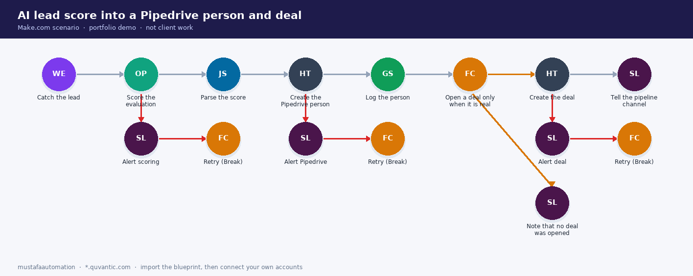
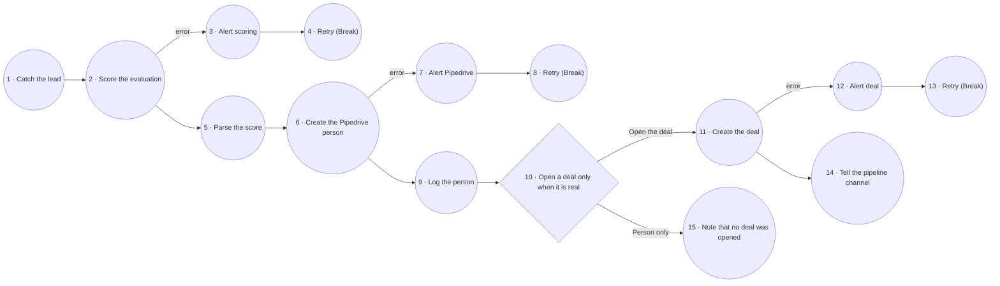

# AI lead score into a Pipedrive person and deal

Portfolio demo by Mustafa ([mustafaautomation](https://github.com/mustafaautomation)). Not client work. Connect your own accounts after import. Live walkthroughs, when published, sit on a subdomain of quvantic.com.

**Category:** Lead gen and CRM  
**Difficulty:** intermediate  
**Apps:** Webhooks, OpenAI, Pipedrive, Slack, Google Sheets  
**Test status:** documented blueprint, structurally validated

## Problem

Pipedrive pipelines fill up with people who asked for a PDF. This demo writes every person, and opens a deal only when the note looks like a real evaluation. The deal value stays blank for a human to set.

## Who it's for

Small sales teams on Pipedrive who want the CRM write without a pile of empty deals.

## Module-by-module walkthrough

Ids match the blueprint. A router runs every route whose filter passes. An error handler runs only when that module throws.

### 1. Catch the lead

`gateway:CustomWebHook` · Custom webhook · Webhooks

Site form or a landing tool posts name, email, org, and message.

No mapped fields. Configure the module after import, or it only passes the bundle through.

### 2. Score the evaluation

`openai-gpt-3:CreateCompletion` · Create a completion · OpenAI

A named decision date or an approved budget should land above 65.

- `select`: `"chat"`
- `model`: `"gpt-4o-mini"`
- `max_tokens`: `"250"`
- `temperature`: `"0.2"`
- `messages`: `[{"role": "system", "content": "You qualify leads for a Pipedrive pipeline. Return JSON only: score (0-100), title (a six-word deal title), reason."}, {"role": "user", "content": "{{1.name}} <{{1.email}}> at {{1.org}}...`

### 3. Alert scoring — error handler

`slack:CreateMessage` · Send a message · Slack

Pipedrive scoring failed for {{lead.email}}.

- `channelWType`: `"list"`
- `channelType`: `"public"`
- `channel`: `""`
- `text`: `"Pipedrive scoring failed for {{1.email}}."`
- `mrkdwn`: `true`
- `parse`: `false`

### 4. Retry (Break) — error handler

`builtin:Break` · Retry (Break) · Flow control

Scoring failed. Do not create a person without a score.

- `retry`: `true`
- `count`: `3`
- `interval`: `15`

### 5. Parse the score

`json:ParseJSON` · Parse JSON · JSON

Exposes score, title, and reason.

- `json`: `"{{2.result}}"`

### 6. Create the Pipedrive person

`http:ActionSendData` · Make a request · HTTP

Every lead becomes a person. The deal is the optional part.

- `url`: `"https://api.pipedrive.com/v1/persons"`
- `serializeUrl`: `false`
- `method`: `"post"`
- `headers`: `[{"name": "Accept", "value": "application/json"}, {"name": "Content-Type", "value": "application/json"}]`
- `qs`: `[{"name": "api_token", "value": "YOUR_API_KEY"}]`
- `bodyType`: `"raw"`
- `parseResponse`: `true`
- `contentType`: `"application/json"`
- `data`: `"{\"name\":\"{{1.name}}\",\"email\":[\"{{1.email}}\"],\"org_name\":\"{{1.org}}\"}"`
- `timeout`: `""`
- `shareCookies`: `false`
- `ca`: `""`
- `rejectUnauthorized`: `true`
- `followRedirect`: `true`
- `useQuerystring`: `false`
- `gzip`: `true`
- `useMtls`: `false`
- `followAllRedirects`: `false`

### 7. Alert Pipedrive — error handler

`slack:CreateMessage` · Send a message · Slack

Person create failed for {{lead.email}}.

- `channelWType`: `"list"`
- `channelType`: `"public"`
- `channel`: `""`
- `text`: `"Person create failed for {{1.email}}."`
- `mrkdwn`: `true`
- `parse`: `false`

### 8. Retry (Break) — error handler

`builtin:Break` · Retry (Break) · Flow control

Pipedrive did not create the person.

- `retry`: `true`
- `count`: `3`
- `interval`: `15`

### 9. Log the person

`google-sheets:addRow` · Add a row · Google Sheets

Records the person id before the deal route, so a skipped deal is still traceable.

- `from`: `"drive"`
- `mode`: `"select"`
- `spreadsheetId`: `""`
- `sheetId`: `""`
- `includesHeaders`: `true`
- `insertDataOption`: `"INSERT_ROWS"`
- `valueInputOption`: `"USER_ENTERED"`
- `values`: `{"0": "{{now}}", "1": "{{1.email}}", "2": "{{1.org}}", "3": "{{5.score}}", "4": "{{6.data.data.id}}", "5": "person-only"}`

### 10. Open a deal only when it is real

`builtin:BasicRouter` · Router · Flow control

Under 65 the scenario ends after the sheet. The person still exists in Pipedrive.

### 11. Create the deal — route **Open the deal**

`http:ActionSendData` · Make a request · HTTP

Title comes from the model. Value is omitted on purpose.

Filter **Score at least 65**: `[[{"a": "{{5.score}}", "o": "number:greaterorequal", "b": "65"}]]`

- `url`: `"https://api.pipedrive.com/v1/deals"`
- `serializeUrl`: `false`
- `method`: `"post"`
- `headers`: `[{"name": "Accept", "value": "application/json"}, {"name": "Content-Type", "value": "application/json"}]`
- `qs`: `[{"name": "api_token", "value": "YOUR_API_KEY"}]`
- `bodyType`: `"raw"`
- `parseResponse`: `true`
- `contentType`: `"application/json"`
- `data`: `"{\"title\":\"{{5.title}}\",\"person_id\":\"{{6.data.data.id}}\"}"`
- `timeout`: `""`
- `shareCookies`: `false`
- `ca`: `""`
- `rejectUnauthorized`: `true`
- `followRedirect`: `true`
- `useQuerystring`: `false`
- `gzip`: `true`
- `useMtls`: `false`
- `followAllRedirects`: `false`

### 12. Alert deal — error handler

`slack:CreateMessage` · Send a message · Slack

Deal create failed for {{lead.email}}.

- `channelWType`: `"list"`
- `channelType`: `"public"`
- `channel`: `""`
- `text`: `"Deal create failed for {{1.email}}."`
- `mrkdwn`: `true`
- `parse`: `false`

### 13. Retry (Break) — error handler

`builtin:Break` · Retry (Break) · Flow control

The person exists. Retry the deal.

- `retry`: `true`
- `count`: `3`
- `interval`: `15`

### 14. Tell the pipeline channel — route **Open the deal**

`slack:CreateMessage` · Send a message · Slack

Includes the reason so the rep does not open Pipedrive cold.

- `channelWType`: `"list"`
- `channelType`: `"public"`
- `channel`: `""`
- `text`: `"*Deal opened* {{5.title}} for {{1.org}} — {{5.score}}. {{5.reason}}"`
- `mrkdwn`: `true`
- `parse`: `false`

### 15. Note that no deal was opened — route **Person only**

`slack:CreateMessage` · Send a message · Slack

Stops the team from wondering if the webhook failed.

Filter **Under 65**: `[[{"a": "{{5.score}}", "o": "number:less", "b": "65"}]]`

- `channelWType`: `"list"`
- `channelType`: `"public"`
- `channel`: `""`
- `text`: `"Person only for {{1.email}} at {{5.score}}. No deal."`
- `mrkdwn`: `true`
- `parse`: `false`

## Diagram

## Setup

1. In Make, create a scenario, open the three-dot menu at the bottom of the editor, and choose **Import Blueprint**. Select `blueprint.json`.
2. Open every red module and pick or create the connection. Red means the account is not selected yet.
3. Schedule: Immediately, from the webhook.
4. Create the spreadsheet tab this scenario expects, with a header row in row 1:
   - A received_at
   - B email
   - C org
   - D score
   - E person_id
   - F deal_opened
5. Select that spreadsheet and sheet on every Google Sheets module. The ids are blank in the file.
6. Run once with the bundled `sample-input.json`. Fictional payload. Paste it into the first module when you run the scenario once.
7. Check the output bundle of each module before you turn the schedule on.

## Connections

- **OpenAI** — create a connection and select it on every OpenAI module. The blueprint leaves `__IMTCONN__` unset on purpose.
- **Slack** — create a connection and select it on every Slack module. The blueprint leaves `__IMTCONN__` unset on purpose.
- **Google Sheets** — create a connection and select it on every Google Sheets module. The blueprint leaves `__IMTCONN__` unset on purpose.

Replace these placeholders in the HTTP modules before the first live run:
- `YOUR_API_KEY`

Nothing in the file is a live connection id, webhook URL, or API key. Make rejects another team's connection id at import, so the slots are empty on purpose.

## Data mapping

References use the module id: `{{1.subject}}` is the `subject` field of module 1. Sheets columns are zero-based and backticked (`{{1.`0`}}` is column A) so a renamed header does not break the map.

- Pipedrive's REST person call is POST /v1/persons with api_token on the query string. The demo expects the new id at `{{person.data.data.id}}`. Confirm that path on the first run.
- The deal call sends person_id and title only. Add pipeline_id from your account if the default pipeline is not the one you want.

## Error handling

Scenario settings: `maxErrors` 3, `dlq` true, `sequential` false, `autoCommit` true. After this many consecutive failed runs Make deactivates a scheduled scenario.

- Module 2 (Score the evaluation) handles errors with `builtin:Break`. Scoring failed. Do not create a person without a score.
- Module 6 (Create the Pipedrive person) handles errors with `builtin:Break`. Pipedrive did not create the person.
- Router 10 (Open a deal only when it is real) Under 65 the scenario ends after the sheet. The person still exists in Pipedrive.
  - **Open the deal.** Create the deal and tell Slack. Filter: **Score at least 65**.
  - **Person only.** Say so in Slack. Filter: **Under 65**.
- Module 11 (Create the deal) handles errors with `builtin:Break`. The person exists. Retry the deal.
- Module 11 runs only when filter **Score at least 65** passes. A blocked bundle stops on that path. It is not an error.
- Module 15 runs only when filter **Under 65** passes. A blocked bundle stops on that path. It is not an error.

## Customization

- Replace YOUR_API_KEY with a Pipedrive API token that can add persons and deals.
- Change 65 if your team wants fewer deals.
- Map org_id once you also create the organization. This demo puts the company name on the person title only.
- Swap any `YOUR_*` value for the id from your own account. Do not commit the filled-in file.
- Duplicate the scenario before you change the prompt, so you can diff against this demo later.

## Time saved

About 3 minutes per lead of clicking through person, then deal, then a Slack paste.

## Files

| File | What it is |
| --- | --- |
| `blueprint.json` | Import this into Make. |
| `sample-input.json` | Fictional bundle for the first run. |
| `diagram.png` | Flow diagram. |
| `diagram.mmd` | Mermaid source for the same flow. |
