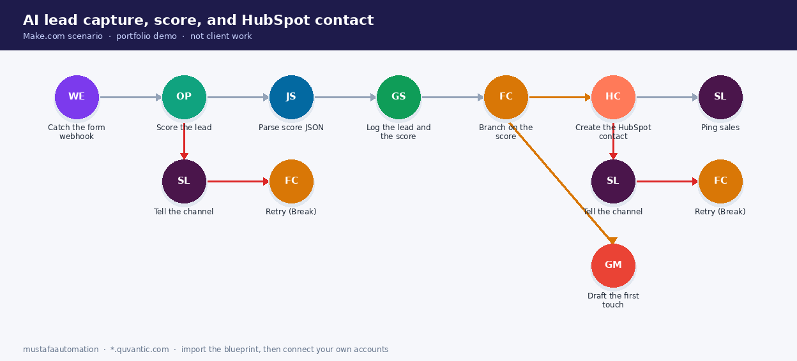
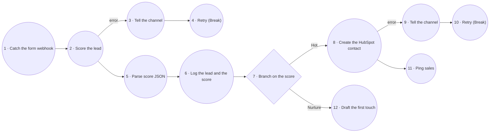

# AI lead capture, score, and HubSpot contact

Portfolio demo by Mustafa ([mustafaautomation](https://github.com/mustafaautomation)). Not client work. Connect your own accounts after import. Live walkthroughs, when published, sit on a subdomain of quvantic.com.

**Category:** Lead gen and CRM  
**Difficulty:** intermediate  
**Apps:** Webhooks, OpenAI, Google Sheets, HubSpot CRM, Slack, Gmail  
**Test status:** documented blueprint, structurally validated

## Problem

Form fills sit in an inbox until someone copies them into HubSpot. Hot leads cool off. This demo takes the webhook, asks the model for a 0–100 score and a one-sentence reason, logs the row, creates the contact only at 70 or above, and leaves a Gmail draft for the 40–69 band so a person still sends the first note.

## Who it's for

Solo SDRs and small B2B teams that capture leads on a site form and sell from HubSpot.

## Module-by-module walkthrough

Ids match the blueprint. A router runs every route whose filter passes. An error handler runs only when that module throws.

### 1. Catch the form webhook

`gateway:CustomWebHook` · Custom webhook · Webhooks

The form, or a tool in front of it, POSTs the lead here. Parameters stay empty so Make creates a new hook after import.

No mapped fields. Configure the module after import, or it only passes the bundle through.

### 2. Score the lead

`openai-gpt-3:CreateCompletion` · Create a completion · OpenAI

Returns JSON with score, band (hot, nurture, low), and reason. The rubric is in the prompt, not buried in a filter.

- `select`: `"chat"`
- `model`: `"gpt-4o-mini"`
- `max_tokens`: `"300"`
- `temperature`: `"0.2"`
- `messages`: `[{"role": "system", "content": "You qualify B2B leads. Return JSON only, with keys score (0-100), band (hot, nurture, or low), and reason (one sentence)."}, {"role": "user", "content": "Score this lead. Hot means they...`

### 3. Tell the channel — error handler

`slack:CreateMessage` · Send a message · Slack

Lead scoring failed for {{lead.email}}.

- `channelWType`: `"list"`
- `channelType`: `"public"`
- `channel`: `""`
- `text`: `"Lead scoring failed for {{1.email}}."`
- `mrkdwn`: `true`
- `parse`: `false`

### 4. Retry (Break) — error handler

`builtin:Break` · Retry (Break) · Flow control

Scoring failed. Retry before the lead goes cold.

- `retry`: `true`
- `count`: `3`
- `interval`: `15`

### 5. Parse score JSON

`json:ParseJSON` · Parse JSON · JSON

Exposes score, band, and reason to the sheet and the filters.

- `json`: `"{{2.result}}"`

### 6. Log the lead and the score

`google-sheets:addRow` · Add a row · Google Sheets

Every lead is logged, including the ones you do not contact. That is the audit trail.

- `from`: `"drive"`
- `mode`: `"select"`
- `spreadsheetId`: `""`
- `sheetId`: `""`
- `includesHeaders`: `true`
- `insertDataOption`: `"INSERT_ROWS"`
- `valueInputOption`: `"USER_ENTERED"`
- `values`: `{"0": "{{now}}", "1": "{{1.email}}", "2": "{{1.company}}", "3": "{{5.score}}", "4": "{{5.reason}}", "5": "{{5.band}}"}`

### 7. Branch on the score

`builtin:BasicRouter` · Router · Flow control

Hot creates the CRM contact and pings Slack. Nurture only drafts an email. Low stops after the sheet, which already ran.

### 8. Create the HubSpot contact — route **Hot**

`hubspotcrm:createContact` · Create a contact · HubSpot CRM

Uses the native HubSpot module confirmed in Make's scenario-building examples. Email is the identity.

Filter **Score at least 70**: `[[{"a": "{{5.score}}", "o": "number:greaterorequal", "b": "70"}]]`

- `email`: `"{{1.email}}"`
- `firstname`: `"{{1.first_name}}"`
- `lastname`: `"{{1.last_name}}"`
- `company`: `"{{1.company}}"`
- `phone`: `"{{1.phone}}"`

### 9. Tell the channel — error handler

`slack:CreateMessage` · Send a message · Slack

HubSpot create failed for {{lead.email}} (score {{parsed.score}}).

- `channelWType`: `"list"`
- `channelType`: `"public"`
- `channel`: `""`
- `text`: `"HubSpot create failed for {{1.email}} (score {{5.score}})."`
- `mrkdwn`: `true`
- `parse`: `false`

### 10. Retry (Break) — error handler

`builtin:Break` · Retry (Break) · Flow control

HubSpot rejected the contact. Retry, then a person can create it from the sheet.

- `retry`: `true`
- `count`: `3`
- `interval`: `15`

### 11. Ping sales — route **Hot**

`slack:CreateMessage` · Send a message · Slack

The channel sees the score and the reason, not just the email.

- `channelWType`: `"list"`
- `channelType`: `"public"`
- `channel`: `""`
- `text`: `"*Hot lead* {{1.first_name}} {{1.last_name}} at {{1.company}} — {{5.score}}. {{5.reason}}"`
- `mrkdwn`: `true`
- `parse`: `false`

### 12. Draft the first touch — route **Nurture**

`google-email:ActionCreateDraft` · Create a draft · Gmail

A draft, not a send. The seller reviews tone before it goes out.

Filter **Between 40 and 69**: `[[{"a": "{{5.score}}", "o": "number:greaterorequal", "b": "40"}, {"a": "{{5.score}}", "o": "number:less", "b": "70"}]]`

- `from`: `""`
- `to`: `["{{1.email}}"]`
- `cc`: `[]`
- `bcc`: `[]`
- `replyTo`: `""`
- `subject`: `"Re: {{1.company}} and the form you just sent"`
- `html`: `"
Hi {{1.first_name}},

Thanks for the note from {{1.company}}. We read this as: {{5.reason}}

Worth a 20-minute look this week?
"`
- `attachments`: `[]`

## Diagram

## Setup

1. In Make, create a scenario, open the three-dot menu at the bottom of the editor, and choose **Import Blueprint**. Select `blueprint.json`.
2. Open every red module and pick or create the connection. Red means the account is not selected yet.
3. Schedule: Immediately. The webhook is the trigger, so the scenario stays on and Make wakes it per request.
4. Create the spreadsheet tab this scenario expects, with a header row in row 1:
   - A received_at
   - B email
   - C company
   - D score
   - E reason
   - F band — hot, nurture, or low
5. Select that spreadsheet and sheet on every Google Sheets module. The ids are blank in the file.
6. Run once with the bundled `sample-input.json`. Fictional payload. Paste it into the first module when you run the scenario once.
7. Check the output bundle of each module before you turn the schedule on.

## Connections

- **OpenAI** — create a connection and select it on every OpenAI module. The blueprint leaves `__IMTCONN__` unset on purpose.
- **Slack** — create a connection and select it on every Slack module. The blueprint leaves `__IMTCONN__` unset on purpose.
- **Google Sheets** — create a connection and select it on every Google Sheets module. The blueprint leaves `__IMTCONN__` unset on purpose.
- **HubSpot CRM** — create a connection and select it on every HubSpot CRM module. The blueprint leaves `__IMTCONN__` unset on purpose.
- **Gmail** — create a connection and select it on every Gmail module. The blueprint leaves `account` unset on purpose.

Nothing in the file is a live connection id, webhook URL, or API key. Make rejects another team's connection id at import, so the slots are empty on purpose.

## Data mapping

References use the module id: `{{1.subject}}` is the `subject` field of module 1. Sheets columns are zero-based and backticked (`{{1.`0`}}` is column A) so a renamed header does not break the map.

- HubSpot's create-contact module in Make's own examples maps email, firstname, and lastname at the top level of the mapper. If your UI shows a properties group after import, map those same three fields inside it.
- The score is a number in the parsed JSON. The filters compare it with number operators, not text.

## Error handling

Scenario settings: `maxErrors` 3, `dlq` true, `sequential` false, `autoCommit` true. After this many consecutive failed runs Make deactivates a scheduled scenario.

- Module 2 (Score the lead) handles errors with `builtin:Break`. Scoring failed. Retry before the lead goes cold.
- Router 7 (Branch on the score) Hot creates the CRM contact and pings Slack. Nurture only drafts an email. Low stops after the sheet, which already ran.
  - **Hot.** Create the HubSpot contact and ping the channel. Filter: **Score at least 70**.
  - **Nurture.** Leave a draft. Do not send it. Filter: **Between 40 and 69**.
- Module 8 (Create the HubSpot contact) handles errors with `builtin:Break`. HubSpot rejected the contact. Retry, then a person can create it from the sheet.
- Module 8 runs only when filter **Score at least 70** passes. A blocked bundle stops on that path. It is not an error.
- Module 12 runs only when filter **Between 40 and 69** passes. A blocked bundle stops on that path. It is not an error.

## Customization

- Edit the rubric in the system prompt. The demo treats a timeline plus a team size as buying signals.
- Swap the nurture draft for your own first-touch copy. It stays a draft so nothing sends itself.
- Add a company property if your portal requires it. The native module call here is the contact only.
- Duplicate the scenario before you change the prompt, so you can diff against this demo later.

## Time saved

About 3 minutes of copy-paste per lead, and the first touch goes out in the same run instead of the next morning.

## Files

| File | What it is |
| --- | --- |
| `blueprint.json` | Import this into Make. |
| `sample-input.json` | Fictional bundle for the first run. |
| `diagram.png` | Flow diagram. |
| `diagram.mmd` | Mermaid source for the same flow. |
