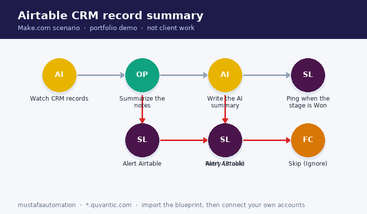
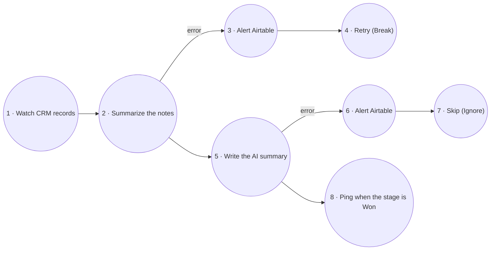

# Airtable CRM record summary

Portfolio demo by Mustafa ([mustafaautomation](https://github.com/mustafaautomation)). Not client work. Connect your own accounts after import. Live walkthroughs, when published, sit on a subdomain of quvantic.com.

**Category:** Lead gen and CRM  
**Difficulty:** intermediate  
**Apps:** Airtable, OpenAI, Slack  
**Test status:** documented blueprint, structurally validated

## Problem

The notes field on a CRM record gets long, and the next person does not read it. This demo watches Airtable, summarizes Notes into the AI summary field, and pings Slack only when Stage is Won.

## Who it's for

Teams who use Airtable as a light CRM and want the summary on the record, not in a side channel.

## Module-by-module walkthrough

Ids match the blueprint. A router runs every route whose filter passes. An error handler runs only when that module throws.

### 1. Watch CRM records

`airtable:TriggerWatchRecords` · Watch records · Airtable

Select the base and the CRM table after import. Leave the ids blank in the file.

No mapped fields. Configure the module after import, or it only passes the bundle through.

### 2. Summarize the notes

`openai-gpt-3:CreateCompletion` · Create a completion · OpenAI

Three sentences. No new promises.

- `select`: `"chat"`
- `model`: `"gpt-4o-mini"`
- `max_tokens`: `"280"`
- `temperature`: `"0.2"`
- `messages`: `[{"role": "system", "content": "Summarize CRM notes in three sentences for the next person on the account. Do not add facts that are not in the notes."}, {"role": "user", "content": "Account: {{1.fields.Name}}\nStage:...`

### 3. Alert Airtable — error handler

`slack:CreateMessage` · Send a message · Slack

Summary failed for {{rec.fields.Name}}.

- `channelWType`: `"list"`
- `channelType`: `"public"`
- `channel`: `""`
- `text`: `"Summary failed for {{1.fields.Name}}."`
- `mrkdwn`: `true`
- `parse`: `false`

### 4. Retry (Break) — error handler

`builtin:Break` · Retry (Break) · Flow control

Summary failed. Retry before writing a blank field.

- `retry`: `true`
- `count`: `3`
- `interval`: `15`

### 5. Write the AI summary

`airtable:ActionUpdateRecords` · Update records · Airtable

One field. The record id comes from the watch module.

- `baseId`: `""`
- `tableId`: `""`
- `fields`: `{"AI summary": "{{2.result}}"}`
- `recordId`: `"{{1.id}}"`

### 6. Alert Airtable — error handler

`slack:CreateMessage` · Send a message · Slack

Could not write the summary on {{rec.fields.Name}}.

- `channelWType`: `"list"`
- `channelType`: `"public"`
- `channel`: `""`
- `text`: `"Could not write the summary on {{1.fields.Name}}."`
- `mrkdwn`: `true`
- `parse`: `false`

### 7. Skip (Ignore) — error handler

`builtin:Ignore` · Skip (Ignore) · Flow control

The update failed. Do not page Slack about a summary that was not saved.

No mapped fields. Configure the module after import, or it only passes the bundle through.

### 8. Ping when the stage is Won

`slack:CreateMessage` · Send a message · Slack

Quiet for every other stage.

Filter **Stage is Won**: `[[{"a": "{{1.fields.Stage}}", "o": "text:equal", "b": "Won"}]]`

- `channelWType`: `"list"`
- `channelType`: `"public"`
- `channel`: `""`
- `text`: `"*Won* {{1.fields.Name}}\n{{2.result}}"`
- `mrkdwn`: `true`
- `parse`: `false`

## Diagram

## Setup

1. In Make, create a scenario, open the three-dot menu at the bottom of the editor, and choose **Import Blueprint**. Select `blueprint.json`.
2. Open every red module and pick or create the connection. Red means the account is not selected yet.
3. Schedule: Every 15 minutes, through Airtable's watch-records module.
4. Fill every blank selector (spreadsheet, channel, base, calendar) from your own account.
6. Run once with the bundled `sample-input.json`. Fictional payload. Paste it into the first module when you run the scenario once.
7. Check the output bundle of each module before you turn the schedule on.

## Connections

- **Airtable** — create a connection and select it on every Airtable module. The blueprint leaves `__IMTCONN__` unset on purpose.
- **OpenAI** — create a connection and select it on every OpenAI module. The blueprint leaves `__IMTCONN__` unset on purpose.
- **Slack** — create a connection and select it on every Slack module. The blueprint leaves `__IMTCONN__` unset on purpose.

Nothing in the file is a live connection id, webhook URL, or API key. Make rejects another team's connection id at import, so the slots are empty on purpose.

## Data mapping

References use the module id: `{{1.subject}}` is the `subject` field of module 1. Sheets columns are zero-based and backticked (`{{1.`0`}}` is column A) so a renamed header does not break the map.

- Watch-records output shapes vary. This demo maps the notes as `{{rec.fields.Notes}}`, the stage as `{{rec.fields.Stage}}`, and the record id as `{{rec.id}}`. Confirm those paths on the first bundle.
- The update writes only the AI summary field. Other fields are omitted so an empty string cannot wipe them.
- The Slack filter is text:equal on Won. Other stages update the summary and stay quiet.

## Error handling

Scenario settings: `maxErrors` 3, `dlq` true, `sequential` false, `autoCommit` true. After this many consecutive failed runs Make deactivates a scheduled scenario.

- Module 2 (Summarize the notes) handles errors with `builtin:Break`. Summary failed. Retry before writing a blank field.
- Module 5 (Write the AI summary) handles errors with `builtin:Ignore`. The update failed. Do not page Slack about a summary that was not saved.
- Module 8 runs only when filter **Stage is Won** passes. A blocked bundle stops on that path. It is not an error.

## Customization

- Create a long-text field named AI summary before you run it.
- Change Won to your own closed-won label.
- If watch-records fires on the summary update itself, exclude that field in the Airtable module or you will loop. The README cannot set that exclusion for you.
- Duplicate the scenario before you change the prompt, so you can diff against this demo later.

## Time saved

About 3 minutes per record of rereading notes before a call.

## Files

| File | What it is |
| --- | --- |
| `blueprint.json` | Import this into Make. |
| `sample-input.json` | Fictional bundle for the first run. |
| `diagram.png` | Flow diagram. |
| `diagram.mmd` | Mermaid source for the same flow. |
