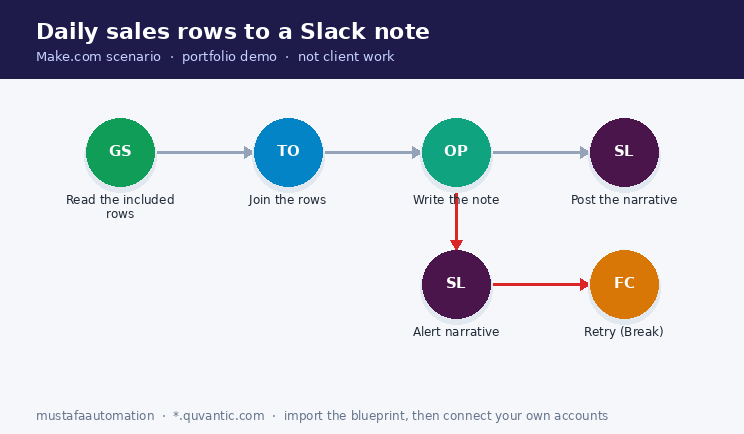
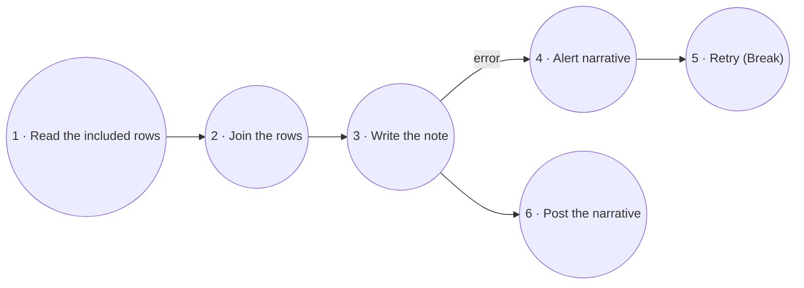

# Daily sales rows to a Slack note

Portfolio demo by Mustafa ([mustafaautomation](https://github.com/mustafaautomation)). Not client work. Connect your own accounts after import. Live walkthroughs, when published, sit on a subdomain of quvantic.com.

**Category:** Reporting  
**Difficulty:** beginner  
**Apps:** Google Sheets, OpenAI, Slack  
**Test status:** documented blueprint, structurally validated

## Problem

The sales sheet is updated all day and read by nobody until someone asks. This demo, on a morning schedule, joins rows whose include column is YES and writes five sentences. It does not invent a reason the number moved.

## Who it's for

Shop owners who already type daily totals into a sheet.

## Module-by-module walkthrough

Ids match the blueprint. A router runs every route whose filter passes. An error handler runs only when that module throws.

### 1. Read the included rows

`google-sheets:filterRows` · Search rows · Google Sheets

Column D is YES for the days that belong in this note.

- `from`: `"drive"`
- `spreadsheetId`: `""`
- `sheetId`: `""`
- `includesHeaders`: `true`
- `tableFirstRow`: `"A1:Z1"`
- `valueRenderOption`: `"FORMATTED_VALUE"`
- `dateTimeRenderOption`: `"FORMATTED_STRING"`
- `limit`: `25`
- `filter`: `[[{"a": "D", "o": "text:equal", "b": "YES"}]]`

### 2. Join the rows

`util:TextAggregator` · Text aggregator · Tools

One text bundle. The feeder is the search.

- `value`: `"{{1.`0`}}: orders {{1.`1`}}, revenue {{1.`2`}}"`

### 3. Write the note

`openai-gpt-3:CreateCompletion` · Create a completion · OpenAI

Use only the joined lines. Do not invent a cause.

- `select`: `"chat"`
- `model`: `"gpt-4o-mini"`
- `max_tokens`: `"450"`
- `temperature`: `"0.2"`
- `messages`: `[{"role": "system", "content": "Write five sentences on these daily sales lines. Use only the figures given. Do not explain a cause you were not given."}, {"role": "user", "content": "{{2.text}}"}]`

### 4. Alert narrative — error handler

`slack:CreateMessage` · Send a message · Slack

Narrative failed.

- `channelWType`: `"list"`
- `channelType`: `"public"`
- `channel`: `""`
- `text`: `"Narrative failed."`
- `mrkdwn`: `true`
- `parse`: `false`

### 5. Retry (Break) — error handler

`builtin:Break` · Retry (Break) · Flow control

The narrative failed.

- `retry`: `true`
- `count`: `3`
- `interval`: `15`

### 6. Post the narrative

`slack:CreateMessage` · Send a message · Slack

Skipped when the search returned nothing.

Filter **Digest exists**: `[[{"a": "{{2.text}}", "o": "exist"}]]`

- `channelWType`: `"list"`
- `channelType`: `"public"`
- `channel`: `""`
- `text`: `"*Daily sales*\n{{3.result}}"`
- `mrkdwn`: `true`
- `parse`: `false`

## Diagram

## Setup

1. In Make, create a scenario, open the three-dot menu at the bottom of the editor, and choose **Import Blueprint**. Select `blueprint.json`.
2. Open every red module and pick or create the connection. Red means the account is not selected yet.
3. Schedule: Every weekday at 08:00.
4. Create the spreadsheet tab this scenario expects, with a header row in row 1:
   - A day
   - B orders
   - C revenue
   - D include — YES
5. Select that spreadsheet and sheet on every Google Sheets module. The ids are blank in the file.
6. Run once with the bundled `sample-input.json`. Fictional payload. Paste it into the first module when you run the scenario once.
7. Check the output bundle of each module before you turn the schedule on.

## Connections

- **Google Sheets** — create a connection and select it on every Google Sheets module. The blueprint leaves `__IMTCONN__` unset on purpose.
- **OpenAI** — create a connection and select it on every OpenAI module. The blueprint leaves `__IMTCONN__` unset on purpose.
- **Slack** — create a connection and select it on every Slack module. The blueprint leaves `__IMTCONN__` unset on purpose.

Nothing in the file is a live connection id, webhook URL, or API key. Make rejects another team's connection id at import, so the slots are empty on purpose.

## Data mapping

References use the module id: `{{1.subject}}` is the `subject` field of module 1. Sheets columns are zero-based and backticked (`{{1.`0`}}` is column A) so a renamed header does not break the map.

- Column D is filtered with text:equal against YES.
- Aggregator output is {{digest.text}}. The model is told to use only that text.

## Error handling

Scenario settings: `maxErrors` 3, `dlq` true, `sequential` false, `autoCommit` true. After this many consecutive failed runs Make deactivates a scheduled scenario.

- Module 3 (Write the note) handles errors with `builtin:Break`. The narrative failed.
- Module 6 runs only when filter **Digest exists** passes. A blocked bundle stops on that path. It is not an error.

## Customization

- Schedule it for the morning you actually read the update. The search module does not watch the sheet.
- Duplicate the scenario before you change the prompt, so you can diff against this demo later.

## Time saved

About 20 minutes a morning of writing the note you already postpone.

## Files

| File | What it is |
| --- | --- |
| `blueprint.json` | Import this into Make. |
| `sample-input.json` | Fictional bundle for the first run. |
| `diagram.png` | Flow diagram. |
| `diagram.mmd` | Mermaid source for the same flow. |
