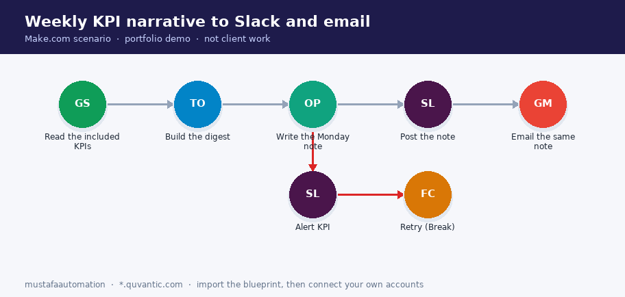
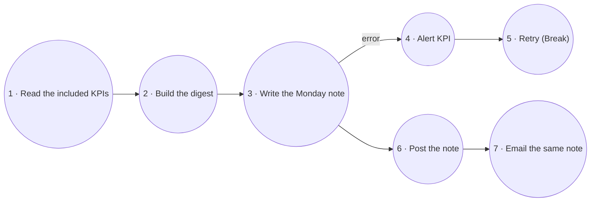

# Weekly KPI narrative to Slack and email

Portfolio demo by Mustafa ([mustafaautomation](https://github.com/mustafaautomation)). Not client work. Connect your own accounts after import. Live walkthroughs, when published, sit on a subdomain of quvantic.com.

**Category:** Reporting  
**Difficulty:** intermediate  
**Apps:** Google Sheets, OpenAI, Slack, Gmail  
**Test status:** documented blueprint, structurally validated

## Problem

The Monday KPI sheet is accurate and unread. Someone screenshots it into Slack, or they don't. This demo reads the rows marked Include, joins them, and writes six sentences: what moved, what did not, and what to look at.

## Who it's for

Operators who already maintain a weekly sheet and want the narrative without hiring someone to write it.

## Module-by-module walkthrough

Ids match the blueprint. A router runs every route whose filter passes. An error handler runs only when that module throws.

### 1. Read the included KPIs

`google-sheets:filterRows` · Search rows · Google Sheets

Column D equals YES. Limit 30.

- `from`: `"drive"`
- `spreadsheetId`: `""`
- `sheetId`: `""`
- `includesHeaders`: `true`
- `tableFirstRow`: `"A1:Z1"`
- `valueRenderOption`: `"FORMATTED_VALUE"`
- `dateTimeRenderOption`: `"FORMATTED_STRING"`
- `limit`: `30`
- `filter`: `[[{"a": "D", "o": "text:equal", "b": "YES"}]]`

### 2. Build the digest

`util:TextAggregator` · Text aggregator · Tools

One line per metric.

- `value`: `"{{1.`0`}}: {{1.`1`}} (last week {{1.`2`}})"`

### 3. Write the Monday note

`openai-gpt-3:CreateCompletion` · Create a completion · OpenAI

Six sentences, no new numbers.

- `select`: `"chat"`
- `model`: `"gpt-4o-mini"`
- `max_tokens`: `"500"`
- `temperature`: `"0.2"`
- `messages`: `[{"role": "system", "content": "You write the Monday KPI note. Use only the lines provided. Six sentences. Do not invent a cause."}, {"role": "user", "content": "{{2.text}}"}]`

### 4. Alert KPI — error handler

`slack:CreateMessage` · Send a message · Slack

Weekly KPI narrative failed.

- `channelWType`: `"list"`
- `channelType`: `"public"`
- `channel`: `""`
- `text`: `"Weekly KPI narrative failed."`
- `mrkdwn`: `true`
- `parse`: `false`

### 5. Retry (Break) — error handler

`builtin:Break` · Retry (Break) · Flow control

The narrative failed. Retry before anyone is emailed a stack trace.

- `retry`: `true`
- `count`: `3`
- `interval`: `15`

### 6. Post the note

`slack:CreateMessage` · Send a message · Slack

The sheet block is included under the prose so people can check the figures.

Filter **Digest exists**: `[[{"a": "{{2.text}}", "o": "exist"}]]`

- `channelWType`: `"list"`
- `channelType`: `"public"`
- `channel`: `""`
- `text`: `"*Monday KPIs*\n{{3.result}}\n\n```{{2.text}}```"`
- `mrkdwn`: `true`
- `parse`: `false`

### 7. Email the same note

`google-email:ActionSendEmail` · Send an email · Gmail

Same text as Slack. The filter stops an empty digest from becoming an email.

Filter **Digest exists**: `[[{"a": "{{2.text}}", "o": "exist"}]]`

- `from`: `""`
- `to`: `["leadership@example.com"]`
- `cc`: `[]`
- `bcc`: `[]`
- `replyTo`: `""`
- `subject`: `"Monday KPIs"`
- `html`: `"<p>{{3.result}}</p><pre>{{2.text}}</pre>"`
- `attachments`: `[]`

## Diagram





## Setup

1. In Make, create a scenario, open the three-dot menu at the bottom of the editor, and choose **Import Blueprint**. Select `blueprint.json`.
2. Open every red module and pick or create the connection. Red means the account is not selected yet.
3. Schedule: Mondays at 08:00 in your timezone. The first module is a search, so the schedule is what runs it. There is no watch trigger.
4. Create the spreadsheet tab this scenario expects, with a header row in row 1:
   - A metric
   - B this week
   - C last week
   - D include — YES to be in the digest
5. Select that spreadsheet and sheet on every Google Sheets module. The ids are blank in the file.
6. Run once with the bundled `sample-input.json`. Fictional payload. Paste it into the first module when you run the scenario once.
7. Check the output bundle of each module before you turn the schedule on.

## Connections

- **Google Sheets** — create a connection and select it on every Google Sheets module. The blueprint leaves `__IMTCONN__` unset on purpose.
- **OpenAI** — create a connection and select it on every OpenAI module. The blueprint leaves `__IMTCONN__` unset on purpose.
- **Slack** — create a connection and select it on every Slack module. The blueprint leaves `__IMTCONN__` unset on purpose.
- **Gmail** — create a connection and select it on every Gmail module. The blueprint leaves `account` unset on purpose.

Nothing in the file is a live connection id, webhook URL, or API key. Make rejects another team's connection id at import, so the slots are empty on purpose.

## Data mapping

References use the module id: `{{1.subject}}` is the `subject` field of module 1. Sheets columns are zero-based and backticked (`{{1.`0`}}` is column A) so a renamed header does not break the map.

- The search keeps rows whose column D equals YES. The text aggregator prints metric, this week, and last week.
- The email sends only when the digest text exists, so an empty search does not email a blank update. That filter sits on the email module. Slack is before it and has the same filter, so neither sends on an empty digest.

## Error handling

Scenario settings: `maxErrors` 3, `dlq` true, `sequential` false, `autoCommit` true. After this many consecutive failed runs Make deactivates a scheduled scenario.

- Module 3 (Write the Monday note) handles errors with `builtin:Break`. The narrative failed. Retry before anyone is emailed a stack trace.
- Module 6 runs only when filter **Digest exists** passes. A blocked bundle stops on that path. It is not an error.
- Module 7 runs only when filter **Digest exists** passes. A blocked bundle stops on that path. It is not an error.

## Customization

- Change the recipient. leadership@example.com is a placeholder mailbox you control.
- Edit the prompt if you want a different length. Six sentences is the demo.
- Add a numeric aggregator if you also want a single total. The narrative does not do arithmetic it was not given.
- Duplicate the scenario before you change the prompt, so you can diff against this demo later.

## Time saved

About 45 minutes a week of writing the update, for a team that already trusts the sheet.

## Files

| File | What it is |
| --- | --- |
| `blueprint.json` | Import this into Make. |
| `sample-input.json` | Fictional bundle for the first run. |
| `diagram.png` | Flow diagram. |
| `diagram.mmd` | Mermaid source for the same flow. |
