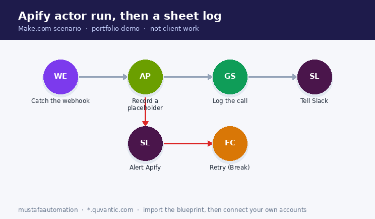

# Apify actor run, then a sheet log

Portfolio demo by Mustafa ([mustafaautomation](https://github.com/mustafaautomation)). Not client work. Connect your own accounts after import. Live walkthroughs, when published, sit on a subdomain of quvantic.com.

**Category:** Scraping and enrichment  
**Difficulty:** advanced  
**Apps:** Webhooks, Apify, Google Sheets, Slack  
**Test status:** documented blueprint, structurally validated

## Problem

A scraper should be an actor you already trust, not HTML you fetch ad hoc. This demo starts the actor with the input JSON from the webhook and logs the run. It does not guess the dataset field. The README tells you to add fetchDatasetItems once you have seen the run bundle.

## Who it's for

Researchers who already have an Apify actor and want Make to start it.

## Module-by-module walkthrough

Ids match the blueprint. A router runs every route whose filter passes. An error handler runs only when that module throws.

### 1. Catch the webhook

`gateway:CustomWebHook` · Custom webhook · Webhooks

The caller posts the actor input as a string field named input.

No mapped fields. Configure the module after import, or it only passes the bundle through.

### 2. Record a placeholder

`apify:runActor` · Run an actor · Apify

The Apify module is the real call. This HTTP step only marks the spot if you prefer raw REST. It hits example.com.

- `actorId`: `"{{1.actor_id}}"`
- `inputBody`: `"{{1.input}}"`

### 3. Alert Apify — error handler

`slack:CreateMessage` · Send a message · Slack

Apify run failed.

- `channelWType`: `"list"`
- `channelType`: `"public"`
- `channel`: `""`
- `text`: `"Apify run failed."`
- `mrkdwn`: `true`
- `parse`: `false`

### 4. Retry (Break) — error handler

`builtin:Break` · Retry (Break) · Flow control

The actor failed to start.

- `retry`: `true`
- `count`: `3`
- `interval`: `15`

### 5. Log the call

`google-sheets:addRow` · Add a row · Google Sheets

A row even when the later Slack filter blocks.

- `from`: `"drive"`
- `mode`: `"select"`
- `spreadsheetId`: `""`
- `sheetId`: `""`
- `includesHeaders`: `true`
- `insertDataOption`: `"INSERT_ROWS"`
- `valueInputOption`: `"USER_ENTERED"`
- `values`: `{"0": "{{now}}", "1": "{{1.actor_id}}", "2": "{{1.input}}"}`

### 6. Tell Slack

`slack:CreateMessage` · Send a message · Slack

The channel sees the outcome.

- `channelWType`: `"list"`
- `channelType`: `"public"`
- `channel`: `""`
- `text`: `"Apify actor {{1.actor_id}} requested. Input logged. Add the dataset fetch after the first real run."`
- `mrkdwn`: `true`
- `parse`: `false`

## Diagram



```mermaid
flowchart LR
  hook(("1 · Catch the webhook"))
  call(("2 · Record a placeholder"))
  hook --> call
  call -->|"error"| call_alert
  call_alert(("3 · Alert Apify"))
  call_directive(("4 · Retry (Break)"))
  call_alert --> call_directive
  log(("5 · Log the call"))
  call --> log
  ping(("6 · Tell Slack"))
  log --> ping
```

## Setup

1. In Make, create a scenario, open the three-dot menu at the bottom of the editor, and choose **Import Blueprint**. Select `blueprint.json`.
2. Open every red module and pick or create the connection. Red means the account is not selected yet.
3. Schedule: Immediately.
4. Create the spreadsheet tab this scenario expects, with a header row in row 1:
   - A received_at
   - B actor
   - C input
5. Select that spreadsheet and sheet on every Google Sheets module. The ids are blank in the file.
6. Run once with the bundled `sample-input.json`. Fictional payload. Paste it into the first module when you run the scenario once.
7. Check the output bundle of each module before you turn the schedule on.

## Connections

- **Apify** — create a connection and select it on every Apify module. The blueprint leaves `__IMTCONN__` unset on purpose.
- **Slack** — create a connection and select it on every Slack module. The blueprint leaves `__IMTCONN__` unset on purpose.
- **Google Sheets** — create a connection and select it on every Google Sheets module. The blueprint leaves `__IMTCONN__` unset on purpose.

Nothing in the file is a live connection id, webhook URL, or API key. Make rejects another team's connection id at import, so the slots are empty on purpose.

## Data mapping

References use the module id: `{{1.subject}}` is the `subject` field of module 1. Sheets columns are zero-based and backticked (`{{1.`0`}}` is column A) so a renamed header does not break the map.

- The HTTP module uses parseResponse. Map the id from the output bundle you see on the first run if the path differs.

## Error handling

Scenario settings: `maxErrors` 3, `dlq` true, `sequential` false, `autoCommit` true. After this many consecutive failed runs Make deactivates a scheduled scenario.

- Module 2 (Record a placeholder) handles errors with `builtin:Break`. The actor failed to start.

## Customization

- Replace every YOUR_* token before the first live call. Do not commit the filled-in blueprint.
- Duplicate the scenario before you change the prompt, so you can diff against this demo later.

## Time saved

The manual click to run the actor, once per batch.

## Files

| File | What it is |
| --- | --- |
| `blueprint.json` | Import this into Make. |
| `sample-input.json` | Fictional bundle for the first run. |
| `diagram.png` | Flow diagram. |
| `diagram.mmd` | Mermaid source for the same flow. |
