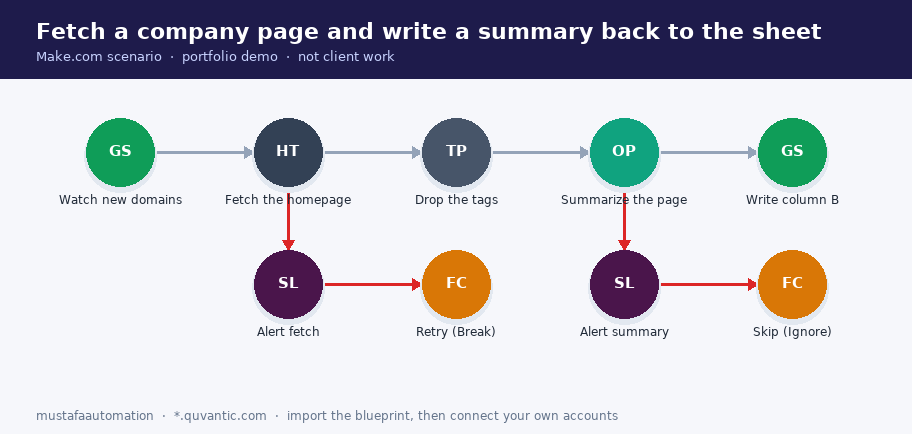
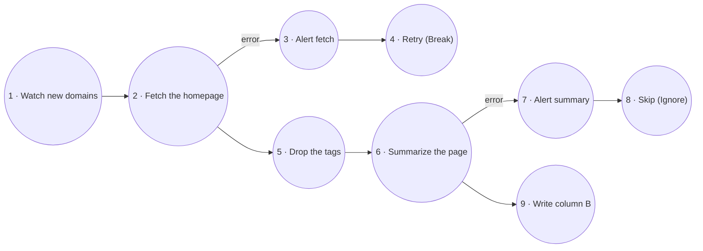

# Fetch a company page and write a summary back to the sheet

Portfolio demo by Mustafa ([mustafaautomation](https://github.com/mustafaautomation)). Not client work. Connect your own accounts after import. Live walkthroughs, when published, sit on a subdomain of quvantic.com.

**Category:** Scraping and enrichment  
**Difficulty:** intermediate  
**Apps:** Google Sheets, HTTP, OpenAI  
**Test status:** documented blueprint, structurally validated

## Problem

A researcher pastes domains into a sheet and then opens each one. This demo watches for new rows, fetches the homepage, turns the HTML into text, and writes two sentences back into column B. It is a summary of the page, not a claim about the business beyond that page.

## Who it's for

Researchers and SDRs building a list who want a first-pass note, not a full enrichment vendor.

## Module-by-module walkthrough

Ids match the blueprint. A router runs every route whose filter passes. An error handler runs only when that module throws.

### 1. Watch new domains

`google-sheets:watchRows` · Watch new rows · Google Sheets

New rows only, five at a time.

No mapped fields. Configure the module after import, or it only passes the bundle through.

### 2. Fetch the homepage

`http:ActionSendData` · Make a request · HTTP

GET https:// plus the hostname. No API key.

- `url`: `"https://{{1.`0`}}"`
- `serializeUrl`: `false`
- `method`: `"get"`
- `headers`: `[{"name": "Accept", "value": "application/json"}, {"name": "Content-Type", "value": "application/json"}]`
- `qs`: `[]`
- `bodyType`: `"raw"`
- `parseResponse`: `true`
- `contentType`: `"application/json"`
- `data`: `""`
- `timeout`: `""`
- `shareCookies`: `false`
- `ca`: `""`
- `rejectUnauthorized`: `true`
- `followRedirect`: `true`
- `useQuerystring`: `false`
- `gzip`: `true`
- `useMtls`: `false`
- `followAllRedirects`: `false`

### 3. Alert fetch — error handler

`slack:CreateMessage` · Send a message · Slack

Could not fetch https://{{row.`0`}}

- `channelWType`: `"list"`
- `channelType`: `"public"`
- `channel`: `""`
- `text`: `"Could not fetch https://{{1.`0`}}"`
- `mrkdwn`: `true`
- `parse`: `false`

### 4. Retry (Break) — error handler

`builtin:Break` · Retry (Break) · Flow control

The site did not respond. Retry later.

- `retry`: `true`
- `count`: `3`
- `interval`: `15`

### 5. Drop the tags

`regexp:HTMLToText` · HTML to text · Text parser

The model should see text, not a stylesheet.

- `html`: `"{{2.data}}"`

### 6. Summarize the page

`openai-gpt-3:CreateCompletion` · Create a completion · OpenAI

Two sentences. If the text is empty, say the page had no text.

- `select`: `"chat"`
- `model`: `"gpt-4o-mini"`
- `max_tokens`: `"220"`
- `temperature`: `"0.2"`
- `messages`: `[{"role": "system", "content": "Summarize a homepage in two sentences. Use only the text. Do not guess funding, revenue, or headcount."}, {"role": "user", "content": "Domain: {{1.`0`}}\n\n{{5.text}}"}]`

### 7. Alert summary — error handler

`slack:CreateMessage` · Send a message · Slack

Summary failed for {{row.`0`}}

- `channelWType`: `"list"`
- `channelType`: `"public"`
- `channel`: `""`
- `text`: `"Summary failed for {{1.`0`}}"`
- `mrkdwn`: `true`
- `parse`: `false`

### 8. Skip (Ignore) — error handler

`builtin:Ignore` · Skip (Ignore) · Flow control

The summary failed. Leave column B blank rather than writing an error into the sheet.

No mapped fields. Configure the module after import, or it only passes the bundle through.

### 9. Write column B

`google-sheets:updateRow` · Update a row · Google Sheets

Updates the same row the trigger produced.

Filter **Summary exists**: `[[{"a": "{{6.result}}", "o": "exist"}]]`

- `mode`: `"map"`
- `spreadsheetId`: `""`
- `sheetId`: `""`
- `rowNumber`: `"{{1.__ROW_NUMBER__}}"`
- `tableFirstRow`: `"A1:Z1"`
- `includesHeaders`: `true`
- `valueInputOption`: `"USER_ENTERED"`
- `values`: `{"1": "{{6.result}}"}`

## Diagram

## Setup

1. In Make, create a scenario, open the three-dot menu at the bottom of the editor, and choose **Import Blueprint**. Select `blueprint.json`.
2. Open every red module and pick or create the connection. Red means the account is not selected yet.
3. Schedule: Every 15 minutes, via the Watch new rows module.
4. Create the spreadsheet tab this scenario expects, with a header row in row 1:
   - A domain — hostname only, no scheme
   - B summary — written by the scenario
5. Select that spreadsheet and sheet on every Google Sheets module. The ids are blank in the file.
6. Run once with the bundled `sample-input.json`. The scenario watches the sheet. Add a row whose column A is example.com and run once. This file shows the shape of that row.
7. Check the output bundle of each module before you turn the schedule on.

## Connections

- **Google Sheets** — create a connection and select it on every Google Sheets module. The blueprint leaves `__IMTCONN__` unset on purpose.
- **Slack** — create a connection and select it on every Slack module. The blueprint leaves `__IMTCONN__` unset on purpose.
- **OpenAI** — create a connection and select it on every OpenAI module. The blueprint leaves `__IMTCONN__` unset on purpose.

Nothing in the file is a live connection id, webhook URL, or API key. Make rejects another team's connection id at import, so the slots are empty on purpose.

## Data mapping

References use the module id: `{{1.subject}}` is the `subject` field of module 1. Sheets columns are zero-based and backticked (`{{1.`0`}}` is column A) so a renamed header does not break the map.

- Column A is `{{row.`0`}}`. The URL is https:// plus that hostname.
- The update writes column B (values["1"]) on `{{row.__ROW_NUMBER__}}`, which is the row the watch module emitted.
- Only fetch hostnames you are allowed to request. The sample uses example.com.

## Error handling

Scenario settings: `maxErrors` 3, `dlq` true, `sequential` false, `autoCommit` true. After this many consecutive failed runs Make deactivates a scheduled scenario.

- Module 2 (Fetch the homepage) handles errors with `builtin:Break`. The site did not respond. Retry later.
- Module 6 (Summarize the page) handles errors with `builtin:Ignore`. The summary failed. Leave column B blank rather than writing an error into the sheet.
- Module 9 runs only when filter **Summary exists** passes. A blocked bundle stops on that path. It is not an error.

## Customization

- Add a pause with the Sleep module if the sites rate-limit you.
- Swap the prompt if you want emails extracted. Do not ask the model to invent an address that is not in the text.
- A paid enrichment API can replace the HTTP plus model pair. Keep the sheet update.
- Duplicate the scenario before you change the prompt, so you can diff against this demo later.

## Time saved

About 3 minutes per domain of open, skim, and type.

## Files

| File | What it is |
| --- | --- |
| `blueprint.json` | Import this into Make. |
| `sample-input.json` | Fictional bundle for the first run. |
| `diagram.png` | Flow diagram. |
| `diagram.mmd` | Mermaid source for the same flow. |
