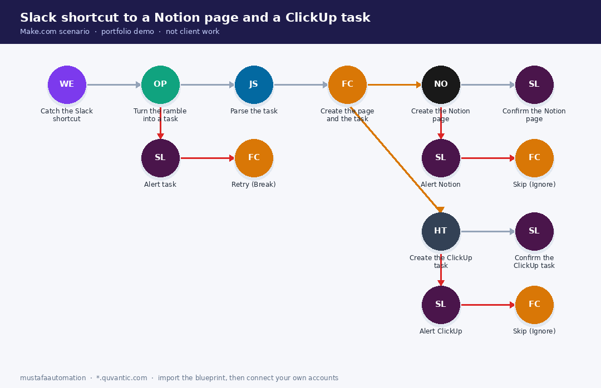
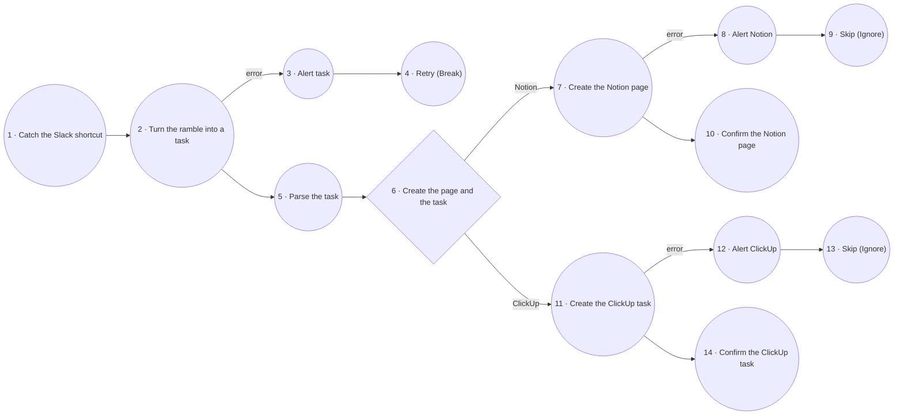

# Slack shortcut to a Notion page and a ClickUp task

Portfolio demo by Mustafa ([mustafaautomation](https://github.com/mustafaautomation)). Not client work. Connect your own accounts after import. Live walkthroughs, when published, sit on a subdomain of quvantic.com.

**Category:** Slack, Notion, and ClickUp  
**Difficulty:** intermediate  
**Apps:** Webhooks, OpenAI, Notion, ClickUp, Slack  
**Test status:** documented blueprint, structurally validated

## Problem

Work gets requested in Slack and dies there. Notion is where the note should live, ClickUp is where the assignee lives, and nobody wants to fill both forms. This demo takes the shortcut payload, asks for a title and a three-bullet body, and fans out to both tools. Delete a route if you only use one.

## Who it's for

Ops teams that capture requests with a Slack shortcut and track them in Notion, ClickUp, or both.

## Module-by-module walkthrough

Ids match the blueprint. A router runs every route whose filter passes. An error handler runs only when that module throws.

### 1. Catch the Slack shortcut

`gateway:CustomWebHook` · Custom webhook · Webhooks

A Slack shortcut or workflow posts user and text.

No mapped fields. Configure the module after import, or it only passes the bundle through.

### 2. Turn the ramble into a task

`openai-gpt-3:CreateCompletion` · Create a completion · OpenAI

Title, a short body, and a due date only if the text named one.

- `select`: `"chat"`
- `model`: `"gpt-4o-mini"`
- `max_tokens`: `"400"`
- `temperature`: `"0.2"`
- `messages`: `[{"role": "system", "content": "Turn a Slack request into a task. Return JSON only: title (under 80 characters), body (three short lines), due (YYYY-MM-DD or empty). Do not invent a deadline."}, {"role": "user", "cont...`

### 3. Alert task — error handler

`slack:CreateMessage` · Send a message · Slack

Could not parse a Slack request from {{msg.user}}.

- `channelWType`: `"list"`
- `channelType`: `"public"`
- `channel`: `""`
- `text`: `"Could not parse a Slack request from {{1.user}}."`
- `mrkdwn`: `true`
- `parse`: `false`

### 4. Retry (Break) — error handler

`builtin:Break` · Retry (Break) · Flow control

Could not shape the task. Retry before creating empty pages.

- `retry`: `true`
- `count`: `3`
- `interval`: `15`

### 5. Parse the task

`json:ParseJSON` · Parse JSON · JSON

Exposes title, body, and due.

- `json`: `"{{2.result}}"`

### 6. Create the page and the task

`builtin:BasicRouter` · Router · Flow control

Both routes run. Each one confirms in Slack so you can see which write succeeded.

### 7. Create the Notion page — route **Notion**

`notion:createAPage` · Create a page · Notion

Title and body. Pick the parent database or page after import.

- `select`: `"page"`
- `title`: `"{{5.title}}"`
- `content`: `"{{5.body}}"`

### 8. Alert Notion — error handler

`slack:CreateMessage` · Send a message · Slack

Notion page failed: {{parsed.title}}

- `channelWType`: `"list"`
- `channelType`: `"public"`
- `channel`: `""`
- `text`: `"Notion page failed: {{5.title}}"`
- `mrkdwn`: `true`
- `parse`: `false`

### 9. Skip (Ignore) — error handler

`builtin:Ignore` · Skip (Ignore) · Flow control

Notion failed. ClickUp can still run on its own route.

No mapped fields. Configure the module after import, or it only passes the bundle through.

### 10. Confirm the Notion page — route **Notion**

`slack:CreateMessage` · Send a message · Slack

A short confirmation back to the channel.

- `channelWType`: `"list"`
- `channelType`: `"public"`
- `channel`: `""`
- `text`: `"Notion page created: {{5.title}}"`
- `mrkdwn`: `true`
- `parse`: `false`

### 11. Create the ClickUp task — route **ClickUp**

`http:ActionSendData` · Make a request · HTTP

List id is in the URL. Due date is sent only as text inside the description if you leave the date field to ClickUp's UI.

- `url`: `"https://api.clickup.com/api/v2/list/YOUR_LIST_ID/task"`
- `serializeUrl`: `false`
- `method`: `"post"`
- `headers`: `[{"name": "Content-Type", "value": "application/json"}, {"name": "Authorization", "value": "YOUR_API_KEY"}]`
- `qs`: `[]`
- `bodyType`: `"raw"`
- `parseResponse`: `true`
- `contentType`: `"application/json"`
- `data`: `"{\"name\":\"{{5.title}}\",\"description\":\"{{5.body}}\\nDue: {{5.due}}\\nFrom: {{1.user}}\"}"`
- `timeout`: `""`
- `shareCookies`: `false`
- `ca`: `""`
- `rejectUnauthorized`: `true`
- `followRedirect`: `true`
- `useQuerystring`: `false`
- `gzip`: `true`
- `useMtls`: `false`
- `followAllRedirects`: `false`

### 12. Alert ClickUp — error handler

`slack:CreateMessage` · Send a message · Slack

ClickUp task failed: {{parsed.title}}

- `channelWType`: `"list"`
- `channelType`: `"public"`
- `channel`: `""`
- `text`: `"ClickUp task failed: {{5.title}}"`
- `mrkdwn`: `true`
- `parse`: `false`

### 13. Skip (Ignore) — error handler

`builtin:Ignore` · Skip (Ignore) · Flow control

ClickUp failed. The Notion route is independent.

No mapped fields. Configure the module after import, or it only passes the bundle through.

### 14. Confirm the ClickUp task — route **ClickUp**

`slack:CreateMessage` · Send a message · Slack

Separate from the Notion confirmation.

- `channelWType`: `"list"`
- `channelType`: `"public"`
- `channel`: `""`
- `text`: `"ClickUp task created: {{5.title}}"`
- `mrkdwn`: `true`
- `parse`: `false`

## Diagram

## Setup

1. In Make, create a scenario, open the three-dot menu at the bottom of the editor, and choose **Import Blueprint**. Select `blueprint.json`.
2. Open every red module and pick or create the connection. Red means the account is not selected yet.
3. Schedule: Immediately. Slack sends the shortcut to the webhook.
4. Fill every blank selector (spreadsheet, channel, base, calendar) from your own account.
6. Run once with the bundled `sample-input.json`. Fictional payload. Paste it into the first module when you run the scenario once.
7. Check the output bundle of each module before you turn the schedule on.

## Connections

- **OpenAI** — create a connection and select it on every OpenAI module. The blueprint leaves `__IMTCONN__` unset on purpose.
- **Slack** — create a connection and select it on every Slack module. The blueprint leaves `__IMTCONN__` unset on purpose.
- **Notion** — create a connection and select it on every Notion module. The blueprint leaves `__IMTCONN__` unset on purpose.

Replace these placeholders in the HTTP modules before the first live run:
- `YOUR_API_KEY`
- `YOUR_LIST_ID`

Nothing in the file is a live connection id, webhook URL, or API key. Make rejects another team's connection id at import, so the slots are empty on purpose.

## Data mapping

References use the module id: `{{1.subject}}` is the `subject` field of module 1. Sheets columns are zero-based and backticked (`{{1.`0`}}` is column A) so a renamed header does not break the map.

- The model returns JSON: title, body, due (YYYY-MM-DD or empty). Notion gets title and body. ClickUp gets the same title and the body as the description.
- ClickUp's create-task call is POST /api/v2/list/YOUR_LIST_ID/task. The token is the Authorization header with no Bearer prefix, which is what ClickUp's API expects. The header value is still YOUR_API_KEY until you paste it.
- Both routes are unfiltered, so both tools run. That is fan-out, not a choice.

## Error handling

Scenario settings: `maxErrors` 3, `dlq` true, `sequential` false, `autoCommit` true. After this many consecutive failed runs Make deactivates a scheduled scenario.

- Module 2 (Turn the ramble into a task) handles errors with `builtin:Break`. Could not shape the task. Retry before creating empty pages.
- Router 6 (Create the page and the task) Both routes run. Each one confirms in Slack so you can see which write succeeded.
  - **Notion.** Create the page. No filter, so this route runs for every bundle that reaches the router.
  - **ClickUp.** Create the task. No filter, so this route runs for every bundle that reaches the router.
- Module 7 (Create the Notion page) handles errors with `builtin:Ignore`. Notion failed. ClickUp can still run on its own route.
- Module 11 (Create the ClickUp task) handles errors with `builtin:Ignore`. ClickUp failed. The Notion route is independent.

## Customization

- Paste the ClickUp list id into the URL.
- Select the Notion parent after you connect. The mapper sets the title and the body text.
- If you only use one tool, delete the other route in the router. Do not leave it running against a placeholder URL.
- Swap any `YOUR_*` value for the id from your own account. Do not commit the filled-in file.
- Duplicate the scenario before you change the prompt, so you can diff against this demo later.

## Time saved

About 4 minutes per request of rewriting a Slack ramble into a title plus two tool forms.

## Files

| File | What it is |
| --- | --- |
| `blueprint.json` | Import this into Make. |
| `sample-input.json` | Fictional bundle for the first run. |
| `diagram.png` | Flow diagram. |
| `diagram.mmd` | Mermaid source for the same flow. |
