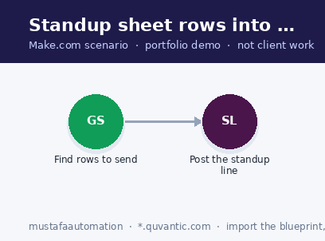
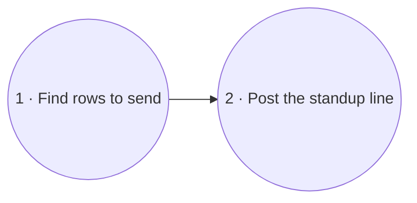

# Standup sheet rows into Slack

Portfolio demo by Mustafa ([mustafaautomation](https://github.com/mustafaautomation)). Not client work. Connect your own accounts after import. Live walkthroughs, when published, sit on a subdomain of quvantic.com.

**Category:** Slack, Notion, and ClickUp  
**Difficulty:** beginner  
**Apps:** Google Sheets, Slack  
**Test status:** documented blueprint, structurally validated

## Problem

Standup is a sheet nobody opens before the meeting. This demo posts each flagged row. People clear their own flag after they have been read, or tomorrow's run repeats them.

## Who it's for

Small teams who already type yesterday and today into a sheet.

## Module-by-module walkthrough

Ids match the blueprint. A router runs every route whose filter passes. An error handler runs only when that module throws.

### 1. Find rows to send

`google-sheets:filterRows` · Search rows · Google Sheets

A flag column marks rows that still need this action.

- `from`: `"drive"`
- `spreadsheetId`: `""`
- `sheetId`: `""`
- `includesHeaders`: `true`
- `tableFirstRow`: `"A1:Z1"`
- `valueRenderOption`: `"FORMATTED_VALUE"`
- `dateTimeRenderOption`: `"FORMATTED_STRING"`
- `limit`: `20`
- `filter`: `[[{"a": "A", "o": "text:equal", "b": "YES"}]]`

### 2. Post the standup line

`slack:CreateMessage` · Send a message · Slack

One message per person so a thread can happen under each.

- `channelWType`: `"list"`
- `channelType`: `"public"`
- `channel`: `""`
- `text`: `"*{{1.`1`}}*\nYesterday: {{1.`2`}}\nToday: {{1.`3`}}"`
- `mrkdwn`: `true`
- `parse`: `false`

## Diagram

## Setup

1. In Make, create a scenario, open the three-dot menu at the bottom of the editor, and choose **Import Blueprint**. Select `blueprint.json`.
2. Open every red module and pick or create the connection. Red means the account is not selected yet.
3. Schedule: Weekday mornings at 09:00.
4. Create the spreadsheet tab this scenario expects, with a header row in row 1:
   - A post — YES
   - B person
   - C yesterday
   - D today
5. Select that spreadsheet and sheet on every Google Sheets module. The ids are blank in the file.
6. Run once with the bundled `sample-input.json`. Fictional payload. Paste it into the first module when you run the scenario once.
7. Check the output bundle of each module before you turn the schedule on.

## Connections

- **Google Sheets** — create a connection and select it on every Google Sheets module. The blueprint leaves `__IMTCONN__` unset on purpose.
- **Slack** — create a connection and select it on every Slack module. The blueprint leaves `__IMTCONN__` unset on purpose.

Nothing in the file is a live connection id, webhook URL, or API key. Make rejects another team's connection id at import, so the slots are empty on purpose.

## Data mapping

References use the module id: `{{1.subject}}` is the `subject` field of module 1. Sheets columns are zero-based and backticked (`{{1.`0`}}` is column A) so a renamed header does not break the map.

- Each matching row is its own bundle. Column letters in the filter are the sheet's own filter, not a scenario filter.

## Error handling

Scenario settings: `maxErrors` 3, `dlq` false, `sequential` false, `autoCommit` true. After this many consecutive failed runs Make deactivates a scheduled scenario.

No router, filter, or error handler is attached. A failed module stops the run, which is the right default when a partial write would be worse than a visible failure.

## Customization

- Clear or change the flag column inside the action if you do not want the same row processed again tomorrow.
- Duplicate the scenario before you change the prompt, so you can diff against this demo later.

## Time saved

The scrolling during standup, about 10 minutes a meeting.

## Files

| File | What it is |
| --- | --- |
| `blueprint.json` | Import this into Make. |
| `sample-input.json` | Fictional bundle for the first run. |
| `diagram.png` | Flow diagram. |
| `diagram.mmd` | Mermaid source for the same flow. |
