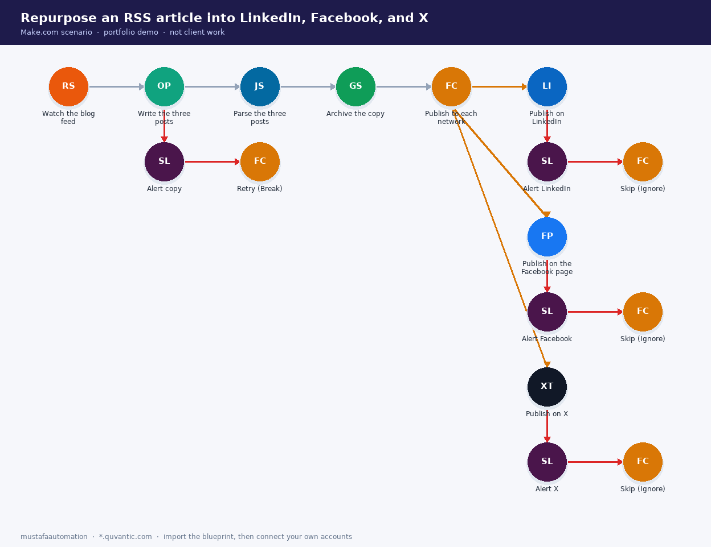
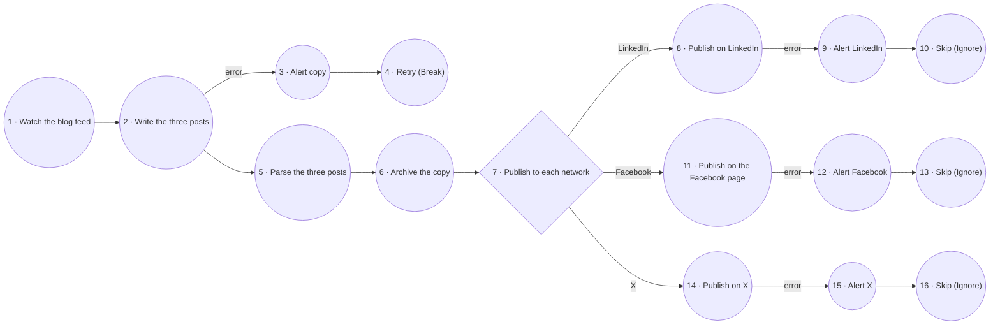

# Repurpose an RSS article into LinkedIn, Facebook, and X

Portfolio demo by Mustafa ([mustafaautomation](https://github.com/mustafaautomation)). Not client work. Connect your own accounts after import. Live walkthroughs, when published, sit on a subdomain of quvantic.com.

**Category:** Social  
**Difficulty:** intermediate  
**Apps:** RSS, OpenAI, Google Sheets, LinkedIn, Facebook Pages, X (Twitter)  
**Test status:** documented blueprint, structurally validated

## Problem

One blog post should not be pasted, slightly edited, into three networks by hand. This demo reads a new feed item, asks for a LinkedIn post, a Facebook post, and a short X post, logs them, and publishes each on its own route so a failure on one network does not block the others.

## Who it's for

Founders and content freelancers who already publish a blog or newsletter with an RSS feed.

## Module-by-module walkthrough

Ids match the blueprint. A router runs every route whose filter passes. An error handler runs only when that module throws.

### 1. Watch the blog feed

`rss:TriggerNewArticle` · Watch RSS feed items · RSS

Polls the feed. maxResults 2 avoids a flood the first time you turn it on if the feed is long. Lower it after the first run if you only want the newest.

- `url`: `"https://example.com/feed.xml"`
- `maxResults`: `2`

### 2. Write the three posts

`openai-gpt-3:CreateCompletion` · Create a completion · OpenAI

One JSON object, three lengths, no hashtags unless they are already in the article title.

- `select`: `"chat"`
- `model`: `"gpt-4o-mini"`
- `max_tokens`: `"900"`
- `temperature`: `"0.2"`
- `messages`: `[{"role": "system", "content": "You repurpose a blog post. Return JSON only with keys linkedin (under 1200 characters), facebook (under 500), and x (under 240). No invented statistics."}, {"role": "user", "content": "...`

### 3. Alert copy — error handler

`slack:CreateMessage` · Send a message · Slack

Social copy failed for {{post.title}}.

- `channelWType`: `"list"`
- `channelType`: `"public"`
- `channel`: `""`
- `text`: `"Social copy failed for {{1.title}}."`
- `mrkdwn`: `true`
- `parse`: `false`

### 4. Retry (Break) — error handler

`builtin:Break` · Retry (Break) · Flow control

Copy generation failed. Retry before publishing anything.

- `retry`: `true`
- `count`: `3`
- `interval`: `15`

### 5. Parse the three posts

`json:ParseJSON` · Parse JSON · JSON

Exposes linkedin, facebook, and x.

- `json`: `"{{2.result}}"`

### 6. Archive the copy

`google-sheets:addRow` · Add a row · Google Sheets

The sheet is the record of what was sent, even if a network later rejects it.

- `from`: `"drive"`
- `mode`: `"select"`
- `spreadsheetId`: `""`
- `sheetId`: `""`
- `includesHeaders`: `true`
- `insertDataOption`: `"INSERT_ROWS"`
- `valueInputOption`: `"USER_ENTERED"`
- `values`: `{"0": "{{now}}", "1": "{{1.title}}", "2": "{{1.url}}", "3": "{{5.linkedin}}", "4": "{{5.facebook}}", "5": "{{5.x}}"}`

### 7. Publish to each network

`builtin:BasicRouter` · Router · Flow control

No filters. Every route runs. Each route swallows its own error.

### 8. Publish on LinkedIn — route **LinkedIn**

`linkedin:CreatePost` · Create a post · LinkedIn

Text only. Image upload is a separate Drive step you can add.

- `text`: `"{{5.linkedin}}\n{{1.url}}"`

### 9. Alert LinkedIn — error handler

`slack:CreateMessage` · Send a message · Slack

LinkedIn post failed for {{post.title}}.

- `channelWType`: `"list"`
- `channelType`: `"public"`
- `channel`: `""`
- `text`: `"LinkedIn post failed for {{1.title}}."`
- `mrkdwn`: `true`
- `parse`: `false`

### 10. Skip (Ignore) — error handler

`builtin:Ignore` · Skip (Ignore) · Flow control

LinkedIn rejected the post. Continue with the other networks.

No mapped fields. Configure the module after import, or it only passes the bundle through.

### 11. Publish on the Facebook page — route **Facebook**

`facebook-pages:CreatePost` · Create a post · Facebook Pages

Select the page after you connect. The message is the Facebook variant.

- `message`: `"{{5.facebook}}\n{{1.url}}"`

### 12. Alert Facebook — error handler

`slack:CreateMessage` · Send a message · Slack

Facebook post failed for {{post.title}}.

- `channelWType`: `"list"`
- `channelType`: `"public"`
- `channel`: `""`
- `text`: `"Facebook post failed for {{1.title}}."`
- `mrkdwn`: `true`
- `parse`: `false`

### 13. Skip (Ignore) — error handler

`builtin:Ignore` · Skip (Ignore) · Flow control

Facebook rejected the post.

No mapped fields. Configure the module after import, or it only passes the bundle through.

### 14. Publish on X — route **X**

`twitter:createATweet` · Create a tweet · X (Twitter)

The model was told to stay under 240 characters so the URL still fits.

- `text`: `"{{5.x}} {{1.url}}"`

### 15. Alert X — error handler

`slack:CreateMessage` · Send a message · Slack

X post failed for {{post.title}}.

- `channelWType`: `"list"`
- `channelType`: `"public"`
- `channel`: `""`
- `text`: `"X post failed for {{1.title}}."`
- `mrkdwn`: `true`
- `parse`: `false`

### 16. Skip (Ignore) — error handler

`builtin:Ignore` · Skip (Ignore) · Flow control

X rejected the post.

No mapped fields. Configure the module after import, or it only passes the bundle through.

## Diagram

## Setup

1. In Make, create a scenario, open the three-dot menu at the bottom of the editor, and choose **Import Blueprint**. Select `blueprint.json`.
2. Open every red module and pick or create the connection. Red means the account is not selected yet.
3. Schedule: Every 60 minutes. The RSS watch module polls on the scenario schedule.
4. Create the spreadsheet tab this scenario expects, with a header row in row 1:
   - A received_at
   - B title
   - C url
   - D linkedin
   - E facebook
   - F x
5. Select that spreadsheet and sheet on every Google Sheets module. The ids are blank in the file.
6. Run once with the bundled `sample-input.json`. Fictional payload. Paste it into the first module when you run the scenario once.
7. Check the output bundle of each module before you turn the schedule on.

## Connections

- **OpenAI** — create a connection and select it on every OpenAI module. The blueprint leaves `__IMTCONN__` unset on purpose.
- **Slack** — create a connection and select it on every Slack module. The blueprint leaves `__IMTCONN__` unset on purpose.
- **Google Sheets** — create a connection and select it on every Google Sheets module. The blueprint leaves `__IMTCONN__` unset on purpose.
- **LinkedIn** — create a connection and select it on every LinkedIn module. The blueprint leaves `__IMTCONN__` unset on purpose.
- **Facebook Pages** — create a connection and select it on every Facebook Pages module. The blueprint leaves `__IMTCONN__` unset on purpose.
- **X (Twitter)** — create a connection and select it on every X (Twitter) module. The blueprint leaves `__IMTCONN__` unset on purpose.

Nothing in the file is a live connection id, webhook URL, or API key. Make rejects another team's connection id at import, so the slots are empty on purpose.

## Data mapping

References use the module id: `{{1.subject}}` is the `subject` field of module 1. Sheets columns are zero-based and backticked (`{{1.`0`}}` is column A) so a renamed header does not break the map.

- The model returns JSON with keys linkedin, facebook, and x. LinkedIn stays under 1,200 characters, X under 240.
- All three publish routes have no filter, so every new article fans out. Delete a route to drop a network.

## Error handling

Scenario settings: `maxErrors` 3, `dlq` true, `sequential` false, `autoCommit` true. After this many consecutive failed runs Make deactivates a scheduled scenario.

- Module 2 (Write the three posts) handles errors with `builtin:Break`. Copy generation failed. Retry before publishing anything.
- Router 7 (Publish to each network) No filters. Every route runs. Each route swallows its own error.
  - **LinkedIn.** Publish the long post. No filter, so this route runs for every bundle that reaches the router.
  - **Facebook.** Publish the page post. No filter, so this route runs for every bundle that reaches the router.
  - **X.** Publish the short post. No filter, so this route runs for every bundle that reaches the router.
- Module 8 (Publish on LinkedIn) handles errors with `builtin:Ignore`. LinkedIn rejected the post. Continue with the other networks.
- Module 11 (Publish on the Facebook page) handles errors with `builtin:Ignore`. Facebook rejected the post.
- Module 14 (Publish on X) handles errors with `builtin:Ignore`. X rejected the post.

## Customization

- Replace the feed URL. example.com/feed.xml is a placeholder host.
- Add a sheet column Status and a filter of Approved on each publish module if you want a human gate. As shipped, a new feed item publishes.
- Each publish module ignores its own error so the other two still run.
- Duplicate the scenario before you change the prompt, so you can diff against this demo later.

## Time saved

About 20 minutes per article of rewriting the same idea three ways and pasting it into each composer.

## Files

| File | What it is |
| --- | --- |
| `blueprint.json` | Import this into Make. |
| `sample-input.json` | Fictional bundle for the first run. |
| `diagram.png` | Flow diagram. |
| `diagram.mmd` | Mermaid source for the same flow. |
