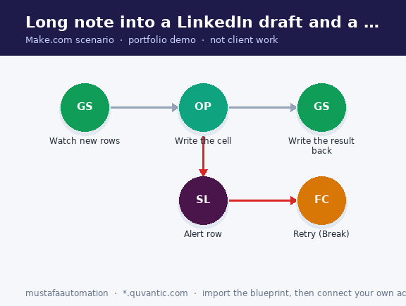
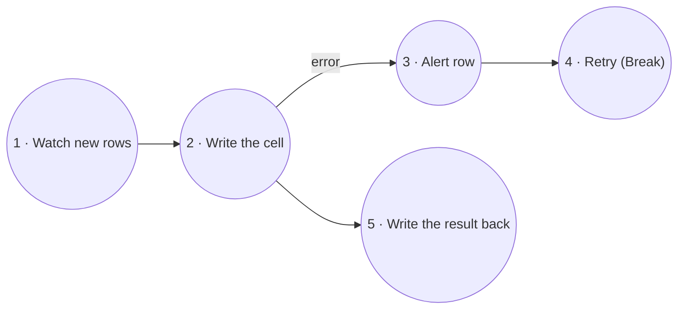

# Long note into a LinkedIn draft and a short post

Portfolio demo by Mustafa ([mustafaautomation](https://github.com/mustafaautomation)). Not client work. Connect your own accounts after import. Live walkthroughs, when published, sit on a subdomain of quvantic.com.

**Category:** Social  
**Difficulty:** intermediate  
**Apps:** Google Sheets, OpenAI  
**Test status:** documented blueprint, structurally validated

## Problem

One note should become a LinkedIn post and a short post, and both should be drafts in the sheet, not live posts. This demo writes both, labeled, into column B. Publishing stays a person's click.

## Who it's for

Founders who draft in a sheet before they post.

## Module-by-module walkthrough

Ids match the blueprint. A router runs every route whose filter passes. An error handler runs only when that module throws.

### 1. Watch new rows

`google-sheets:watchRows` · Watch new rows · Google Sheets

New rows only. The update writes back to the same row.

No mapped fields. Configure the module after import, or it only passes the bundle through.

### 2. Write the cell

`openai-gpt-3:CreateCompletion` · Create a completion · OpenAI

The prompt is the whole policy for this column.

- `select`: `"chat"`
- `model`: `"gpt-4o-mini"`
- `max_tokens`: `"400"`
- `temperature`: `"0.2"`
- `messages`: `[{"role": "system", "content": "You repurpose a note into two drafts. You do not publish."}, {"role": "user", "content": "From this note write two labeled drafts: LINKEDIN (under 700 characters) and SHORT (under 200)....`

### 3. Alert row — error handler

`slack:CreateMessage` · Send a message · Slack

Row model failed.

- `channelWType`: `"list"`
- `channelType`: `"public"`
- `channel`: `""`
- `text`: `"Row model failed."`
- `mrkdwn`: `true`
- `parse`: `false`

### 4. Retry (Break) — error handler

`builtin:Break` · Retry (Break) · Flow control

The model failed. Leave the row unchanged.

- `retry`: `true`
- `count`: `3`
- `interval`: `15`

### 5. Write the result back

`google-sheets:updateRow` · Update a row · Google Sheets

Writes one column on the same row. Other columns are left alone.

Filter **Result exists**: `[[{"a": "{{2.result}}", "o": "exist"}]]`

- `mode`: `"map"`
- `spreadsheetId`: `""`
- `sheetId`: `""`
- `rowNumber`: `"{{1.__ROW_NUMBER__}}"`
- `tableFirstRow`: `"A1:Z1"`
- `includesHeaders`: `true`
- `valueInputOption`: `"USER_ENTERED"`
- `values`: `{"1": "{{2.result}}"}`

## Diagram

## Setup

1. In Make, create a scenario, open the three-dot menu at the bottom of the editor, and choose **Import Blueprint**. Select `blueprint.json`.
2. Open every red module and pick or create the connection. Red means the account is not selected yet.
3. Schedule: Every hour.
4. Create the spreadsheet tab this scenario expects, with a header row in row 1:
   - A note
   - B drafts
5. Select that spreadsheet and sheet on every Google Sheets module. The ids are blank in the file.
6. Run once with the bundled `sample-input.json`. Fictional payload. Paste it into the first module when you run the scenario once.
7. Check the output bundle of each module before you turn the schedule on.

## Connections

- **Google Sheets** — create a connection and select it on every Google Sheets module. The blueprint leaves `__IMTCONN__` unset on purpose.
- **OpenAI** — create a connection and select it on every OpenAI module. The blueprint leaves `__IMTCONN__` unset on purpose.
- **Slack** — create a connection and select it on every Slack module. The blueprint leaves `__IMTCONN__` unset on purpose.

Nothing in the file is a live connection id, webhook URL, or API key. Make rejects another team's connection id at import, so the slots are empty on purpose.

## Data mapping

References use the module id: `{{1.subject}}` is the `subject` field of module 1. Sheets columns are zero-based and backticked (`{{1.`0`}}` is column A) so a renamed header does not break the map.

- Column A on a watch-rows bundle is {{row.`0`}}. The update writes back to {{row.__ROW_NUMBER__}}.
- Only the output column is in the update mapper, so other cells on the row stay as they are.

## Error handling

Scenario settings: `maxErrors` 3, `dlq` true, `sequential` false, `autoCommit` true. After this many consecutive failed runs Make deactivates a scheduled scenario.

- Module 2 (Write the cell) handles errors with `builtin:Break`. The model failed. Leave the row unchanged.
- Module 5 runs only when filter **Result exists** passes. A blocked bundle stops on that path. It is not an error.

## Customization

- If the watch module also fires when you write the result, exclude that column or the scenario loops.
- Duplicate the scenario before you change the prompt, so you can diff against this demo later.

## Time saved

About 20 minutes a note.

## Files

| File | What it is |
| --- | --- |
| `blueprint.json` | Import this into Make. |
| `sample-input.json` | Fictional bundle for the first run. |
| `diagram.png` | Flow diagram. |
| `diagram.mmd` | Mermaid source for the same flow. |
