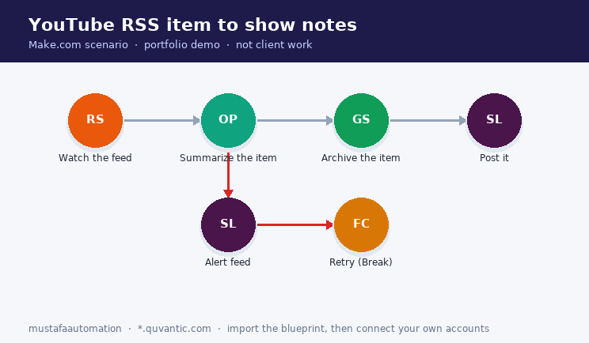
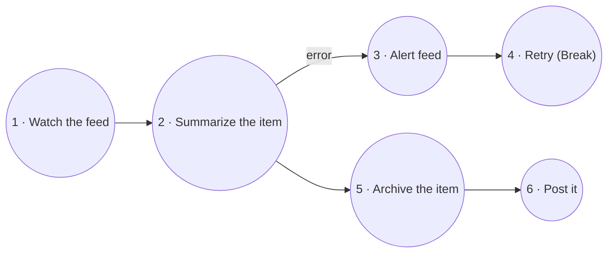

# YouTube RSS item to show notes

Portfolio demo by Mustafa ([mustafaautomation](https://github.com/mustafaautomation)). Not client work. Connect your own accounts after import. Live walkthroughs, when published, sit on a subdomain of quvantic.com.

**Category:** Social  
**Difficulty:** beginner  
**Apps:** RSS, OpenAI, Google Sheets, Slack  
**Test status:** documented blueprint, structurally validated

## Problem

A channel publishes and the show notes are an afterthought. This demo reads the video's RSS entry and drafts three bullets from the description only. It does not post to YouTube. Slack is the review step.

## Who it's for

Creators who already have a channel RSS feed and a sheet of episode notes.

## Module-by-module walkthrough

Ids match the blueprint. A router runs every route whose filter passes. An error handler runs only when that module throws.

### 1. Watch the feed

`rss:TriggerNewArticle` · Watch RSS feed items · RSS

Polls the feed on the scenario schedule.

- `url`: `"https://example.com/videos.xml"`
- `maxResults`: `2`

### 2. Summarize the item

`openai-gpt-3:CreateCompletion` · Create a completion · OpenAI

Two sentences and a reason to read it, or to skip it.

- `select`: `"chat"`
- `model`: `"gpt-4o-mini"`
- `max_tokens`: `"350"`
- `temperature`: `"0.2"`
- `messages`: `[{"role": "system", "content": "Draft three bullets of show notes from the title and description. Do not invent guests, sponsors, or timestamps."}, {"role": "user", "content": "Title: {{1.title}}\n{{1.url}}\n{{1.descr...`

### 3. Alert feed — error handler

`slack:CreateMessage` · Send a message · Slack

Feed item failed: {{post.title}}

- `channelWType`: `"list"`
- `channelType`: `"public"`
- `channel`: `""`
- `text`: `"Feed item failed: {{1.title}}"`
- `mrkdwn`: `true`
- `parse`: `false`

### 4. Retry (Break) — error handler

`builtin:Break` · Retry (Break) · Flow control

The model failed on this item.

- `retry`: `true`
- `count`: `3`
- `interval`: `15`

### 5. Archive the item

`google-sheets:addRow` · Add a row · Google Sheets

Keeps the title and the model text.

- `from`: `"drive"`
- `mode`: `"select"`
- `spreadsheetId`: `""`
- `sheetId`: `""`
- `includesHeaders`: `true`
- `insertDataOption`: `"INSERT_ROWS"`
- `valueInputOption`: `"USER_ENTERED"`
- `values`: `{"0": "{{now}}", "1": "{{1.title}}", "2": "{{1.url}}", "3": "{{2.result}}"}`

### 6. Post it

`slack:CreateMessage` · Send a message · Slack

The channel gets the model text and the link.

- `channelWType`: `"list"`
- `channelType`: `"public"`
- `channel`: `""`
- `text`: `"*Show notes draft*\n{{2.result}}\n{{1.url}}"`
- `mrkdwn`: `true`
- `parse`: `false`

## Diagram

## Setup

1. In Make, create a scenario, open the three-dot menu at the bottom of the editor, and choose **Import Blueprint**. Select `blueprint.json`.
2. Open every red module and pick or create the connection. Red means the account is not selected yet.
3. Schedule: Every hour.
4. Create the spreadsheet tab this scenario expects, with a header row in row 1:
   - A received_at
   - B title
   - C url
   - D summary
5. Select that spreadsheet and sheet on every Google Sheets module. The ids are blank in the file.
6. Run once with the bundled `sample-input.json`. Fictional payload. Paste it into the first module when you run the scenario once.
7. Check the output bundle of each module before you turn the schedule on.

## Connections

- **OpenAI** — create a connection and select it on every OpenAI module. The blueprint leaves `__IMTCONN__` unset on purpose.
- **Slack** — create a connection and select it on every Slack module. The blueprint leaves `__IMTCONN__` unset on purpose.
- **Google Sheets** — create a connection and select it on every Google Sheets module. The blueprint leaves `__IMTCONN__` unset on purpose.

Nothing in the file is a live connection id, webhook URL, or API key. Make rejects another team's connection id at import, so the slots are empty on purpose.

## Data mapping

References use the module id: `{{1.subject}}` is the `subject` field of module 1. Sheets columns are zero-based and backticked (`{{1.`0`}}` is column A) so a renamed header does not break the map.

- RSS fields used here are title, url, and description. Confirm them on the first bundle.

## Error handling

Scenario settings: `maxErrors` 3, `dlq` true, `sequential` false, `autoCommit` true. After this many consecutive failed runs Make deactivates a scheduled scenario.

- Module 2 (Summarize the item) handles errors with `builtin:Break`. The model failed on this item.

## Customization

- Replace the feed URL. The demo points at `https://example.com/videos.xml`.
- Duplicate the scenario before you change the prompt, so you can diff against this demo later.

## Time saved

About 15 minutes a video of staring at a blank notes doc.

## Files

| File | What it is |
| --- | --- |
| `blueprint.json` | Import this into Make. |
| `sample-input.json` | Fictional bundle for the first run. |
| `diagram.png` | Flow diagram. |
| `diagram.mmd` | Mermaid source for the same flow. |
