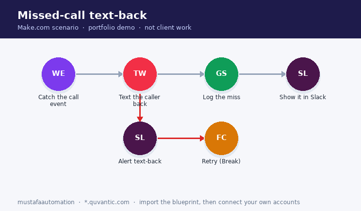

# Missed-call text-back

Portfolio demo by Mustafa ([mustafaautomation](https://github.com/mustafaautomation)). Not client work. Connect your own accounts after import. Live walkthroughs, when published, sit on a subdomain of quvantic.com.

**Category:** Speed to lead  
**Difficulty:** beginner  
**Apps:** Webhooks, Twilio, Google Sheets, Slack  
**Test status:** documented blueprint, structurally validated

## Problem

Missed calls on a main number die in a voicemail box nobody checks before lunch. A text that goes out in the same minute recovers a share of them. This demo listens for a call webhook, refuses to text anything that is not status `missed`, and writes the number to a sheet.

## Who it's for

Local businesses and agencies who forward their phone system into a webhook. Twilio is the SMS pipe, not necessarily the phone system.

## Module-by-module walkthrough

Ids match the blueprint. A router runs every route whose filter passes. An error handler runs only when that module throws.

### 1. Catch the call event

`gateway:CustomWebHook` · Custom webhook · Webhooks

Your phone system posts the caller, your number, a status, and an id.

No mapped fields. Configure the module after import, or it only passes the bundle through.

### 2. Text the caller back

`twilio:SendSMS` · Send an SMS · Twilio

Only runs when the status filter passes. The filter sits on this module, not on the webhook.

Filter **Missed calls only**: `[[{"a": "{{1.status}}", "o": "text:equal", "b": "missed"}]]`

- `to`: `"{{1.from}}"`
- `from`: `"YOUR_TWILIO_NUMBER"`
- `message`: `"Sorry we missed you. Reply here or we will call back shortly."`

### 3. Alert text-back — error handler

`slack:CreateMessage` · Send a message · Slack

Missed-call text failed for {{call.from}}.

- `channelWType`: `"list"`
- `channelType`: `"public"`
- `channel`: `""`
- `text`: `"Missed-call text failed for {{1.from}}."`
- `mrkdwn`: `true`
- `parse`: `false`

### 4. Retry (Break) — error handler

`builtin:Break` · Retry (Break) · Flow control

The text failed. Retry, and the sheet will still record the miss if the retry later succeeds.

- `retry`: `true`
- `count`: `3`
- `interval`: `15`

### 5. Log the miss

`google-sheets:addRow` · Add a row · Google Sheets

A row the front desk can work if the text gets no reply.

- `from`: `"drive"`
- `mode`: `"select"`
- `spreadsheetId`: `""`
- `sheetId`: `""`
- `includesHeaders`: `true`
- `insertDataOption`: `"INSERT_ROWS"`
- `valueInputOption`: `"USER_ENTERED"`
- `values`: `{"0": "{{now}}", "1": "{{1.from}}", "2": "{{1.to}}", "3": "{{1.call_sid}}", "4": "yes"}`

### 6. Show it in Slack

`slack:CreateMessage` · Send a message · Slack

So the person who owns the phone sees the miss without opening the sheet.

- `channelWType`: `"list"`
- `channelType`: `"public"`
- `channel`: `""`
- `text`: `"Missed call from {{1.from}}. Text sent. Sid {{1.call_sid}}."`
- `mrkdwn`: `true`
- `parse`: `false`

## Diagram



```mermaid
flowchart LR
  call(("1 · Catch the call event"))
  sms(("2 · Text the caller back"))
  call --> sms
  sms -->|"error"| sms_alert
  sms_alert(("3 · Alert text-back"))
  sms_directive(("4 · Retry (Break)"))
  sms_alert --> sms_directive
  log(("5 · Log the miss"))
  sms --> log
  ping(("6 · Show it in Slack"))
  log --> ping
```

## Setup

1. In Make, create a scenario, open the three-dot menu at the bottom of the editor, and choose **Import Blueprint**. Select `blueprint.json`.
2. Open every red module and pick or create the connection. Red means the account is not selected yet.
3. Schedule: Immediately.
4. Create the spreadsheet tab this scenario expects, with a header row in row 1:
   - A received_at
   - B caller
   - C your number
   - D call sid
   - E text sent
5. Select that spreadsheet and sheet on every Google Sheets module. The ids are blank in the file.
6. Run once with the bundled `sample-input.json`. Fictional payload. Paste it into the first module when you run the scenario once.
7. Check the output bundle of each module before you turn the schedule on.

## Connections

- **Twilio** — create a connection and select it on every Twilio module. The blueprint leaves `__IMTCONN__` unset on purpose.
- **Slack** — create a connection and select it on every Slack module. The blueprint leaves `__IMTCONN__` unset on purpose.
- **Google Sheets** — create a connection and select it on every Google Sheets module. The blueprint leaves `__IMTCONN__` unset on purpose.

Replace these placeholders in the HTTP modules before the first live run:
- `YOUR_TWILIO_NUMBER`

Nothing in the file is a live connection id, webhook URL, or API key. Make rejects another team's connection id at import, so the slots are empty on purpose.

## Data mapping

References use the module id: `{{1.subject}}` is the `subject` field of module 1. Sheets columns are zero-based and backticked (`{{1.`0`}}` is column A) so a renamed header does not break the map.

- The filter compares `{{call.status}}` to the literal missed. Answered and completed calls fall off before Twilio.
- If your phone vendor uses no-answer or busy, add those as extra OR groups on the filter. The outer array of conditions is OR.

## Error handling

Scenario settings: `maxErrors` 3, `dlq` true, `sequential` false, `autoCommit` true. After this many consecutive failed runs Make deactivates a scheduled scenario.

- Module 2 (Text the caller back) handles errors with `builtin:Break`. The text failed. Retry, and the sheet will still record the miss if the retry later succeeds.
- Module 2 runs only when filter **Missed calls only** passes. A blocked bundle stops on that path. It is not an error.

## Customization

- Match the status string to your phone vendor. The sample uses missed.
- Keep the copy short. People who just hung up do not read a paragraph.
- Add a CRM search later if you want a different text for known customers. The sibling scenarios in this library show that search.
- Swap any `YOUR_*` value for the id from your own account. Do not commit the filled-in file.
- Duplicate the scenario before you change the prompt, so you can diff against this demo later.

## Time saved

One recovered call pays for the scenario. The manual version is a person checking voicemail and texting back, about 2 minutes a miss.

## Files

| File | What it is |
| --- | --- |
| `blueprint.json` | Import this into Make. |
| `sample-input.json` | Fictional bundle for the first run. |
| `diagram.png` | Flow diagram. |
| `diagram.mmd` | Mermaid source for the same flow. |
