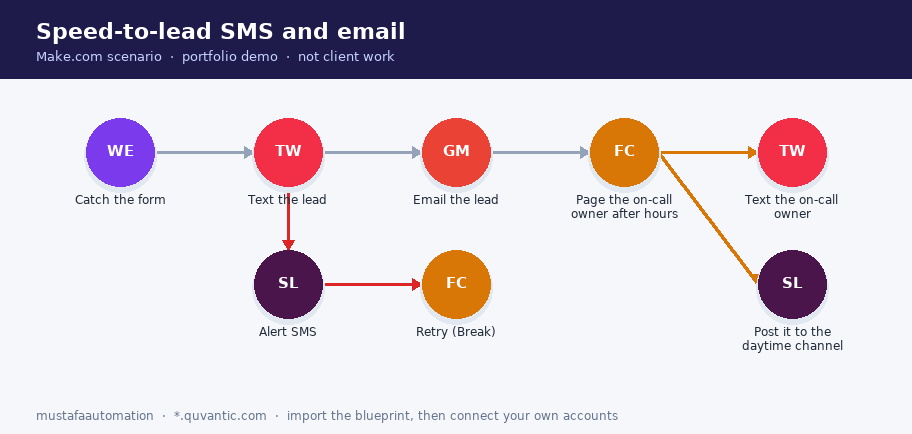
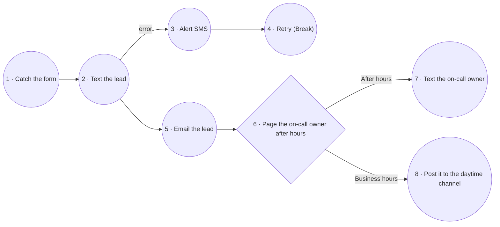

# Speed-to-lead SMS and email

Portfolio demo by Mustafa ([mustafaautomation](https://github.com/mustafaautomation)). Not client work. Connect your own accounts after import. Live walkthroughs, when published, sit on a subdomain of quvantic.com.

**Category:** Speed to lead  
**Difficulty:** beginner  
**Apps:** Webhooks, Twilio, Gmail, Slack  
**Test status:** documented blueprint, structurally validated

## Problem

The lead form already collected the phone number. Waiting until morning to reply is how those leads buy from whoever answered first. This demo sends the lead an SMS and an email immediately, and adds a second SMS to the on-call number only when the payload says after_hours is true.

## Who it's for

Home-services and B2B teams who measure response time in minutes and already pay for Twilio.

## Module-by-module walkthrough

Ids match the blueprint. A router runs every route whose filter passes. An error handler runs only when that module throws.

### 1. Catch the form

`gateway:CustomWebHook` · Custom webhook · Webhooks

The form posts name, email, phone, need, and after_hours.

No mapped fields. Configure the module after import, or it only passes the bundle through.

### 2. Text the lead

`twilio:SendSMS` · Send an SMS · Twilio

Goes out before the email so a phone-first lead sees it first.

- `to`: `"{{1.phone}}"`
- `from`: `"YOUR_TWILIO_NUMBER"`
- `message`: `"Hi {{1.name}}, we received \"{{1.need}}\". A person will follow up shortly."`

### 3. Alert SMS — error handler

`slack:CreateMessage` · Send a message · Slack

Lead SMS failed for {{lead.phone}}.

- `channelWType`: `"list"`
- `channelType`: `"public"`
- `channel`: `""`
- `text`: `"Lead SMS failed for {{1.phone}}."`
- `mrkdwn`: `true`
- `parse`: `false`

### 4. Retry (Break) — error handler

`builtin:Break` · Retry (Break) · Flow control

Twilio failed. Retry the text. The email still has its own module.

- `retry`: `true`
- `count`: `3`
- `interval`: `15`

### 5. Email the lead

`google-email:ActionSendEmail` · Send an email · Gmail

Same facts as the text, with a little more room. This one sends. Do not point it at a list.

- `from`: `""`
- `to`: `["{{1.email}}"]`
- `cc`: `[]`
- `bcc`: `[]`
- `replyTo`: `""`
- `subject`: `"We got your request"`
- `html`: `"
Hi {{1.name}},

Thanks for the note about {{1.need}}. We will reply from this mailbox.
"`
- `attachments`: `[]`

### 6. Page the on-call owner after hours

`builtin:BasicRouter` · Router · Flow control

The lead has already been contacted. This router only adds the internal page.

### 7. Text the on-call owner — route **After hours**

`twilio:SendSMS` · Send an SMS · Twilio

A different Twilio module so the From number can stay the same while the To number changes.

Filter **Payload says after hours**: `[[{"a": "{{1.after_hours}}", "o": "boolean:equal", "b": "true"}]]`

- `to`: `"YOUR_ONCALL_NUMBER"`
- `from`: `"YOUR_TWILIO_NUMBER"`
- `message`: `"After-hours lead: {{1.name}} {{1.phone}} — {{1.need}}"`

### 8. Post it to the daytime channel — route **Business hours**

`slack:CreateMessage` · Send a message · Slack

The owner sees the lead even when nobody is being paged.

Filter **During the day**: `[[{"a": "{{1.after_hours}}", "o": "boolean:equal", "b": "false"}]]`

- `channelWType`: `"list"`
- `channelType`: `"public"`
- `channel`: `""`
- `text`: `"New lead {{1.name}} — {{1.need}}. SMS and email already sent."`
- `mrkdwn`: `true`
- `parse`: `false`

## Diagram

## Setup

1. In Make, create a scenario, open the three-dot menu at the bottom of the editor, and choose **Import Blueprint**. Select `blueprint.json`.
2. Open every red module and pick or create the connection. Red means the account is not selected yet.
3. Schedule: Immediately. Leave the scenario on.
4. Fill every blank selector (spreadsheet, channel, base, calendar) from your own account.
6. Run once with the bundled `sample-input.json`. Fictional payload. Paste it into the first module when you run the scenario once.
7. Check the output bundle of each module before you turn the schedule on.

## Connections

- **Twilio** — create a connection and select it on every Twilio module. The blueprint leaves `__IMTCONN__` unset on purpose.
- **Slack** — create a connection and select it on every Slack module. The blueprint leaves `__IMTCONN__` unset on purpose.
- **Gmail** — create a connection and select it on every Gmail module. The blueprint leaves `account` unset on purpose.

Replace these placeholders in the HTTP modules before the first live run:
- `YOUR_ONCALL_NUMBER`
- `YOUR_TWILIO_NUMBER`

Nothing in the file is a live connection id, webhook URL, or API key. Make rejects another team's connection id at import, so the slots are empty on purpose.

## Data mapping

References use the module id: `{{1.subject}}` is the `subject` field of module 1. Sheets columns are zero-based and backticked (`{{1.`0`}}` is column A) so a renamed header does not break the map.

- after_hours is a boolean on the webhook. If your form cannot send it, compute the hour in the form tool, or replace the filter with an IML hour check once you have confirmed `formatDate` against your timezone.
- The on-call number is YOUR_ONCALL_NUMBER, not the lead's phone.

## Error handling

Scenario settings: `maxErrors` 3, `dlq` true, `sequential` false, `autoCommit` true. After this many consecutive failed runs Make deactivates a scheduled scenario.

- Module 2 (Text the lead) handles errors with `builtin:Break`. Twilio failed. Retry the text. The email still has its own module.
- Router 6 (Page the on-call owner after hours) The lead has already been contacted. This router only adds the internal page.
  - **After hours.** Text the on-call number. Filter: **Payload says after hours**.
  - **Business hours.** Tell Slack and stop. Filter: **During the day**.
- Module 7 runs only when filter **Payload says after hours** passes. A blocked bundle stops on that path. It is not an error.
- Module 8 runs only when filter **During the day** passes. A blocked bundle stops on that path. It is not an error.

## Customization

- Rewrite both messages in the client's voice. The demo copy is plain on purpose.
- Remove the on-call route if there is no after-hours rota.
- Add a sheet log in front of the router if you need an audit trail. The demo keeps this one short.
- Swap any `YOUR_*` value for the id from your own account. Do not commit the filled-in file.
- Duplicate the scenario before you change the prompt, so you can diff against this demo later.

## Time saved

Removes the 5 to 15 minutes a person spends noticing the form, then copying it into a phone and an email.

## Files

| File | What it is |
| --- | --- |
| `blueprint.json` | Import this into Make. |
| `sample-input.json` | Fictional bundle for the first run. |
| `diagram.png` | Flow diagram. |
| `diagram.mmd` | Mermaid source for the same flow. |
