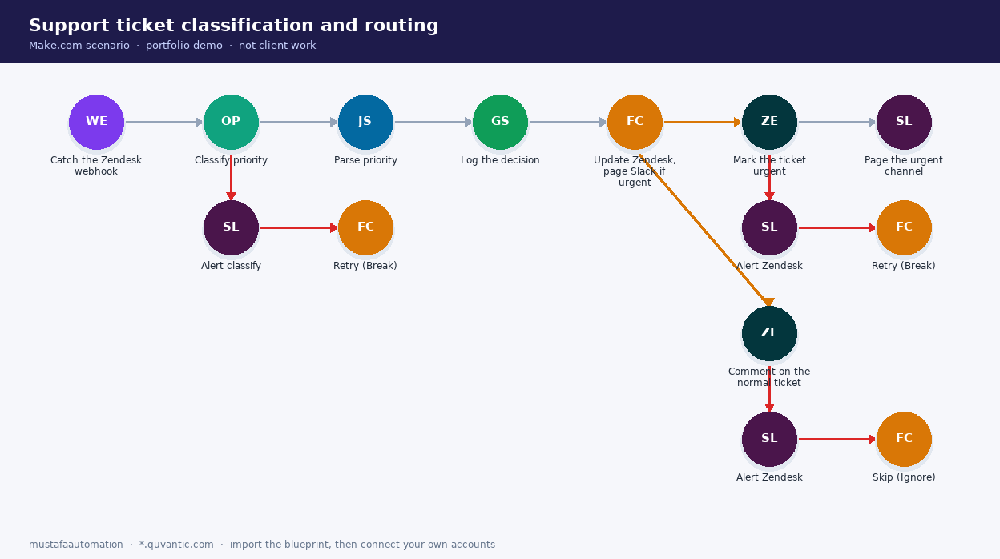
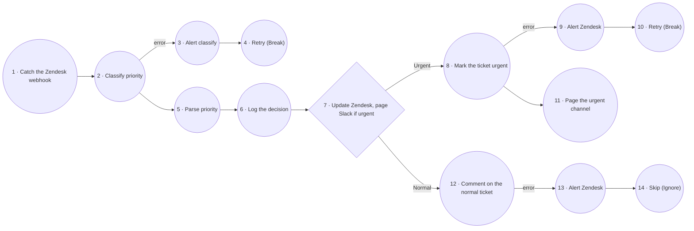

# Support ticket classification and routing

Portfolio demo by Mustafa ([mustafaautomation](https://github.com/mustafaautomation)). Not client work. Connect your own accounts after import. Live walkthroughs, when published, sit on a subdomain of quvantic.com.

**Category:** Support  
**Difficulty:** intermediate  
**Apps:** Webhooks, OpenAI, Zendesk, Slack, Google Sheets  
**Test status:** documented blueprint, structurally validated

## Problem

A Zendesk trigger can fire a webhook, but someone still reads the ticket to decide if it wakes the on-call channel. This demo classifies the subject and the latest comment, writes the summary back onto the ticket, and pages Slack only when the model says urgent.

## Who it's for

Support leads who already have Zendesk triggers and a Slack channel they are trying not to flood.

## Module-by-module walkthrough

Ids match the blueprint. A router runs every route whose filter passes. An error handler runs only when that module throws.

### 1. Catch the Zendesk webhook

`gateway:CustomWebHook` · Custom webhook · Webhooks

A Zendesk notify-webhook target posts the ticket id, subject, requester, and latest comment.

No mapped fields. Configure the module after import, or it only passes the bundle through.

### 2. Classify priority

`openai-gpt-3:CreateCompletion` · Create a completion · OpenAI

Urgent means production impact or an angry customer with a time claim. Everything else is normal.

- `select`: `"chat"`
- `model`: `"gpt-4o-mini"`
- `max_tokens`: `"250"`
- `temperature`: `"0.2"`
- `messages`: `[{"role": "system", "content": "You classify support tickets. Return JSON only: priority (urgent or normal), summary (one sentence). Do not invent refunds."}, {"role": "user", "content": "Ticket {{1.id}}: {{1.subject}...`

### 3. Alert classify — error handler

`slack:CreateMessage` · Send a message · Slack

Ticket {{ticket.id}} was not classified.

- `channelWType`: `"list"`
- `channelType`: `"public"`
- `channel`: `""`
- `text`: `"Ticket {{1.id}} was not classified."`
- `mrkdwn`: `true`
- `parse`: `false`

### 4. Retry (Break) — error handler

`builtin:Break` · Retry (Break) · Flow control

Classification failed. Retry before writing a wrong priority onto the ticket.

- `retry`: `true`
- `count`: `3`
- `interval`: `15`

### 5. Parse priority

`json:ParseJSON` · Parse JSON · JSON

Exposes priority and summary.

- `json`: `"{{2.result}}"`

### 6. Log the decision

`google-sheets:addRow` · Add a row · Google Sheets

The sheet is the audit log if Zendesk's comment is edited later.

- `from`: `"drive"`
- `mode`: `"select"`
- `spreadsheetId`: `""`
- `sheetId`: `""`
- `includesHeaders`: `true`
- `insertDataOption`: `"INSERT_ROWS"`
- `valueInputOption`: `"USER_ENTERED"`
- `values`: `{"0": "{{now}}", "1": "{{1.id}}", "2": "{{1.requester}}", "3": "{{5.priority}}", "4": "{{5.summary}}"}`

### 7. Update Zendesk, page Slack if urgent

`builtin:BasicRouter` · Router · Flow control

Both routes update the ticket. Only urgent also posts to Slack.

### 8. Mark the ticket urgent — route **Urgent**

`zendesk:UpdateTicket` · Update a ticket · Zendesk

Writes the summary as the comment the agent sees. Status stays open.

Filter **Urgent**: `[[{"a": "{{5.priority}}", "o": "text:equal", "b": "urgent"}]]`

- `ticketId`: `"{{1.id}}"`
- `status`: `"open"`
- `comment`: `"Triage: urgent. {{5.summary}}"`

### 9. Alert Zendesk — error handler

`slack:CreateMessage` · Send a message · Slack

Urgent update failed for ticket {{ticket.id}}.

- `channelWType`: `"list"`
- `channelType`: `"public"`
- `channel`: `""`
- `text`: `"Urgent update failed for ticket {{1.id}}."`
- `mrkdwn`: `true`
- `parse`: `false`

### 10. Retry (Break) — error handler

`builtin:Break` · Retry (Break) · Flow control

Zendesk update failed on an urgent ticket.

- `retry`: `true`
- `count`: `3`
- `interval`: `15`

### 11. Page the urgent channel — route **Urgent**

`slack:CreateMessage` · Send a message · Slack

One line, with the requester, so the on-call does not hunt.

- `channelWType`: `"list"`
- `channelType`: `"public"`
- `channel`: `""`
- `text`: `"*Urgent ticket* {{1.id}} from {{1.requester}}: {{5.summary}}"`
- `mrkdwn`: `true`
- `parse`: `false`

### 12. Comment on the normal ticket — route **Normal**

`zendesk:UpdateTicket` · Update a ticket · Zendesk

Same module, no Slack. The queue works the ticket in order.

Filter **Normal**: `[[{"a": "{{5.priority}}", "o": "text:equal", "b": "normal"}]]`

- `ticketId`: `"{{1.id}}"`
- `status`: `"open"`
- `comment`: `"Triage: normal. {{5.summary}}"`

### 13. Alert Zendesk — error handler

`slack:CreateMessage` · Send a message · Slack

Normal update failed for ticket {{ticket.id}}.

- `channelWType`: `"list"`
- `channelType`: `"public"`
- `channel`: `""`
- `text`: `"Normal update failed for ticket {{1.id}}."`
- `mrkdwn`: `true`
- `parse`: `false`

### 14. Skip (Ignore) — error handler

`builtin:Ignore` · Skip (Ignore) · Flow control

A normal update failed. Skip it so one bad ticket does not stop the scenario.

No mapped fields. Configure the module after import, or it only passes the bundle through.

## Diagram

## Setup

1. In Make, create a scenario, open the three-dot menu at the bottom of the editor, and choose **Import Blueprint**. Select `blueprint.json`.
2. Open every red module and pick or create the connection. Red means the account is not selected yet.
3. Schedule: Immediately, from the Zendesk webhook.
4. Create the spreadsheet tab this scenario expects, with a header row in row 1:
   - A received_at
   - B ticket
   - C requester
   - D priority
   - E summary
5. Select that spreadsheet and sheet on every Google Sheets module. The ids are blank in the file.
6. Run once with the bundled `sample-input.json`. Fictional payload. Paste it into the first module when you run the scenario once.
7. Check the output bundle of each module before you turn the schedule on.

## Connections

- **OpenAI** — create a connection and select it on every OpenAI module. The blueprint leaves `__IMTCONN__` unset on purpose.
- **Slack** — create a connection and select it on every Slack module. The blueprint leaves `__IMTCONN__` unset on purpose.
- **Google Sheets** — create a connection and select it on every Google Sheets module. The blueprint leaves `__IMTCONN__` unset on purpose.
- **Zendesk** — create a connection and select it on every Zendesk module. The blueprint leaves `__IMTCONN__` unset on purpose.

Nothing in the file is a live connection id, webhook URL, or API key. Make rejects another team's connection id at import, so the slots are empty on purpose.

## Data mapping

References use the module id: `{{1.subject}}` is the `subject` field of module 1. Sheets columns are zero-based and backticked (`{{1.`0`}}` is column A) so a renamed header does not break the map.

- Zendesk's update module takes ticketId. This blueprint maps it from `{{ticket.id}}`.
- Priority is the literal urgent or normal. The two routes use text:equal so a ticket is updated once.

## Error handling

Scenario settings: `maxErrors` 3, `dlq` true, `sequential` false, `autoCommit` true. After this many consecutive failed runs Make deactivates a scheduled scenario.

- Module 2 (Classify priority) handles errors with `builtin:Break`. Classification failed. Retry before writing a wrong priority onto the ticket.
- Router 7 (Update Zendesk, page Slack if urgent) Both routes update the ticket. Only urgent also posts to Slack.
  - **Urgent.** Public comment is internal in spirit: the summary, then Slack. Filter: **Urgent**.
  - **Normal.** Update the ticket and stay quiet. Filter: **Normal**.
- Module 8 (Mark the ticket urgent) handles errors with `builtin:Break`. Zendesk update failed on an urgent ticket.
- Module 8 runs only when filter **Urgent** passes. A blocked bundle stops on that path. It is not an error.
- Module 12 (Comment on the normal ticket) handles errors with `builtin:Ignore`. A normal update failed. Skip it so one bad ticket does not stop the scenario.
- Module 12 runs only when filter **Normal** passes. A blocked bundle stops on that path. It is not an error.

## Customization

- Point the Zendesk trigger at the webhook URL Make shows after import.
- Add a group id on the urgent route if your module exposes assignee or group after you connect.
- Extend the prompt with your product names so 'down' on a staging box is not urgent.
- Duplicate the scenario before you change the prompt, so you can diff against this demo later.

## Time saved

About 2 minutes of reading and reassigning per ticket. Urgent ones reach Slack in the same run.

## Files

| File | What it is |
| --- | --- |
| `blueprint.json` | Import this into Make. |
| `sample-input.json` | Fictional bundle for the first run. |
| `diagram.png` | Flow diagram. |
| `diagram.mmd` | Mermaid source for the same flow. |
